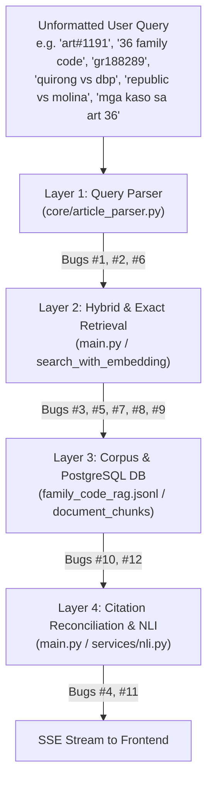

# CIVIL-LEX RAG Pipeline Deep Audit: Loopholes, Critical Bugs, Solutions, Master Checklist & Implementation Plan

> [!IMPORTANT]
> This document consolidates:
> 1. **Industry-Standard RAG Practices & Skills Reference**
> 2. **12 Critical Loopholes & Bugs Found** (with live PostgreSQL `:54322` proofs, root causes, and exact `file_path:line_number` references)
> 3. **How to Solve Each Bug** (surgical, non-destructive fixes)
> 4. **Full Technical Implementation Plan** (component-by-component diffs, code signatures, and verification commands)
> 5. **Master Update Checklist** (every change must update this checklist upon verification)

---

## Part 1: Where to Get Industry-Standard RAG Practices & Skills

### A. Installed Skills in Your Environment (Active Now)
1. **[SKILL.md](file:///home/rence/github_repos/civilex-thesis/.agents/skills/supabase-postgres-best-practices/SKILL.md) (`supabase-postgres-best-practices`)**:
   - Installed in `.agents/skills/supabase-postgres-best-practices/`. Covers PostgreSQL query optimization, partial HNSW `pgvector` indexing, GIN `tsvector` / `pg_trgm` indexing, and connection pooling.
2. **[SKILL.md](file:///home/rence/.gemini/config/skills/civil-lex-latency-optimizer/SKILL.md) (`civil-lex-latency-optimizer`)**:
   - Installed globally. Enforces non-destructive guardrails, SSE event contract preservation, partial HNSW indexes for `'case'` chunks, and hybrid RRF (`k=60`) retrieval invariants.

### B. Agent Marketplace Plugins for RAG & GraphRAG
- **Arize AX** (`antigravity-plugins-partners/plugin/arize-skills`) — Tracing, RAGAS evaluations, dataset management, and prompt optimization for RAG pipelines.
- **Neo4j** (`antigravity-plugins-partners/plugin/neo4j`) — GraphRAG pipeline patterns, citation graph modeling, and hybrid vector + graph retrieval skills.
- **Supabase** (`antigravity-plugins-partners/plugin/supabase`) — Already installed.

### C. Custom Project Skill Included in This Plan
In **Task 4.1**, we will also create a project-scoped skill at `.agents/skills/legal-rag-industry-standards/SKILL.md` codifying **Industry-Standard Philippine Legal RAG Practices**:
- **Query Normalization & Entity Resolution (Fuzzy Docket + Statutory Alias Canonicalization)**
- **Dual-Code Disambiguation & Graph Bridging (RA 386 Civil Code ↔ EO 209 Family Code)**
- **Parent-Document / Full-Article Reconstruction for Multi-Chunk Statutes**
- **Two-Stage Hybrid Retrieval (Dense `multilingual-e5-base` + Lexical/Acronym/Trigram Party & Docket Matching + Reciprocal Rank Fusion)**
- **Answer-Grounded Citation Reconciliation & Neuro-Symbolic NLI Verification**

---

## Part 2: Executive Summary of the 12 Critical Bugs & Loopholes Found



| ID | Severity | Component | Problem Summary | Live Impact |
|---|---|---|---|---|
| **BUG-01** | **CRITICAL** | [article_parser.py](file:///home/rence/github_repos/civilex-thesis/service-rag-python/core/article_parser.py#L18-L127) | Non-standard article formats fail or misparse (`art 1,191` → `['1','191']`, `art#1191` → `[]`, `36 family code` → `[]`, `eo 209 36` → `[]`, single bare `1191` → `[]`) | Users typing informal article numbers get 0 exact statutory matches |
| **BUG-02** | **CRITICAL** | [article_parser.py](file:///home/rence/github_repos/civilex-thesis/service-rag-python/core/article_parser.py#L196-L251) | Non-standard docket formats fail (`gr188289` → `[]`, `gr#188289` → `[]`, `gr-188289` → `['-188289']`, `gr l 1892` → `['l1892']` which fails SQL `ILIKE '%l-1892%'`, bare `188289` → `[]`, `94189` in `94188-89` → `[]`, `A.M. No. 1037` → `[]`) | Direct docket lookups fail unless formatted exactly as `G.R. No. X` |
| **BUG-03** | **CRITICAL** | [main.py](file:///home/rence/github_repos/civilex-thesis/service-rag-python/main.py#L2975-L2991) | **277 Supreme Court cases** have `gr_number = 'G.R. Nos'` (zero digits) and `case_uid = 'GR_S_YYYY_N'`; real G.R. numbers exist only in `content_summary` header | 277 consolidated SC decisions are 100% unreachable by G.R. number in RAG chat |
| **BUG-04** | **CRITICAL** | [main.py](file:///home/rence/github_repos/civilex-thesis/service-rag-python/main.py#L1288-L1312) | **6,132 Supreme Court cases (52% of DB!)** have fused months (`G.R. No. L-1892August 16`), normalizing to `L1892AUGUST16` != `L1892`, while `^GR[_-]([A-Za-z]?\d+)` fails on `GR_L-1892` hyphen | G.R. token matching in `reconcile_response_citations` fails on 52% of all cases |
| **BUG-05** | **CRITICAL** | [main.py](file:///home/rence/github_repos/civilex-thesis/service-rag-python/main.py#L2992-L3024) | Raw `pg_trgm` `similarity(title, %s) > 0.35` matches ANY short title ending in `vs. Republic` or `vs. Court of Appeals`; fails on acronyms (`quirong vs dbp`), aliases (`sps.`), accents (`Cariño`), and single-party queries (`chi ming tsoi case`, `tan-andal`) | Querying `Republic vs. Molina` retrieves 3 unrelated tax/naturalization cases and skips *Molina*! |
| **BUG-06** | **CRITICAL** | [article_parser.py](file:///home/rence/github_repos/civilex-thesis/service-rag-python/core/article_parser.py#L288-L319) | `is_jurisprudence_query` returns `False` for `ruling in X`, `X case`, `X doctrine`, `sc decisions`, and Tagalog `mga kaso sa art X` / `hatol sa article X`, triggering `is_simple_lookup` early exit at [main.py:3233](file:///home/rence/github_repos/civilex-thesis/service-rag-python/main.py#L3233) | Tagalog & informal case queries skip Jurisprudence Retrieval completely |
| **BUG-07** | **CRITICAL** | [main.py](file:///home/rence/github_repos/civilex-thesis/service-rag-python/main.py#L3273-L3293) | `article_jurisprudence_relations` has **0 rows** for `EO209-ART%` (all 11,638 rows use `RA386-ART%`), so querying cases for any Family Code article (`EO209-ART36`, `EO209-ART41`) returns 0 linked cases | Graph-Augmented RAG is 100% disconnected for all 257 Family Code articles |
| **BUG-08** | **HIGH** | [main.py](file:///home/rence/github_repos/civilex-thesis/service-rag-python/main.py#L3282-L3312) | `ORDER BY j.decision_date DESC` sorts a `TEXT` column (`"September 29, 1970"`) **alphabetically by month name (`'S'` first)**, and `real_sim < 0.78` drops valid linked cases | Graph expansion picks 6 random September cases from the 1960s/70s instead of top cases |
| **BUG-09** | **CRITICAL** | [main.py](file:///home/rence/github_repos/civilex-thesis/service-rag-python/main.py#L1164-L1168) & [#L3106](file:///home/rence/github_repos/civilex-thesis/service-rag-python/main.py#L3106) | **72 multi-chunk articles** (`RA386-ART32` has 23 chunks, `EO209-ART45` has 2 chunks) overwrite `fetched_exact[pid]` in a dict loop, keeping only the last chunk (`_c22` or `_c1`) and discarding the rest of the statute | Querying Art. 45 Family Code (Annulment) loses grounds (1)–(3) and only gives the LLM grounds (4)–(6) |
| **BUG-10** | **CRITICAL** | [parse_family_code.py](file:///home/rence/github_repos/civilex-thesis/service-rag-python/parse_family_code.py#L42) | Greedy multiline regex `(?:\d+[a-z]?|...|[0-9a-zA-Z\s,\.\(\)]+)` deleted numbered sub-clauses from the first `(` to the end of the article in **47 Family Code articles** (including Art. 2, 3, 4, 26, 37, 43, 46, 47) | Art. 2 is missing `(2) Consent`; Art. 26 is missing the entire foreign divorce paragraph in DB! |
| **BUG-11** | **HIGH** | [nli.py](file:///home/rence/github_repos/civilex-thesis/service-rag-python/services/nli.py#L457-L468) | `_extract_article_ids` hardcodes `RA386-ART{n}`, which mismatches `EO209-ART{n}` in `Rule 1 (R1_unsupported_statutory_anchor)` when content lacks an inline `Art. N` header | Valid Family Code claims can be downgraded to `neutral` (`Unverified`) during NLI |
| **BUG-12** | **HIGH** | [ingestion_service.py](file:///home/rence/github_repos/civilex-thesis/service-rag-python/services/ingestion_service.py#L140-L166) & [civil-code.js](file:///home/rence/github_repos/civilex-thesis/backend-node/src/routes/civil-code.js#L262-L266) | Missing partial HNSW index `case_vector_idx` on 351k case chunks; `to_tsvector('english')` vs `tsquery('simple')` mismatch in `ingestion_service.py`; Node `/api/civil-code/search` doesn't query `article_jurisprudence_relations` on article searches | Sequential vector scans on 351k case chunks and missing article-linked cases in Explorer search |

---

## Part 3: Detailed Root-Cause Analysis & Solutions

### Bug #1: Non-Standard User Article Number Formats
- **File & Lines:** [article_parser.py](file:///home/rence/github_repos/civilex-thesis/service-rag-python/core/article_parser.py#L18-L127), [civil-code.js](file:///home/rence/github_repos/civilex-thesis/backend-node/src/routes/civil-code.js#L50-L66)
- **Root Cause:**
  1. **Thousands-Comma Split:** When a user writes `"Art 1,191"` or `"Article 2,176"`, `num_match = re.match(r'^(\d+)', sub_text)` grabs `"1"`, and then `ARTICLE_SEP_PATTERN` sees `,191` and treats it as a list of two articles: `['1', '191']`!
  2. **Punctuation & Symbol Prefixes:** `ARTICLE_PREFIX_PATTERN` does not consume `#`, `:`, `-`, `–`, or `=` between `art`/`article`/`artikulo` and the digits, so `"art#1191"`, `"art # 1191"`, `"art-1191"`, `"art: 1191"` return `[]`.
  3. **Missing Family Code & Colloquial Prefixes:** `ARTICLE_PREFIX_PATTERN` matches `civil\s+code` and `ra\s*386`, but omits `family\s+code`, `eo\s*209`, `e\.o\.\s*209`, `fc`, `cc`, `kodigo\s+sibil`, `batas\s+sibil`, `probisyon`, `sec(?:tion)?\.?`.
  4. **Postfix Statute Mentions:** Users often write `"1191 of the civil code"`, `"36 family code"`, `"36 ng family code"`, `"jurisprudence on 36 family code"`. Because the number precedes the statute name, `ARTICLE_PREFIX_PATTERN` misses it.
  5. **Single Bare Number Queries:** `allow_bare_numbers` only checks `bare_chain` (requiring *two* numbers like `1191 and 1170`). A single bare number query like `"what is 1191?"`, `"explain 2176"`, `"ano ang 1191"`, `"cases for 1191"` returns `[]`.
- **Solution:**
  1. Pre-normalize formatted 4-digit article numbers `1,000`–`2,270` (`re.sub(r'(?<![\d,.])\b([12]),(\d{3})\b(?![\d,])', r'\1\2', ...)`) when not preceded by currency tokens before splitting comma lists.
  2. Expand `ARTICLE_PREFIX_PATTERN` and `ARTICLE_SEP_PATTERN` to accept optional `[#:\-–=]` and include `family\s+code`, `e\.?o\.?\s*(?:no\.?\s*)?209`, `r\.?a\.?\s*(?:no\.?\s*)?386`, `kodigo\s+sibil`, `batas\s+sibil`, `probisyon`, `sec(?:tion)?\.?`, `fc`, `cc`.
  3. Add `ARTICLE_POSTFIX_PATTERN` matching `\b(\d{1,4})\s*(?:of\s+(?:the\s+)?|ng\s+|sa\s+|in\s+(?:the\s+)?|under\s+(?:the\s+)?)?(?:civil\s+code|family\s+code|ra\s*386|r\.a\.\s*386|eo\s*209|e\.o\.\s*209|kodigo\s+sibil|batas\s+sibil)\b`.
  4. In `allow_bare_numbers=True` mode, extract single bare integers in `1..2270` when the query is a standalone number (`"1191"`) or contains statutory/case/explanation cues while excluding 4-digit calendar years (`1900..2099`), currency, and G.R. numbers.
  5. Mirror the expanded extractor in `backend-node/src/routes/civil-code.js` (`extractArticleNumber`).

---

### Bug #2 & Bug #3: Non-Standard Jurisprudence Docket Formats & 277 `"G.R. Nos"` Cases Without Digits
- **File & Lines:** [article_parser.py](file:///home/rence/github_repos/civilex-thesis/service-rag-python/core/article_parser.py#L196-L251), [main.py](file:///home/rence/github_repos/civilex-thesis/service-rag-python/main.py#L2968-L2991)
- **Root Cause:**
  1. `GR_PATTERN` requires `\bGR\b` (failing on `"gr188289"`), omits `#`/`:` (failing on `"gr#188289"`), captures a leading hyphen on `"gr-188289"` (`"-188289"`), and strips spaces on `"gr l 1892"` (`"l1892"`), which fails SQL `gr_number ILIKE '%l1892%'` because the database stores `"G.R. No. L-1892..."` with a hyphen.
  2. `parse_gr_numbers` ignores `A.M. No.`, `A.C. No.`, `B.M. No.` (202 cases in DB), bare `L-1892` / `l1892` codes, bare 5–6 digit G.R. numbers (`"188289"`, `"case 188289"`, `"docket 188289"`), and consolidated range targets (`"94189"` inside `"G.R. Nos. 94188-89"` or `"L-11320"` inside `"G.R. No. L-11319-20"`).
  3. **277 cases in `jurisprudence_cases`** have `gr_number = 'G.R. Nos'` and `case_uid = 'GR_S_YYYY_N'`, with their actual docket numbers (`G.R. Nos. 94188-89`, `G.R. Nos. 51171-72`, `G.R. Nos. 159561-62`) present only in `content_summary` / `full_text`.
- **Solution:**
  1. Upgrade `parse_gr_numbers` (and add `extract_docket_candidates`) in `core/article_parser.py` to handle fused prefixes, `#`/`:`/`-` separators, `L-` series variants (`L-1892`, `L1892`, `1892`), `A.M./A.C./B.M.` dockets, bare 5–6 digit G.R. numbers (`> 2270`), and consolidated range expansion (`94188-89` → `94188`, `94189`).
  2. Repair the 277 `'G.R. Nos'` rows in `jurisprudence_cases` by extracting their true docket headers from `content_summary` / `full_text`, and index all dockets in memory via `core/jurisprudence_matcher.py`.

---

### Bug #4: 6,132 Fused-Month `gr_number` Rows Break Post-Generation Citation Reconciliation
- **File & Lines:** [main.py](file:///home/rence/github_repos/civilex-thesis/service-rag-python/main.py#L1288-L1312)
- **Root Cause:**
  - 6,132 rows in `jurisprudence_cases` have `gr_number` strings with fused dates like `"G.R. No. L-1892August 16"` or `"G.R. No. 119190January 16"`.
  - `_normalize_gr_token("G.R. No. L-1892August 16")` returns `"L1892AUGUST16"`, which never matches `"L1892"` or `"1892"` parsed from the LLM response.
  - Line 1307 `re.match(r'^GR[_-]([A-Za-z]?\d+)', pid)` fails on `"GR_L-1892AUGUST_1949"` because of the hyphen between `L` and `1892`.
- **Solution:**
  1. Strip fused month/date suffixes (`(?:January|February|March|April|May|June|July|August|September|October|November|December)\s*\d*.*$`) and trailing slash artifacts (`/G`) inside `_normalize_gr_token` before alphanumeric normalization, and expand consolidated ranges.
  2. Update `pid_match` at line 1307 to `re.match(r'^GR[_-]([A-Za-z]?[-_]?\d+(?:-\d+)?)', pid, re.IGNORECASE)` and normalize by stripping hyphens/underscores so `GR_L-1892AUGUST_1949` yields both `"L1892"` and `"1892"`.

---

### Bug #5: `resolve_exact_cases` Trigram False Positives (`vs. Republic` / `vs. CA`) & Missing Acronym / Single-Party / Unicode Resolution
- **File & Lines:** [main.py](file:///home/rence/github_repos/civilex-thesis/service-rag-python/main.py#L2968-L3059), [article_parser.py](file:///home/rence/github_repos/civilex-thesis/service-rag-python/core/article_parser.py#L202-L286)
- **Root Cause:**
  1. `CASE_VS_PATTERN` in `article_parser.py:203` uses `[A-Z][a-zA-Z\s\.,\'-]+`, failing on Unicode letters like `ñ`/`Ñ` (`Cariño vs. Cariño`, `Osmeña`, `Peña`, `Bañez`).
  2. `extract_case_parties` returns `[]` unless `vs.` is present, so queries like `"chi ming tsoi case"`, `"ruling in tan-andal"`, `"noveras case"`, `"molina doctrine"` extract zero party tokens.
  3. In `resolve_exact_cases`, `WHERE similarity(title, %s) > 0.35` ranks any short title sharing boilerplate party words (`"Republic"`, `"Court of Appeals"`) above the actual target case (`"republic vs. molina"` returns 3 unrelated `"vs. Republic"` cases and never checks `"molina"`).
  4. Acronym and abbreviation queries (`"quirong vs dbp"`, `"sps. quirong v. dbp"`, `"pnb"`, `"bpi"`) fail `ILIKE '%quirong%dbp%'`.
- **Solution:**
  - Create `service-rag-python/core/jurisprudence_matcher.py` providing an in-memory cached index over `jurisprudence_cases` with Unicode `NFD` accent stripping, acronym/alias expansion (`sps` ↔ `spouses`, `dbp` ↔ `development bank of the philippines`, `pnb`, `bpi`, `ca`, `rp`, etc.), IDF-weighted distinctive token scoring, a public-party collision guard, single-party lookup without `"vs."`, and bounded Levenshtein typo tolerance.

---

### Bug #6: `is_jurisprudence_query` Misses Informal & Tagalog Phrasings, Causing `is_simple_lookup` Early Exit
- **File & Lines:** [article_parser.py](file:///home/rence/github_repos/civilex-thesis/service-rag-python/core/article_parser.py#L288-L319), [main.py](file:///home/rence/github_repos/civilex-thesis/service-rag-python/main.py#L1609-L1645)
- **Root Cause:**
  - `JURISPRUDENCE_PATTERNS` misses `rulings?\s+(?:in|of)`, `<Name> case|doctrine|ruling`, `\bsc\s+(?:cases?|decisions?|rulings?)\b`, and Tagalog `(?:mga\s+)?(?:kaso|hatol|desisyon|doktrina)\s+(?:sa|ng|ukol\s+sa|tungkol\s+sa)` when `"sa korte suprema"` is omitted.
  - When `is_jurisprudence_query` returns `False` on a single-article query, `is_simple_lookup` returns `True` and `main.py:3233` exits early before jurisprudence retrieval runs.
- **Solution:**
  - Expand `JURISPRUDENCE_PATTERNS` to cover `rulings?/decisions? in|of|applying|interpreting`, `sc cases/decisions/rulings`, `<Name> doctrine/ruling/case`, and Tagalog statutory/article case queries while preserving `EXCLUDE_CHARGE_PATTERNS`.

---

### Bug #7 & Bug #8: Family Code (`EO209`) Has 0 Linked Cases in `article_jurisprudence_relations` & Alphabetical `decision_date` Sort Drops Landmark Cases
- **File & Lines:** [main.py](file:///home/rence/github_repos/civilex-thesis/service-rag-python/main.py#L3258-L3334), [main.py](file:///home/rence/github_repos/civilex-thesis/service-rag-python/main.py#L452-L464), [civil-code.js](file:///home/rence/github_repos/civilex-thesis/backend-node/src/routes/civil-code.js#L449-L469)
- **Root Cause:**
  1. `article_jurisprudence_relations` has `0` rows for `EO209-ART%` (all 11,638 rows use `RA386-ART%`).
  2. `ROW_NUMBER() OVER (PARTITION BY r.article_id ORDER BY j.decision_date DESC)` sorts a `TEXT` column (`"September 29, 1970"`) alphabetically by month name (`'S'`), selecting 6 arbitrary September cases and including duplicate raw-docket-titled cases.
  3. Line 3311 `if real_sim < 0.78: continue` discards valid linked cases on concise queries.
- **Solution:**
  1. Populate `EO209-ART1..257` links in `article_jurisprudence_relations` and add runtime dual-code bridging (`EO209-ART<N>` ↔ post-1988 Family Code cases in `RA386-ART<N>` + case chunk search).
  2. Replace the alphabetical `ORDER BY j.decision_date DESC` subquery (`WHERE rn <= 6`) with a direct vector similarity join against `document_chunks` (`MAX(1 - (dc.embedding <=> %s::vector))`), filtering out duplicate raw-docket titles and using a calibrated threshold (`0.68` for `is_juris`, `0.75` otherwise).

---

### Bug #9: 72 Multi-Chunk Articles Lose Their Paragraphs During Exact Article Retrieval
- **File & Lines:** [main.py](file:///home/rence/github_repos/civilex-thesis/service-rag-python/main.py#L1142-L1170), [#L2837-L2849](file:///home/rence/github_repos/civilex-thesis/service-rag-python/main.py#L2837-L2849), [#L3101-L3135](file:///home/rence/github_repos/civilex-thesis/service-rag-python/main.py#L3101-L3135), [#L3182-L3205](file:///home/rence/github_repos/civilex-thesis/service-rag-python/main.py#L3182-L3205)
- **Root Cause:**
  - 72 articles have multiple chunks in `document_chunks` (`RA386-ART32` has 23 chunks; `EO209-ART45` has 2 chunks; `RA386-ART1032` has 9 chunks). `{row['parent_id']: row for row in cur.fetchall()}` overwrites earlier chunks and keeps only the last chunk (`_c22` or `_c1`).
- **Solution:**
  - Group chunks by `parent_id` taking `MAX(similarity)` and `MAX(rrf_score)`, and hydrate full canonical statutory text from `civil_code_articles.content`.

---

### Bug #10: 47 Family Code Articles Truncated in `family_code_rag.jsonl` and PostgreSQL by Greedy Regex
- **File & Lines:** [parse_family_code.py](file:///home/rence/github_repos/civilex-thesis/service-rag-python/parse_family_code.py#L40-L46), [family_code_rag.jsonl](file:///home/rence/github_repos/civilex-thesis/service-rag-python/data/family_code_rag.jsonl)
- **Root Cause:**
  - `re.sub(r'\s*\((?:...|[0-9a-zA-Z\s,\.\(\)]+)\)\s*$', '', raw_text.strip(), flags=re.MULTILINE)` matched across newlines and nested parentheses from the first `(` in the article body (`(2) Consent...` in Art. 2, `Articles 35 (1)...` in Art. 26) to the trailing historical note `(53a)` / `(As amended by Executive Order 227)`, truncating 47 Family Code articles (and `RA386-ART1636`).
- **Solution:**
  - Replace the regex with a strict end-of-string non-nested source-note pattern, repair `text_clean` and `chunks` for all 47 Family Code articles + `RA386-ART1636`, re-embed with `intfloat/multilingual-e5-base` (`"passage: "` prefix), and upsert into `civil_code_articles` and `document_chunks`.

---

### Bug #11: NLI Statutory Anchor Verification False-Veto on Family Code (`EO209`) Claims
- **File & Lines:** [nli.py](file:///home/rence/github_repos/civilex-thesis/service-rag-python/services/nli.py#L431-L469), [#L1222-L1250](file:///home/rence/github_repos/civilex-thesis/service-rag-python/services/nli.py#L1222-L1250)
- **Root Cause:**
  - `_extract_article_ids` always produces `RA386-ART{n}`, which can mismatch `EO209-ART{n}` in `context_article_ids` during Rule 1 (`R1_unsupported_statutory_anchor`).
- **Solution:**
  - In `_normalize_context_payload`, register both `RA386-ART{n}` and `EO209-ART{n}` for any in-context article number `n`.

---

### Bug #12: Database Indexes, FTS Config Consistency, and Node Explorer Article-to-Case Lookup
- **File & Lines:** [ingestion_service.py](file:///home/rence/github_repos/civilex-thesis/service-rag-python/services/ingestion_service.py#L140-L166), [civil-code.js](file:///home/rence/github_repos/civilex-thesis/backend-node/src/routes/civil-code.js#L262-L266)
- **Root Cause:**
  - Missing partial HNSW index `case_vector_idx` (`WHERE parent_type = 'case'`) on `document_chunks`; `to_tsvector('english')` vs `tsquery('simple')` mismatch in `ingestion_service.py`; Node `/api/civil-code/search` doesn't query `article_jurisprudence_relations` when an article number is searched.
- **Solution:**
  - Create additive migration `supabase/migrations/20261120170000_rag_retrieval_indexes_and_repairs.sql` adding `case_vector_idx` and `idx_civil_code_articles_num`, align `ingestion_service.py`, and query `article_jurisprudence_relations` in `backend-node/src/routes/civil-code.js`.

---

## Part 4: Technical Implementation Plan

### Global Constraints
- **Zero Feature Overwrite Policy (`civil-lex-latency-optimizer`):** Preserve bilingual (EN/TL) unilingual output directives, `DomainRouter`, `services/ambiguity.py`, RRF (`k=60`), `intfloat/multilingual-e5-base` `"query: "` / `"passage: "` prefixes, neuro-symbolic NLI, 3 follow-ups, and `QueryQueueManager` 1-query GPU concurrency lock.
- **SSE Contract Preservation:** Keep all SSE event names and payload schemas identical (`queued`, `embedding`, `clarification_needed`, `retrieving`, `retrieving_done`, `prompting`, `thinking`, `text`, `citations`, `accumulated_citations`, `evaluating_nli`, `legal_analytics`, `follow_ups`, `done`).
- **Clean Code Hygiene (`clean-code-hygiene`):** Zero emojis in source code, comments, or logs; no decorative banner comments; concise single-line comments explaining "why".
- **Mandatory Checklist Sync:** Update Part 5 of this file and [task.md](file:///home/rence/.gemini/antigravity/brain/a6b7786d-ddb9-45a6-a0d7-7709fc5a8d81/task.md) after every change.

---

### Component 1: Dataset & Database Integrity Repairs (`service-rag-python` & `supabase`)

#### [MODIFY] [parse_family_code.py](file:///home/rence/github_repos/civilex-thesis/service-rag-python/parse_family_code.py#L40-L46)
- Replace the greedy multiline regex in `clean_article_text(raw_text: str) -> str` with a strict end-of-string non-nested source-note stripper:
  ```python
  _TRAILING_SOURCE_NOTE_RE = re.compile(
      r'\s*\((?:\d+[a-z]?(?:,\s*\d+[a-z]?)*|n|As\s+amended\s+by\s+[^()]+|\d+\([^()]+\)[a-z]?(?:\s+and\s+\(\d+\)[a-z]?)?)\)\s*\.?\s*$',
      re.IGNORECASE,
  )
  ```

#### [NEW] [repair_rag_corpus_and_db.py](file:///home/rence/github_repos/civilex-thesis/service-rag-python/repair_rag_corpus_and_db.py)
- Standalone idempotent repair script that:
  1. Repairs the 47 truncated Family Code articles + `RA386-ART1636` in `family_code_rag.jsonl`, `civil_code_rag.jsonl`, `civil_code_articles`, and `document_chunks` (re-computing 768-dim `intfloat/multilingual-e5-base` `"passage: "` embeddings for repaired chunks).
  2. Extracts real docket headers (`G.R. No(s). ...`, `A.M. No. ...`, `A.C. No. ...`, `B.M. No. ...`) from `content_summary` / `full_text` for the 277 rows in `jurisprudence_cases` where `gr_number !~ '[0-9]'` and updates `jurisprudence_cases.gr_number` in PostgreSQL.
  3. Populates `EO209-ART1..257` citation linkages in `article_jurisprudence_relations` by scanning `jurisprudence_cases` (and existing `RA386-ART1..257` relations decided after August 3, 1988 that contain Family Code signals or explicit `Family Code` / `Executive Order No. 209` references).
  4. Applies the missing indexes (`case_vector_idx`, `idx_civil_code_articles_num`).

#### [NEW] [20261120170000_rag_retrieval_indexes_and_repairs.sql](file:///home/rence/github_repos/civilex-thesis/supabase/migrations/20261120170000_rag_retrieval_indexes_and_repairs.sql)
- Additive SQL migration creating:
  ```sql
  CREATE INDEX IF NOT EXISTS case_vector_idx ON public.document_chunks
      USING hnsw (embedding vector_cosine_ops) WHERE parent_type = 'case';
  CREATE INDEX IF NOT EXISTS idx_civil_code_articles_num
      ON public.civil_code_articles (article_number);
  ```

---

### Component 2: Non-Standard Article & Jurisprudence Query Parser (`service-rag-python/core/article_parser.py`)

#### [MODIFY] [article_parser.py](file:///home/rence/github_repos/civilex-thesis/service-rag-python/core/article_parser.py)
- **Thousands-comma pre-normalization:** In `parse_all_article_candidates`, normalize contiguous thousands-formatted article numbers `r'(?<![\d,.])\b([12]),(\d{3})\b(?![\d,])'` → `r'\1\2'` when not preceded by currency tokens.
- **Expanded Prefix & Postfix Article Patterns:**
  - Allow optional `[#:\-–=]` after `art`/`article`/`artikulo`/`probisyon`/`sec`/`section` and after `no.`/`bilang`.
  - Include `family\s+code`, `e\.?o\.?\s*(?:no\.?\s*)?209`, `r\.?a\.?\s*(?:no\.?\s*)?386`, `kodigo\s+sibil`, `batas\s+sibil`, `fc`, `cc` in `ARTICLE_PREFIX_PATTERN` and `ARTICLE_SEP_PATTERN`.
  - Add `ARTICLE_POSTFIX_PATTERN` for `<number> (of the |ng |sa |under )?(civil code|family code|ra 386|eo 209|kodigo sibil|batas sibil|fc|cc)`.
  - Support single bare article numbers (`1..2270`) when `allow_bare_numbers=True` and the query is either a standalone number (`^\s*#?\s*\d{1,4}\s*\??\s*$`) or contains statutory/case inquiry cues without currency/date/docket context (excluding 4-digit calendar years `1900..2099` unless paired with an explicit statute/article cue).
- **Flexible Docket Extraction (`parse_gr_numbers` & `expand_docket_range`):**
  - Match `G.R.`, `GR`, `A.M.`, `AM`, `A.C.`, `AC`, `B.M.`, `BM` with optional `No.`/`Nos.`/`Number`/`#`/`:`/`-` and optional fused digits (`gr188289`, `gr#188289`, `gr-188289`, `gr l 1892`, `A.M. No. RTJ-93-978`).
  - Match standalone `L-\d{3,6}` / `l\d{4,6}` dockets and 5–6 digit bare docket numbers (`> 2270`, or preceded by `case`, `docket`, `sc`, `ruling`, `decision`).
  - Strip leading hyphens (`-188289` → `188289`), emit both hyphenated (`L-1892`) and numeric-core (`1892`) forms for `L-` series, and expand consolidated ranges (`94188-89` → `94188`, `94189`; `L-11319-20` → `L-11319`, `L-11320`, `11319`, `11320`).
- **Unicode Party & Single-Party Jurisprudence Detection:**
  - Update `CASE_VS_PATTERN` to support Unicode letters (`[\w\u00c0-\u024f\s\.,\'-]+`) so `Cariño vs. Cariño`, `Osmeña vs. Rodriguez`, `Bañez` match cleanly.
  - Expand `JURISPRUDENCE_PATTERNS` to match `rulings? in|of`, `decisions? in|of`, `sc cases|decisions|rulings`, `<Name> case|doctrine|ruling`, and Tagalog `(?:mga\s+)?(?:kaso|hatol|desisyon|doktrina|jurisprudensya)\s+(?:sa|ng|ukol\s+sa|tungkol\s+sa|para\s+sa|kaugnay\s+ng|sa\s+ilalim\s+ng)`.

---

### Component 3: In-Memory Normalized Jurisprudence Matcher (`service-rag-python/core/jurisprudence_matcher.py`)

#### [NEW] [jurisprudence_matcher.py](file:///home/rence/github_repos/civilex-thesis/service-rag-python/core/jurisprudence_matcher.py)
- Implement `search_jurisprudence_cases(conn, raw_query: str, max_results: int = 4) -> List[Dict[str, Any]]` with an in-memory TTL-cached index over `jurisprudence_cases`:
  - **Docket & Range Indexing:** Extracts normalized docket series (`GR`, `AM`, `AC`, `BM`, `CA`), codes (`l-1892`, `l1892`, `rtj-93-978`), and expanded range numbers (`94188`, `94189`) from `gr_number`, `title`, and hydrated `content_summary` headers.
  - **Party & Acronym Indexing:** Strips diacritics (`Cariño` → `carino`), expands `TOKEN_ALIASES` (`sps` ↔ `spouses`, `hrs` ↔ `heirs`, `corp`, `inc`, `assn`, `dev`, `phil`, `ma`, `sta`, `sto`) and `PHRASE_ACRONYMS` (`dbp`, `pnb`, `bpi`, `bdo`, `ca`, `sc`, `rtc`, `mtc`, `rp`, `gsis`, `sss`, `nlrc`, `sec`, `bir`, `comelec`).
  - **Two-Sided & Single-Party IDF Scoring + Public-Party Guard:**
    - Requires at least one non-public distinctive token (`IDF >= 3.2`) to match so generic `"vs. Republic"` or `"vs. Court of Appeals"` never match on boilerplate alone.
    - Supports single-party / doctrine queries without `"vs."` (`"chi ming tsoi case"`, `"tan-andal ruling"`, `"molina doctrine"`, `"noveras legal separation"`).
    - Includes bounded Levenshtein (`max_dist = 1..2`) fuzzy matching for misspelled party surnames.

---

### Component 4: Hybrid Search, Multi-Chunk Hydration, Graph Bridging & NLI Alignment (`service-rag-python/main.py` & `services/nli.py`)

#### [MODIFY] [main.py](file:///home/rence/github_repos/civilex-thesis/service-rag-python/main.py)
1. **Multi-Chunk Canonical Article Hydration (`fetch_article_citations` at line 1141 & `search_with_embedding` at lines 2837, 3101, 3128, 3195):**
   - Group multi-chunk rows by `parent_id`, taking `MAX(similarity)` and `MAX(rrf_score)` across chunks of the same article.
   - Fetch `article_id, article_number, hierarchy, content` from `civil_code_articles` and hydrate the complete canonical statutory text (`civil_code_articles.content`) whenever an article has multiple chunks or when `len(civil_code_articles.content) > len(chunk.content)`.
2. **Replace `resolve_exact_cases` (line 2968) with `search_jurisprudence_cases` from `core/jurisprudence_matcher.py`.**
3. **Fix Step 3 Graph-Augmented Jurisprudence Retrieval (lines 3273–3334) & `/api/civil-code/article/{article_id}` (line 452):**
   - Bridge `EO209-ART<N>` ↔ `RA386-ART<N>` + Family Code case chunk search.
   - Replace the alphabetical `ORDER BY j.decision_date DESC` subquery (`WHERE rn <= 6`) with a direct vector similarity join against `document_chunks` (`MAX(1 - (dc.embedding <=> %s::vector))`), excluding duplicate raw-docket-title entries.
   - Calibrate the linked-case similarity floor to `0.68` when `is_juris` is True (`0.75` for general non-case queries).
4. **Fix Fused-Month & Consolidated G.R. Normalization in `reconcile_response_citations` (lines 1288–1315):**
   - Strip fused month names (`January..December` + day/year) and trailing `/[A-Za-z]` before normalizing G.R. strings, expand consolidated ranges, and fix `pid_match` to `r'^GR[_-]([A-Za-z]?[-_]?\d+)'`.

#### [MODIFY] [nli.py](file:///home/rence/github_repos/civilex-thesis/service-rag-python/services/nli.py#L1222-L1250)
- In `_normalize_context_payload`, register both `RA386-ART{num}` and `EO209-ART{num}` for any in-context article number `num`.

---

### Component 5: Node.js Civil Code Explorer Parity (`backend-node`)

#### [MODIFY] [civil-code.js](file:///home/rence/github_repos/civilex-thesis/backend-node/src/routes/civil-code.js#L50-L66)
- Upgrade `extractArticleNumber(q)` to match Tagalog (`artikulo`), typos (`artilce`, `atr`, `arts`), `#`/`:`/`-` delimiters, thousands commas (`1,191`), prefix/postfix statute names (`ra 386 1191`, `eo 209 36`, `family code 36`, `36 family code`, `1191 civil code`).
- In `/api/civil-code/search` (lines 262–266) and `/api/civil-code/article/:id` (lines 449–469), fetch linked cases from `article_jurisprudence_relations` (bridging `EO209-ART<N>` and `RA386-ART<N>`) and merge with `searchJurisprudence` results.

---

### Component 6: Industry-Standard Legal RAG Skill & Intensive Edge-Case Test Suite

#### [NEW] [SKILL.md](file:///home/rence/github_repos/civilex-thesis/.agents/skills/legal-rag-industry-standards/SKILL.md)
- Project skill codifying industry-standard Philippine Legal RAG patterns, query canonicalization, dual-code graph bridging, multi-chunk parent reconstruction, and verification checklists.

#### [NEW] [test_rag_edge_cases_and_scenarios.py](file:///home/rence/github_repos/civilex-thesis/service-rag-python/tests/test_rag_edge_cases_and_scenarios.py)
- Intensive automated test suite covering 60+ edge cases and multi-scenario tests across Civil Code (RA 386), Family Code (EO 209), and Supreme Court Jurisprudence.

---

## Part 5: Master Update Checklist (Sync on Every Change)

### Phase 1: Deep Audit & Planning
- [x] Scan entire RAG pipeline across `service-rag-python`, `backend-node`, and `supabase` PostgreSQL (`:54322`)
- [x] Identify root causes of non-standard Article Number and Jurisprudence Case retrieval failures
- [x] Search Marketplace and local environment for Industry-Standard RAG practices & skills
- [x] Draft comprehensive diagnostic report, checklist, and implementation plan in Markdown
- [ ] Obtain user review and approval of the Implementation Plan before modifying code/database

### Phase 2: Dataset & Database Integrity Repairs (Bugs #3, #7, #10, #12)
- [ ] **Task 1.1 (Bug #10):** Fix greedy multiline regex in [parse_family_code.py](file:///home/rence/github_repos/civilex-thesis/service-rag-python/parse_family_code.py#L42)
- [ ] **Task 1.2 (Bug #10):** Repair 47 truncated Family Code articles in [family_code_rag.jsonl](file:///home/rence/github_repos/civilex-thesis/service-rag-python/data/family_code_rag.jsonl) and `RA386-ART1636` in [civil_code_rag.jsonl](file:///home/rence/github_repos/civilex-thesis/service-rag-python/data/civil_code_rag.jsonl), re-embed with `intfloat/multilingual-e5-base`, and upsert into `civil_code_articles` and `document_chunks`
- [ ] **Task 1.3 (Bug #3):** Hydrate missing docket numbers for the 277 `gr_number = 'G.R. Nos'` cases in `jurisprudence_cases` from their `content_summary` / `full_text` headers
- [ ] **Task 1.4 (Bug #7):** Populate `EO209-ART1..257` citation links in `article_jurisprudence_relations`
- [ ] **Task 1.5 (Bug #12):** Apply additive SQL migration (`supabase/migrations/20261120170000_rag_retrieval_indexes_and_repairs.sql`) creating `case_vector_idx` and `idx_civil_code_articles_num`, and align [ingestion_service.py](file:///home/rence/github_repos/civilex-thesis/service-rag-python/services/ingestion_service.py#L140-L166)

### Phase 3: Non-Standard Article & Jurisprudence Parser Overhaul (Bugs #1, #2, #6)
- [ ] **Task 2.1 (Bug #1):** Update [article_parser.py](file:///home/rence/github_repos/civilex-thesis/service-rag-python/core/article_parser.py#L18-L149) for thousands commas (`1,191`), symbols (`art#1191`, `art-1191`, `art: 1191`), Family Code/Tagalog prefixes (`eo 209 36`, `family code 36`, `fc 36`, `cc 1191`, `probisyon 1191`, `sec 36`), postfix statutes (`36 family code`, `1191 of the civil code`), and single bare article numbers (`what is 1191?`, `explain 2176`, `cases for 1191`)
- [ ] **Task 2.2 (Bug #2):** Update `parse_gr_numbers` in [article_parser.py](file:///home/rence/github_repos/civilex-thesis/service-rag-python/core/article_parser.py#L196-L251) for fused/symbol dockets (`gr188289`, `gr#188289`, `gr-188289`), `L-` series variants (`gr l 1892`, `l-1892`, `l1892`), `A.M./A.C./B.M.` dockets, bare 5–6 digit dockets (`188289`, `case 188289`), and consolidated range expansion (`94188-89` → `94188`, `94189`)
- [ ] **Task 2.3 (Bug #5 & #6):** Update `CASE_VS_PATTERN`, `extract_case_parties`, and `is_jurisprudence_query` in [article_parser.py](file:///home/rence/github_repos/civilex-thesis/service-rag-python/core/article_parser.py#L202-L319) for Unicode/accented party names (`Cariño vs. Cariño`, `Osmeña`), single-party/doctrine queries (`chi ming tsoi case`, `ruling in tan-andal`, `molina doctrine`), and Tagalog case inquiries (`mga kaso sa art 1191`, `ano ang mga hatol sa article 36`)

### Phase 4: In-Memory Jurisprudence Matcher & Graph/Multi-Chunk Retrieval Fixes (Bugs #4, #5, #7, #8, #9, #11)
- [ ] **Task 3.1 (Bug #3 & #5):** Create `service-rag-python/core/jurisprudence_matcher.py` and integrate into `resolve_exact_cases` in [main.py](file:///home/rence/github_repos/civilex-thesis/service-rag-python/main.py#L2968-L3059)
- [ ] **Task 3.2 (Bug #9):** Update article hydration in [main.py](file:///home/rence/github_repos/civilex-thesis/service-rag-python/main.py#L1142-L1170) and [#L2837-L3205](file:///home/rence/github_repos/civilex-thesis/service-rag-python/main.py#L2837-L3205) so all 72 multi-chunk articles use full canonical text from `civil_code_articles.content` and `MAX(similarity)`
- [ ] **Task 3.3 (Bug #7 & #8):** Fix Step 3 Graph-Augmented Jurisprudence ranking in [main.py](file:///home/rence/github_repos/civilex-thesis/service-rag-python/main.py#L3258-L3334) and `/api/civil-code/article/{article_id}` ([main.py:452](file:///home/rence/github_repos/civilex-thesis/service-rag-python/main.py#L452))
- [ ] **Task 3.4 (Bug #4):** Update `_normalize_gr_token` and `_is_case_cited_in_text` in [main.py](file:///home/rence/github_repos/civilex-thesis/service-rag-python/main.py#L1288-L1355) to strip fused months (`L-1892August 16`), handle `GR_L-` hyphens, and expand consolidated G.R. ranges
- [ ] **Task 3.5 (Bug #11):** Update `_normalize_context_payload` in [nli.py](file:///home/rence/github_repos/civilex-thesis/service-rag-python/services/nli.py#L1222-L1250) for dual-code (`EO209` ↔ `RA386`) statutory anchor recognition
- [ ] **Task 3.6 (Bug #1 & #12):** Update [civil-code.js](file:///home/rence/github_repos/civilex-thesis/backend-node/src/routes/civil-code.js#L50-L66) and [#L262-L266](file:///home/rence/github_repos/civilex-thesis/backend-node/src/routes/civil-code.js#L262-L266) for non-standard article formats and `article_jurisprudence_relations` lookup

### Phase 5: Industry-Standard Legal RAG Skill & Comprehensive Edge-Case Test Suite
- [ ] **Task 4.1:** Author `.agents/skills/legal-rag-industry-standards/SKILL.md`
- [ ] **Task 4.2:** Create and run `service-rag-python/tests/test_rag_edge_cases_and_scenarios.py` (60+ edge-case and multi-scenario tests)
- [ ] **Task 4.3:** Run mandatory autonomous verification loop (`pytest`, `verify_rag_pipeline.py`, `ruff check .`, `npm test`, `npm run type-check`) with zero errors and zero warnings
