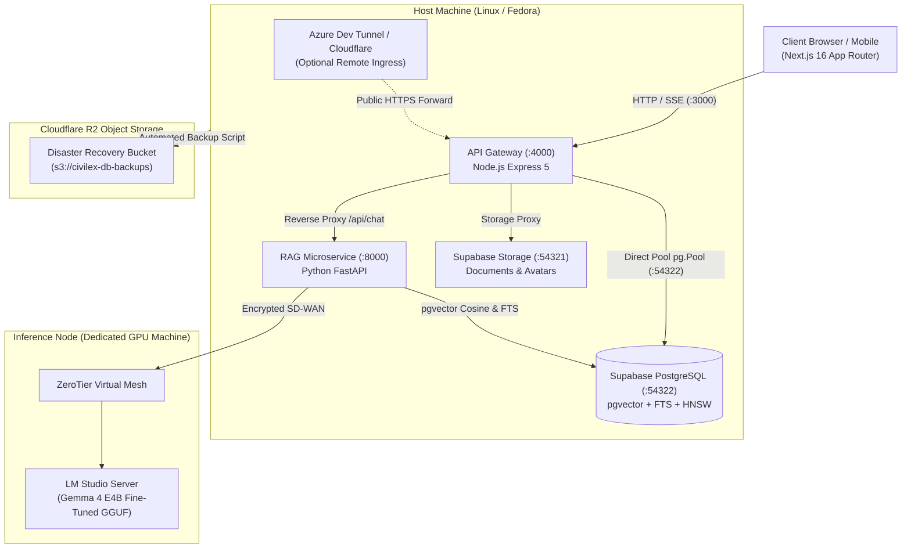

# CIVIL-LEX: AI-Powered Philippine Civil Law Legal Assistant & RAG System

[](https://huggingface.co/renzzyyy1028/civilex-gemma-4-e4b)
[](https://huggingface.co/datasets/renzzyyy1028/civil-code-phil)

An enterprise-grade, retrieval-augmented generation (RAG) system specialized in the **Civil Code of the Philippines (Republic Act No. 386)**, the **Family Code of the Philippines (Executive Order No. 209)**, and Philippine Supreme Court jurisprudence.

The platform combines a bilingual Next.js client, an Express API gateway, a FastAPI neuro-symbolic RAG microservice, a Supabase PostgreSQL vector database, and a private ZeroTier mesh network for local LLM inference.

---

## 1. System Architecture

CIVIL-LEX uses a distributed microservice topology designed for low-latency streaming, memory-constrained GPU inference, and strict statutory verification.



### Component Breakdown

| Tier | Technology | Port | Responsibilities |
| :--- | :--- | :--- | :--- |
| **Frontend** | Next.js 16 (React 19, TypeScript, TailwindCSS) | `3000` | Real-time SSE chat streaming, document upload interface, statutory explorer (`/civil-code`), interactive ambiguity prompts, and legal analytics display. |
| **API Gateway** | Node.js (Express 5, ESM) | `4000` | JWT verification (Supabase Auth), reverse proxying to Python (`/search`, `/cancel`), database connection pooling (`pg.Pool({ max: 25 })`), user presence, and session management. |
| **RAG Microservice** | Python 3.11+ (FastAPI, Uvicorn) | `8000` | Query intent classification (`DomainRouter`), dense retrieval (`intfloat/multilingual-e5-base`), sparse full-text search (`tsvector`), Reciprocal Rank Fusion (`RRF k=60`), statutory companion graph expansion, neuro-symbolic NLI verification, and single-slot FIFO GPU queue management. |
| **Database & Storage** | Supabase PostgreSQL 17 | `54322` / `54321` | Vector store with HNSW index (`pgvector`), GIN full-text index, user chat history, document metadata, and object storage for physical legal PDFs. |
| **LLM Inference** | Gemma 4 E4B (Fine-Tuned GGUF) via LM Studio | `1234` | Private on-premise inference hosted over an encrypted ZeroTier software-defined network, eliminating external API dependencies and preserving legal data privacy. |
| **Backup & DR** | Cloudflare R2 | S3 API | Automated offsite disaster recovery storing compressed database schema, vector embeddings, and physical storage files. |

---

## 2. Infrastructure Setup & Network Topology

### ZeroTier Encrypted Private Mesh
The Python RAG microservice and the GPU inference server communicate over a private ZeroTier Layer-2 virtual network. This isolates model inference traffic from the public internet without requiring port forwarding or public IP exposure.

```bash
# Verify ZeroTier daemon status on the Linux host
sudo zerotier-cli status

# Verify network attachment and assigned IP (10.57.24.x)
sudo zerotier-cli listnetworks

# Verify socket connectivity to LM Studio on the inference host
nc -zv 10.57.24.131 1234
curl -s http://10.57.24.131:1234/v1/models
```

### Local Supabase Database Engine
Database services run via the Supabase CLI in Docker containers. Non-essential background services (such as Realtime and Edge Runtime) are disabled in `supabase/config.toml` to minimize memory footprint on development machines.

Key database extensions enabled:
- `vector`: 768-dimensional dense vector embeddings with HNSW cosine distance (`vector_cosine_ops`).
- `pg_trgm`: Trigram fuzzy text matching for statutory articles and titles.
- `uuid-ossp`: Canonical UUIDv4 generation for sessions and document chunks.

```bash
# Start database and storage containers
npx supabase start

# Check status and port mappings
npx supabase status
```

---

## 3. DevOps & Automation Scripts

The repository includes automation scripts in `/scripts` and the project root to streamline deployment, monitoring, testing, and backups.

### 3.1 Process Orchestration (`start.sh`)
Root service manager for development and server environments:
- Cleans orphaned ports (`3000`, `4000`, `8000`) using `lsof`, `fuser`, and `ss`.
- Launches a 5-pane `tmux` console displaying Next.js, Node.js Gateway, Python RAG, Azure Dev Tunnel, and an interactive process controller.
- Features automatic log rotation (prunes when logs exceed 25 MB) and real-time colorized log streaming.

```bash
# Start all microservices in a balanced tmux grid
./start.sh -t

# Start all microservices as background daemons
./start.sh

# Display live service PID and port statuses
./start.sh -s

# Stop all microservices and release ports
./start.sh -k
```

### 3.2 Automated Disaster Recovery (`scripts/backup-to-r2.sh`)
Production-grade backup automation targeting Cloudflare R2:
- Exports full PostgreSQL database schema (`supabase_schema.sql`).
- Exports all records, table rows, and vector embeddings (`supabase_data.sql`).
- Packages physical legal documents and avatars from the Supabase Storage container (`supabase_storage_backup.tar.gz`).
- Compresses dumps using `gzip` (shrinking 4.9 GB to ~1.7 GB).
- Uploads timestamped archives to Cloudflare R2 via AWS CLI.
- Automatically executes an offsite retention policy: keeps the 2 most recent backups and prunes older archives to prevent exceeding the 10 GB free tier.
- Cleans up older local backup directories to preserve host disk space.

```bash
# Execute automated backup pipeline
./scripts/backup-to-r2.sh

# List available backups in Cloudflare R2
aws s3 ls s3://civilex-db-backups/ --profile r2
```

### 3.3 Live Telemetry Monitor (`scripts/system_monitor.sh`)
Terminal dashboard monitoring host hardware and application concurrency:
- Host hardware metrics: CPU load per core, memory consumption, swap utilization, and disk I/O.
- Live LLM concurrency queue: Tracks active, waiting, and completed RAG requests through `QueryQueueManager`.
- Real-time active user presence and session states.

```bash
./scripts/system_monitor.sh
```

### 3.4 Concurrency Stress Testing
- `scripts/k6-stress-test.js`: High-concurrency k6 script benchmarking throughput and latency under concurrent query loads.
- `scripts/node-stress-test.mjs`: Node.js multi-client stress harness testing queue stability and database connection pool saturation.
- `scripts/inject-users.mjs` / `scripts/cleanup-users.mjs`: Automated mock user generators for benchmarking user presence telemetry.

---
