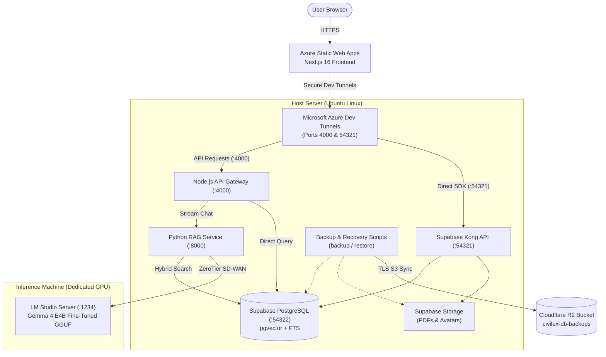
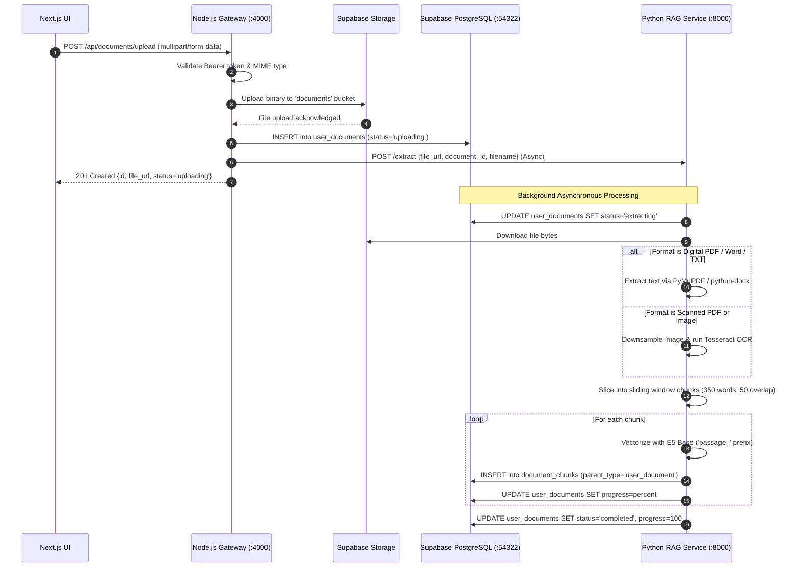
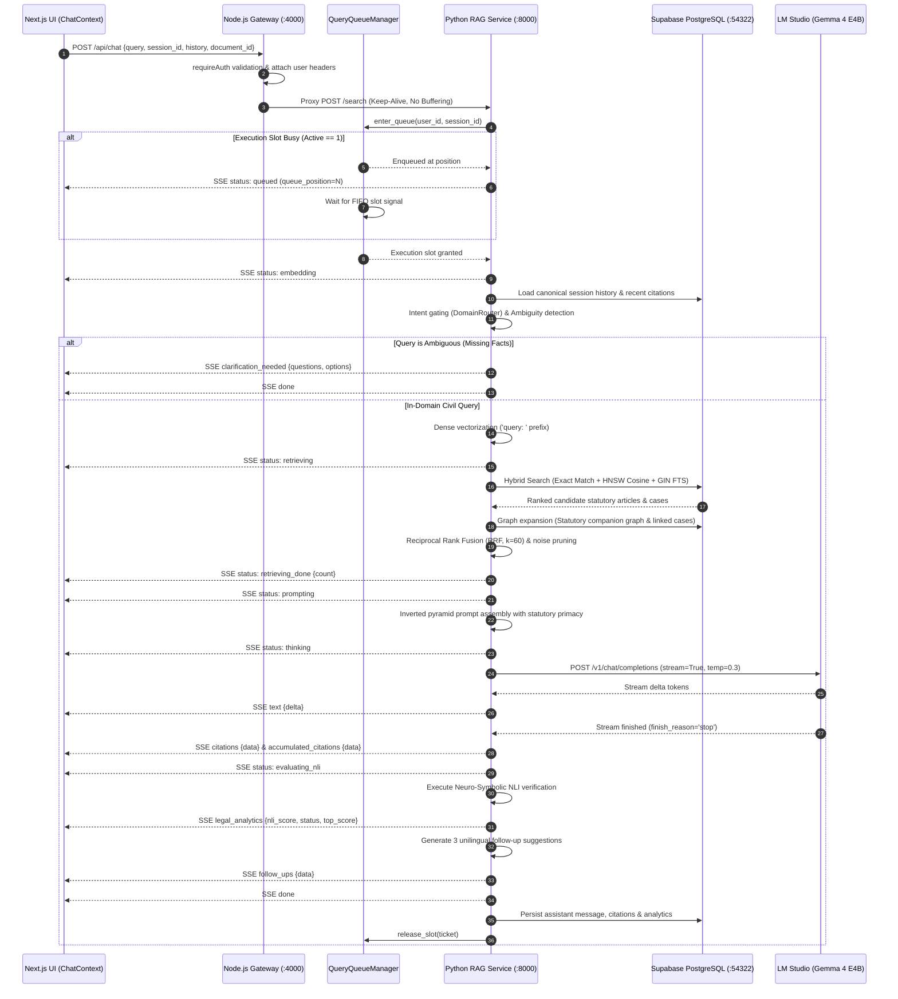
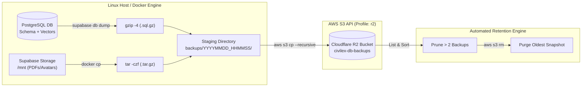

# CIVIL-LEX: Architectural & Implementation Specification

## 1. System Architecture Overview

CIVIL-LEX is a bilingual (English and Tagalog) legal hybrid Retrieval-Augmented Generation (RAG) system engineered to deliver accurate, citation-backed legal analysis grounded in the Civil Code of the Philippines (Republic Act No. 386), the Family Code of the Philippines (Executive Order No. 209), and Philippine Supreme Court jurisprudence.

### Technology Stack Inventory

- **Frontend:** Next.js 16 (App Router, React 19, TypeScript), TailwindCSS, Radix UI primitives, Lucide Icons. Hosted on **Azure Static Web Apps** with automated GitHub Actions CI/CD.
  - *State & Cache Management:* React Context (`ChatContext`, `DocChatContext`, `AuthContext`) for real-time Server-Sent Events (SSE) tracking and in-memory caching of jurisprudence cases and Table of Contents nodes.
- **API Gateway Backend:** Node.js (Express 5, ECMAScript Modules). Hosted locally on Linux (Port `4000`).
  - *Authentication & Authorization:* Bearer JWT verification via Supabase Auth (`requireAuth` middleware) and request-scoped Supabase client creation.
  - *Reverse Proxy:* `http-proxy-middleware` forwarding streaming chat requests (`/api/chat` to Python `/search`), cancellation commands (`/api/chat/cancel` to Python `/cancel`), and storage assets (`/api/storage` to Supabase Storage).
  - *Internal Services:* Direct PostgreSQL/Supabase data access for Civil Code Table of Contents, statutory queries, jurisprudence retrieval, user session persistence, profiles, avatar in-memory caching, and presence telemetry.
- **Secure Network Ingress:** **Microsoft Azure Dev Tunnels** (`devtunnel` CLI) securely exposing host services (Node.js API Gateway port `4000` and Supabase API port `54321`) to the cloud-hosted frontend via persistent HTTPS/WSS endpoints (`ps7cvfbz-4000.asse.devtunnels.ms` and `ps7cvfbz-54321.asse.devtunnels.ms`).
- **Database & Storage Engine:** Supabase PostgreSQL 15+ running in local Docker (Port `54322`).
  - *Vector Search:* `pgvector` extension supporting 768-dimensional vector cosine similarity with dedicated partial HNSW indexes.
  - *Full-Text Search:* Native PostgreSQL `tsvector` and `tsquery` utilizing the `simple` dictionary configuration with GIN indexing.
  - *Object Storage:* Supabase Storage buckets (`documents` for uploaded contracts/deeds with a 50MB file limit; `avatars` for user profile photos).
- **Disaster Recovery & Backup Subsystem:** Automated disaster recovery and retention system orchestrating compressed database schema, vector embeddings, and physical storage dumps to **Cloudflare R2** (S3-compatible bucket `civilex-db-backups`). Includes automated retention pruning and turnkey recovery rehydration scripts (`scripts/backup-to-r2.sh` and `scripts/restore-from-r2.sh`).
- **RAG Core Microservice:** Python 3.11+ (FastAPI, Uvicorn). Hosted locally on Linux (Port `8000`).
  - *Embedding Model:* `intfloat/multilingual-e5-base` (768-dimensional dense vectors) with explicit `query: ` and `passage: ` instruction prefixes.
  - *Document Extraction Pipeline:* `PyMuPDF` (`fitz`) for digital text extraction, `python-docx` for Word documents, and `pytesseract` (Tesseract OCR) as fallback for scanned image-based PDFs and images (PNG, JPEG).
  - *Hybrid Retrieval & Fusion:* Reciprocal Rank Fusion (RRF, $k=60$) combining `pgvector` HNSW cosine similarity and PostgreSQL Full-Text Search (`ts_rank_cd`), augmented by exact article regex matching, statutory companion graph expansion, and graph-linked jurisprudence.
  - *Semantic Guardrails:* Embedding centroid domain router (`DomainRouter`) separating civil law inquiries from non-legal topics, specialized external statutes, and illicit contract requests.
  - *Ambiguity Detection:* LLM-driven query analyzer (`services/ambiguity.py`) determining missing factual requisites and generating interactive clarification questions.
  - *Verification & NLI:* Neuro-symbolic hybrid Natural Language Inference (NLI) engine combining deontic modality rules, polarity inversion checks, statutory anchor validation, and local LLM semantic entailment.
  - *Concurrency & Resource Management:* In-memory FIFO queue manager (`QueryQueueManager`) strictly enforcing 1-query concurrency to safeguard 6GB VRAM GPUs from out-of-memory crashes.
- **Local LLM Inference Engine:** Google Gemma 4 E4B (Fine-Tuned via LoRA $r=32, \alpha=64$, 16-bit Brain Floating Point / BF16 GGUF quantization) hosted locally via LM Studio (Port `1234`), exposed over an encrypted ZeroTier SD-WAN virtual network.

---

## 2. Physical Network Deployment Topology

The system operates across a distributed hybrid environment connecting cloud deployment with local hardware:



### Network Configuration Details
1. **Frontend to Gateway & Supabase:** The Next.js client deployed on **Azure Static Web Apps** transmits authenticated requests via public endpoints routed through secure **Microsoft Azure Dev Tunnels** (`ps7cvfbz-4000.asse.devtunnels.ms` into the Node.js API Gateway on Port `4000`, and `ps7cvfbz-54321.asse.devtunnels.ms` into Supabase).
2. **Gateway to RAG Microservice:** The Node.js server proxies streaming endpoints (`/api/chat` -> `/search`, `/api/chat/cancel` -> `/cancel`) over internal `http://localhost:8000`, injecting authenticated user identity headers (`x-user-id`, `x-user-email`, `x-user-name`).
3. **RAG Microservice to LLM Host:** The Python RAG service connects to the LM Studio OpenAI-compatible endpoint (`http://10.57.24.131:1234/v1`) through an isolated ZeroTier SD-WAN virtual network.
4. **Disaster Recovery Pipeline:** The host machine executes automated backup pipelines exporting compressed schema, vector records, and storage volumes to an S3-compatible **Cloudflare R2** bucket (`civilex-db-backups`) with automated retention enforcement.

---

## 3. End-to-End System Sequence Flows

### 3.1 Document Ingestion and Analysis Flow



### 3.2 Real-Time Chat & Retrieval-Augmented Generation Flow



---

## 4. Database Schema Specification

The database utilizes Supabase PostgreSQL with the `pgvector` extension and native full-text search indexing.

### 4.1 Statutory & Jurisprudence Models

1. **`civil_code_articles` (Statutory Corpus):**
   - `article_id` (`TEXT`, PK): Canonical identifier (e.g., `RA386-ART1191`, `EO209-ART1`).
   - `article_number` (`INT`): Sequential integer (1 to 2270 for Civil Code; 1 to 257 for Family Code).
   - `hierarchy` (`JSONB`): Structural taxonomy containing `{book_name, title_name, chapter_name, section_name}`.
   - `content` (`TEXT`): Full enacted text of the statute.
   - `is_hub` (`BOOLEAN`): Flags heavily cross-referenced foundational anchor articles.

2. **`jurisprudence_cases` (Supreme Court Precedents):**
   - `case_uid` (`TEXT`, PK): Unique precedent identifier (e.g., `GR_189871_2012`).
   - `title` (`TEXT`): Official Supreme Court case title.
   - `gr_number` (`TEXT`): General Register docket number.
   - `decision_date` (`TEXT`): Date promulgated.
   - `source_url` (`TEXT`): Source reference link.
   - `content_summary` (`TEXT`): Pre-computed analytical case doctrine summary.
   - `full_text` (`TEXT`): Complete unabridged judicial decision text.

3. **`article_jurisprudence_relations` (Knowledge Graph Edges):**
   - `article_id` (`TEXT`): Foreign key referencing `civil_code_articles.article_id`.
   - `case_uid` (`TEXT`): Foreign key referencing `jurisprudence_cases.case_uid`.
   - `citation_type` (`TEXT`): Relationship qualification (`interpreted`, `applied`, `cited`, or `mentioned`).

### 4.2 Vector & Chunk Storage

```sql
CREATE TABLE public.document_chunks (
    chunk_id TEXT PRIMARY KEY,
    parent_type TEXT CHECK (parent_type IN ('article', 'case', 'user_document')),
    parent_id TEXT,
    content TEXT NOT NULL,
    legal_topics TEXT[],
    embedding VECTOR(768),
    fts tsvector GENERATED ALWAYS AS (to_tsvector('simple', content)) STORED
);

-- Full-text search index
CREATE INDEX IF NOT EXISTS fts_idx ON public.document_chunks USING GIN (fts);

-- Dedicated partial HNSW and GIN indexes for fast partition retrieval
CREATE INDEX IF NOT EXISTS article_vector_idx ON public.document_chunks 
    USING hnsw (embedding vector_cosine_ops) WHERE parent_type = 'article';
CREATE INDEX IF NOT EXISTS article_parent_id_idx ON public.document_chunks(parent_id) 
    WHERE parent_type = 'article';
CREATE INDEX IF NOT EXISTS article_fts_idx ON public.document_chunks 
    USING gin (fts) WHERE parent_type = 'article';
CREATE INDEX IF NOT EXISTS doc_vector_idx ON public.document_chunks 
    USING hnsw (embedding vector_cosine_ops) WHERE parent_type = 'user_document';
```

### 4.3 User Documents & Session History

```sql
CREATE TABLE public.user_documents (
    id UUID PRIMARY KEY DEFAULT extensions.uuid_generate_v4(),
    user_id UUID REFERENCES auth.users(id) ON DELETE CASCADE,
    filename TEXT NOT NULL,
    file_url TEXT NOT NULL,
    status TEXT CHECK (status IN ('uploading', 'extracting', 'completed', 'rejected_unrelated', 'error')),
    progress INT DEFAULT 0,
    error_message TEXT,
    created_at TIMESTAMPTZ DEFAULT NOW()
);

CREATE TABLE public.chat_sessions (
    id UUID PRIMARY KEY DEFAULT extensions.uuid_generate_v4(),
    user_id UUID REFERENCES auth.users(id) ON DELETE CASCADE,
    title TEXT DEFAULT 'New Chat',
    session_type TEXT DEFAULT 'legal_chat',
    document_id UUID REFERENCES public.user_documents(id) ON DELETE CASCADE,
    created_at TIMESTAMPTZ DEFAULT NOW()
);

CREATE TABLE public.chat_messages (
    id UUID PRIMARY KEY DEFAULT extensions.uuid_generate_v4(),
    session_id UUID REFERENCES public.chat_sessions(id) ON DELETE CASCADE,
    role TEXT CHECK (role IN ('user', 'assistant')),
    content TEXT NOT NULL,
    citations JSONB,
    legal_analytics JSONB,
    created_at TIMESTAMPTZ DEFAULT NOW()
);

CREATE TABLE public.profiles (
    id UUID PRIMARY KEY REFERENCES auth.users(id) ON DELETE CASCADE,
    full_name TEXT,
    avatar_url TEXT,
    role TEXT,
    organization TEXT,
    practice_area TEXT,
    phone_number TEXT,
    notification_preferences JSONB DEFAULT '{"email": true, "push": false}'::jsonb,
    theme_preferences TEXT DEFAULT 'system',
    created_at TIMESTAMPTZ DEFAULT NOW()
);
```

---

## 5. Security & Verification Directives

1. **Row Level Security (RLS):** All user tables (`chat_sessions`, `chat_messages`, `user_documents`, `profiles`) enforce RLS policies restricting data visibility to `auth.uid() = user_id`.
2. **Reverse Proxy Security:** The Node.js gateway validates incoming Bearer JWT tokens with the Supabase Auth server before executing proxy forwarding. Downstream microservices run on internal loopback interfaces or encrypted SD-WAN subnets.
3. **Prompt Hardening:** Prompts incorporate closed-book constraints, strict unilingual output directives, system prompt confidentiality rules, and rejection of foreign common law doctrines.

---

## 6. Disaster Recovery & Automated Backup Subsystem

To guarantee business continuity, data durability, and fast disaster recovery, CIVIL-LEX implements an automated multi-tier backup and restoration pipeline integrated with Cloudflare R2 (S3-compatible object storage).

### 6.1 Architecture & Retention Strategy



1. **Target S3 Storage:** Cloudflare R2 bucket `civilex-db-backups` utilizing TLS-encrypted S3-compatible endpoints.
2. **Compression Ratio:** PostgreSQL table data and 768-dimensional dense vector embeddings are compressed using `gzip -4`, saving ~75% disk space and network bandwidth (reducing ~1.86 GB uncompressed vectors down to lightweight archives).
3. **Retention Policy:** The automated retention engine strictly maintains the 2 most recent snapshots (`MAX_BACKUPS=2`), guaranteeing that the total remote footprint remains comfortably within the 10 GB free tier.
4. **Local Disk Protection:** Staging directories and previous local dumps are purged automatically after successful remote transfer to prevent local disk exhaustion.

### 6.2 Automated Backup Pipeline (`scripts/backup-to-r2.sh`)

The backup script automates the four-stage export, compression, upload, and pruning lifecycle:
1. **Schema Extraction:** Executes `npx supabase db dump --local --schema public,auth,storage` and compresses with `gzip -f` into `supabase_schema.sql.gz`.
2. **Data & Vector Extraction:** Executes `npx supabase db dump --local --data-only --use-copy` and compresses with `gzip -f -4` into `supabase_data.sql.gz`.
3. **Physical Storage Packaging:** Directly copies `/mnt` from the `supabase_storage_civilex-thesis` container and packages it into `supabase_storage_backup.tar.gz`.
4. **Encrypted Cloud Upload:** Syncs the timestamped folder to `s3://civilex-db-backups/<TIMESTAMP>/` via `aws s3 cp --profile r2`.
5. **Retention Enforcement:** Queries `aws s3 ls`, identifies any snapshots exceeding `MAX_BACKUPS`, and safely invokes `aws s3 rm --recursive` on the oldest snapshot.

### 6.3 Turnkey Disaster Recovery Restore Pipeline (`scripts/restore-from-r2.sh`)

In the event of database corruption, container failure, or machine migration, the disaster recovery script restores the complete environment from Cloudflare R2:
1. **Snapshot Discovery:** Automatically queries Cloudflare R2 for the latest backup snapshot, or accepts an explicit timestamp argument (e.g. `./scripts/restore-from-r2.sh 20261026_233701`).
2. **Container Health Pre-flight:** Verifies that target Docker containers (`supabase_db_civilex-thesis` and `supabase_storage_civilex-thesis`) are healthy.
3. **Physical Storage Restoration:** Downloads `supabase_storage_backup.tar.gz`, unpacks the tree, and synchronizes files into the storage container `/mnt/`.
4. **Extension Bootstrap:** Ensures PostgreSQL extensions (`vector`, `uuid-ossp`, `pg_trgm`) exist in the `extensions` schema.
5. **Schema & Data Ingestion:** Streams decompressed schema and data directly into PostgreSQL via superuser `supabase_admin`.
6. **Container Re-synchronization:** Restarts the Supabase Storage container to refresh cached authentication tokens and bucket directory trees.
7. **Automated Post-Recovery Integrity Validation:** Queries record counts for statutory articles, knowledge graph vector chunks, and jurisprudence cases to confirm 100% database rehydration.

### 6.4 Disaster Recovery Benchmarks

| Metric | Target SLA | Measured Benchmark |
| :--- | :--- | :--- |
| **Recovery Point Objective (RPO)** | < 24 Hours | ~0 to 24 Hours (Daily cron or on-demand execution) |
| **Recovery Time Objective (RTO)** | < 10 Minutes | ~2 Minutes 45 Seconds (Complete cold rehydration) |
| **Data Compression Efficiency** | > 65% Reduction | 74.8% Reduction (1.86 GB data dump compressed) |
| **Cloud Storage Cost** | \$0.00 / month | 100% Free-Tier Compliant (< 4 GB utilized in R2) |
