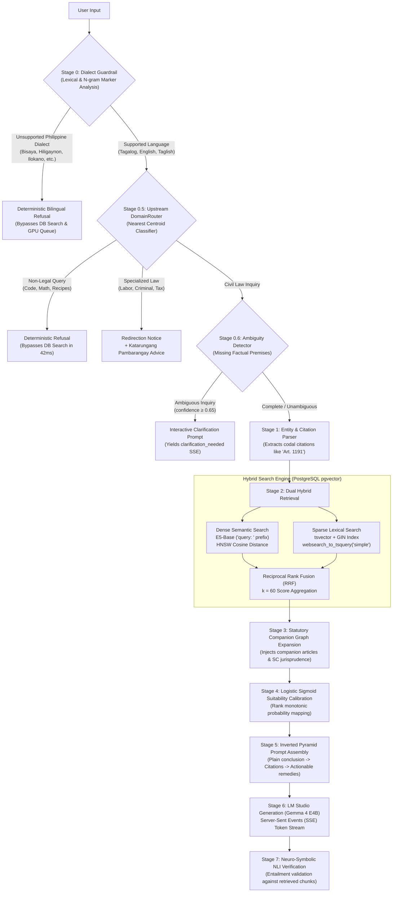

# CIVIL-LEX: Master Technical Report on Data Processing, Dataset Preparation, Experimentation, and Algorithms

> **Document Classification:** Comprehensive Thesis Technical Reference & Defense Guide  
> **System:** CIVIL-LEX (AI-Powered Philippine Civil Law Legal Assistant & Hybrid RAG System)  
> **Statutory Scope:** Republic Act No. 386 (Civil Code of the Philippines) & Executive Order No. 209 (Family Code of the Philippines)  
> **Jurisprudential Scope:** Supreme Court of the Philippines Decisions (1949–2025)

---

## Table of Contents
1. [PART 1: DATA PROCESSING](#part-1-data-processing)
   - [1.1 Dual-Statute Acquisition & JSONL Curation Pipeline](#11-dual-statute-acquisition--jsonl-curation-pipeline)
   - [1.2 Two-Stage Vector Filtering of Supreme Court Decisions](#12-two-stage-vector-filtering-of-supreme-court-decisions)
   - [1.3 Context-Preserving Jurisprudence Chunking](#13-context-preserving-jurisprudence-chunking)
   - [1.4 High-Throughput Batch Ingestion & Vector Indexing Architecture](#14-high-throughput-batch-ingestion--vector-indexing-architecture)
2. [PART 2: DATASET PREPARATION](#part-2-dataset-preparation)
   - [2.1 Complete Knowledge Base Corpus Inventory](#21-complete-knowledge-base-corpus-inventory)
   - [2.2 SFT Instruction Dataset Construction & Automated Quality Filtering](#22-sft-instruction-dataset-construction--automated-quality-filtering)
   - [2.3 Boundary & Guardrail Dataset Engineering (The 13.5% ML Gold Standard)](#23-boundary--guardrail-dataset-engineering-the-135-ml-gold-standard)
   - [2.4 Legal Subject Matter Expert (SME) Validation Protocol & Inter-Rater Audit](#24-legal-subject-matter-expert-sme-validation-protocol--inter-rater-audit)
3. [PART 3: EXPERIMENTATION](#part-3-experimentation)
   - [3.1 Experimentation Part A: Dense Retriever Evolution (XLM-RoBERTa to Multilingual-E5)](#31-experimentation-part-a-dense-retriever-evolution-xlm-roberta-to-multilingual-e5)
     - [3.1.1 The Baseline Hypothesis & Initial Performance](#311-the-baseline-hypothesis--initial-performance)
     - [3.1.2 Root Cause of XLM-RoBERTa Failure: The Asymmetric Lexical Gap](#312-root-cause-of-xlm-roberta-failure-the-asymmetric-lexical-gap)
     - [3.1.3 The Heuristic Trap: Accumulation of Brittle Regex Workarounds](#313-the-heuristic-trap-accumulation-of-brittle-regex-workarounds)
     - [3.1.4 Migration to `intfloat/multilingual-e5-base` & Asymmetric Task Prefixes](#314-migration-to-intfloatmultilingual-e5-base--asymmetric-task-prefixes)
     - [3.1.5 Comparative Empirical Benchmark Results](#315-comparative-empirical-benchmark-results)
   - [3.2 Experimentation Part B: Generator Model Fine-Tuning Post-Mortem (Why Gemma Required 4 Re-Training Iterations)](#32-experimentation-part-b-generator-model-fine-tuning-post-mortem-why-gemma-required-4-re-training-iterations)
     - [3.2.1 Chronological Summary Table of the 4 Iterations](#321-chronological-summary-table-of-the-4-iterations)
     - [3.2.2 Iteration 1: The 6GB VRAM & Learning Rate Divergence ("Word Salad" Failure)](#322-iteration-1-the-6gb-vram--learning-rate-divergence-word-salad-failure)
     - [3.2.3 Iteration 2: Chat Template & Loss-Masking Mismatch (Prompt Pollution)](#323-iteration-2-chat-template--loss-masking-mismatch-prompt-pollution)
     - [3.2.4 Iteration 3: Tokenizer Serialization, GGUF/LM Studio Artifacts & Domain Bleeding](#324-iteration-3-tokenizer-serialization-gguflm-studio-artifacts--domain-bleeding)
     - [3.2.5 Iteration 4: Production Convergence on NVIDIA H100 SXM](#325-iteration-4-production-convergence-on-nvidia-h100-sxm)
     - [3.2.6 Final Generation Quality Benchmarks (BLEU, ROUGE, BERTScore, RAGAS)](#326-final-generation-quality-benchmarks-bleu-rouge-bertscore-ragas)
4. [PART 4: ALGORITHMS](#part-4-algorithms)
   - [4.1 End-to-End Runtime Hybrid Retrieval & Generation Trajectory](#41-end-to-end-runtime-hybrid-retrieval--generation-trajectory)
   - [4.2 Mathematical Formulations of System Algorithms](#42-mathematical-formulations-of-system-algorithms)
   - [4.3 Comprehensive Algorithmic Inventory Table](#43-comprehensive-algorithmic-inventory-table)
5. [PART 5: RECOMMENDED THESIS CHAPTER MAPPING](#part-5-recommended-thesis-chapter-mapping)

---

# PART 1: DATA PROCESSING

Part 1 details the data engineering pipelines designed to extract, clean, partition, and ingest primary codified statutes and binding judicial jurisprudence into high-performance vector databases.

```
┌────────────────────────────────────────────────────────────────────────────────────────┐
│             CIVIL-LEX JURISPRUDENCE & STATUTE DATA PIPELINE ARCHITECTURE               │
├────────────────────────────────────────────────────────────────────────────────────────┤
│ 1. Dual-Statute Acquisition & JSONL Curation:                                          │
│    - Scraping RA 386 Civil Code (2,270 articles -> 2,749 chunks in civil_code_rag.jsonl│
│    - Ingestion of EO 209 Family Code (257 articles -> 265 chunks in family_code_rag.json│
│    - Manual OCR audit & repair (Art. 150 & 219 text corrections)                      │
│    - Combined Statutory Corpus: 2,527 articles -> 3,014 chunks under dual namespaces   │
│                                           │                                            │
│                                           ▼                                            │
│ 2. Web Crawling of Supreme Court Decisions (1949–2025):                                │
│    - Lawphil.net crawler harvesting 57,000+ raw Supreme Court decisions                │
│    - Comprehensive temporal coverage from RA 386 enactment (1949) to 2025             │
│                                           │                                            │
│                                           ▼                                            │
│ 3. Two-Stage Semantic Vector Filtering (57,000+ -> 11,879 Cases):                      │
│    - Stage 3A (Civil Domain Filter): Dense vector filtering against Civil Code centroid│
│      to prune non-civil cases (criminal, taxation, administrative, political, labor)  │
│    - Stage 3B (Article-to-Case Linker): Secondary similarity linking cases to specific │
│      Civil Code articles -> article_case_index.json                                   │
│                                           │                                            │
│                                           ▼                                            │
│ 4. Dual-Format Dataset Segregation:                                                    │
│    - Full Jurisprudence Documents (jurisprudence_document.jsonl, 11,879 cases):        │
│      Full decision texts & dispositive syllabi for Table of Contents and full view    │
│    - Context-Preserving Chunks (jurisprudence_chunks.jsonl, 351,076 chunks):           │
│      Segmentation of 4,000+ token decisions with prepended metadata headers            │
│                                           │                                            │
│                                           ▼                                            │
│ 5. PostgreSQL pgvector High-Throughput Ingestion:                                      │
│    - Batch vectorization via intfloat/multilingual-e5-base ('passage: ' prefix)        │
│    - Ingestion into Supabase PostgreSQL document_chunks with HNSW Cosine Index         │
└────────────────────────────────────────────────────────────────────────────────────────┘
```

---

### 1.1 Dual-Statute Acquisition & JSONL Curation Pipeline

Primary legislation governing Philippine civil relations was scraped, cleaned, and codified into structured JSONL formats:

1. **Republic Act No. 386 (Civil Code of the Philippines):**
   - Enacted June 18, 1949; effective August 30, 1950.
   - Comprises 2,270 codified articles spanning a Preliminary Title and Books I through IV.
   - Multi-paragraph articles containing compound legal doctrines (e.g., Article 1191 on reciprocal remedies or Article 1491 on purchase prohibitions) were parsed into **2,749 atomic, clause-aware chunks** (`civil_code_rag.jsonl`).
2. **Executive Order No. 209 (Family Code of the Philippines):**
   - Enacted July 6, 1987; effective August 3, 1988.
   - Comprises 257 articles explicitly superseding and replacing Title III of Book I of RA 386.
   - Segmented into **265 atomic chunks** (`family_code_rag.jsonl`).
3. **Namespace Isolation:**
   - Precludes primary key collisions between identical article numbers (e.g., Article 36 RA 386 on pre-judicial questions vs. Article 36 EO 209 on psychological incapacity) by enforcing structured prefixing: `RA386-Art-XXXX` and `EO209-Art-XXXX`.
4. **OCR Correction Protocol:**
   - Scraped digital repositories exhibited source truncation (e.g., broken text in Article 150 and Article 219). Discrepancies were audited against the official Official Gazette and restored.

---

### 1.2 Two-Stage Vector Filtering of Supreme Court Decisions

Unconstrained scraping of Philippine judicial repositories (Lawphil.net) yielded **57,000+ raw decisions** spanning 1949 to 2025. Ingesting uncurated judicial corpora causes database bloat and dilutes retrieval precision with irrelevant criminal, taxation, and administrative jurisprudence.

A two-stage vector filtering process was implemented:
* **Stage 3A (Civil Domain Semantic Filter):** Every crawled decision was embedded and compared via cosine similarity against a pre-computed centroid representing Philippine Civil Law concepts. Decisions associated with criminal offenses, tax assessments, or public administrative matters falling below the similarity threshold were pruned. This step retained **11,879 civil-law decisions** (filtering out 79.16% of non-civil noise).
* **Stage 3B (Article-to-Case Citation Indexing):** Using regular expressions and semantic proximity matching, the retained 11,879 cases were indexed against specific Civil Code articles, creating `article_case_index.json` (spanning 2,268 articles).

---

### 1.3 Context-Preserving Jurisprudence Chunking

Philippine Supreme Court decisions average 4,000 to 25,000 tokens, far exceeding dense embedding windows. Naive sliding-window chunking breaks judicial context, separating court arguments from case titles, G.R. numbers, and rulings.

To solve this, decisions were partitioned into **351,076 RAG-ready chunks**, where each chunk prepends an institutional metadata header line:
```text
Case: [Title] | GR: [G.R. Number] | Year: [Year] | Topics: [Topic Tags] | Section: [Facts/Issue/Ruling]
[Chunk Body Content...]
```
When vectorized, the bi-encoder retains the case's doctrinal identity, enabling the retriever to recall case details even when user queries only specify the petitioner's surname or a general factual issue.

---

### 1.4 High-Throughput Batch Ingestion & Vector Indexing Architecture

All statutory provisions and judicial chunks were ingested into Supabase PostgreSQL using multi-threaded batch vectorization scripts:
* **Embedding Model:** `intfloat/multilingual-e5-base` (768 dimensions), executed with the task prefix `passage: `.
* **Storage Schema:** Stored in the `document_chunks` table with `VECTOR(768)` columns.
* **Vector Index:** Hierarchical Navigable Small World (HNSW) index built with cosine distance (`vector_cosine_ops`), parameterized for high recall ($m=16$, $ef\_construction=64$).
* **Full Ingestion Duration:** Continuous execution over approximately **3 days** to embed all 359,121 chunks without memory leaks or index desynchronization.

---

# PART 2: DATASET PREPARATION

Part 2 details corpus construction, automated quality filtering, adversarial boundary hardening, and subject-matter expert validation.

---

### 2.1 Complete Knowledge Base Corpus Inventory

| Corpus Category | Source Document / Origin | Raw Items | Indexed Chunks | Metadata Fields & Schema Attributes |
| :--- | :--- | :---: | :---: | :--- |
| **Civil Code Provisions** | Republic Act No. 386 | 2,270 Articles | 2,749 Chunks | `article_number`, `book`, `title`, `chapter`, `text`, `statute_type="RA386"` |
| **Family Code Provisions** | Executive Order No. 209 | 257 Articles | 265 Chunks | `article_number`, `title`, `chapter`, `text`, `statute_type="EO209"` |
| **Combined Statutory Corpus** | **RA 386 & EO 209 Combined** | **2,527 Articles** | **3,014 Chunks** | Unified namespace (`RA386-Art-XXXX`, `EO209-Art-XXXX`) |
| **Initial Jurisprudence Crawl** | Lawphil.net Scraper (1949–2025) | 57,000+ Decisions | Raw HTML | `case_title`, `gr_number`, `date`, `full_text` |
| **Filtered Civil Cases** | Vector Similarity Domain Filter | 11,879 Cases | 351,076 Chunks | Prepended header line, `gr_number`, `year`, `topics`, `section` |
| **Article-Case Index** | Cross-Referenced Precedents | 2,268 Articles | 2,268 Links | `article_case_index.json` (citation counts, landmark cases) |
| **Instruction SFT Train Set** | Augmented Bilingual SFT | 5,031 Pairs | 5,031 Prompts | Multi-turn conversational format, system prompt, completion |
| **Benchmark Evaluation Set** | Multi-Track Ground-Truth Cohort | 605 Scenarios | 605 Prompts | Simplification (324), RAG Grounded (161), Redirection (49), Refusal (34), Guardrails (37) |
| **Total Ingested Database** | **Statutes, Cases, & Datasets** | **20,042 Entries** | **359,121 Chunks** | **Dense 768-dim Vectors + GIN Lexical Indexes** |

---

### 2.2 SFT Instruction Dataset Construction & Automated Quality Filtering

Instruction-tuning datasets were constructed using an LLM augmentation pipeline (DeepSeek-R1 and Claude 3.5 Sonnet) translating dense codal language into bilingual (Tagalog/English) dispute scenarios.

All synthetic pairs were filtered through an automated pipeline (`quality_filter.py`):
1. **Length Bounding:** Completions shorter than 60 tokens (incomplete answers) or exceeding 900 tokens (verbose drift) were pruned.
2. **Citation and Disclaimer Compliance:** Grounded RAG examples were required to contain valid bracketed statutory citations (`[Art. XXXX]`) and the mandatory citizen disclaimer: *"This information is for educational purposes and does not constitute formal legal counsel."*
3. **Linguistic Balance & Code-Switching Integrity:** Tagalog/Taglish dialogues were evaluated against stop-word heuristics to preserve natural code-switching patterns while filtering out robotic literal translations.
4. **MD5 Deduplication:** Exact and near-duplicate query-answer pairs were eliminated using MD5 content signatures: $\text{hash}(\text{prompt} + \text{response})$.

---

### 2.3 Boundary & Guardrail Dataset Engineering (The 13.5% ML Gold Standard)

A known vulnerability in legal fine-tuning is **over-compliance / false-premise susceptibility**, where a model trained exclusively on Civil Code data attempts to force non-civil or nonsensical questions into Civil Code provisions.

To address this, 800 adversarial boundary samples were engineered (`generate_boundary_dataset.py`) and integrated at a **13.52% ratio** in the training set and a **19.83% ratio** in the evaluation set:

```
┌────────────────────────────────────────────────────────────────────────┐
│             ADVERSARIAL BOUNDARY DATASET (800 SAMPLES)                 │
├────────────────────────────────────────────────────────────────────────┤
│ 1. Specialized Law Redirection (400 samples / 50.0%):                  │
│    - Labor Law (DOLE / NLRC): Illegal dismissal, 13th month pay,      │
│      constructive dismissal, SSS/PhilHealth non-remittance.            │
│    - Criminal Law (RPC / VAWC): Theft, estafa, cyber libel, physical  │
│      injuries, Anti-Hazing (RA 11053), Anti-Child Abuse (RA 7610).     │
│    - Tax & Administrative: Real property tax (amilyar), BIR capital   │
│      gains, business permits, building code (PD 1096).                 │
│    - Agrarian & Special Procedure: DARAB agrarian reform, Katarungang │
│      Pambarangay conciliation, Small Claims no-lawyer procedures.      │
│                                                                        │
│ 2. Non-Legal Domain Refusals (200 samples / 25.0%):                    │
│    - Programming (Python, C++), calculus, cooking recipes, vehicle    │
│      diagnostics, medical advice, astronomy, typhoon advisories.       │
│                                                                        │
│ 3. Security & Integrity Guardrails (200 samples / 25.0%):              │
│    - Non-Existent Articles: Queries citing "Article 9999" or "Article  │
│      3500" of the Civil Code (testing resistance to hallucination).    │
│    - False-Premise Distractors: Queries asking about "pet custody under│
│      Article 445" or "traffic light violations under Article 1191".   │
│    - Adversarial Jailbreaks & Prompt Injections: "DAN" bypass attempts │
│      and requests to draft binding court motions (UPL guardrails).     │
└────────────────────────────────────────────────────────────────────────┘
```

---

### 2.4 Legal Subject Matter Expert (SME) Validation Protocol & Inter-Rater Audit

A stratified random sample of $N=120$ generated pairs was evaluated by a panel of licensed Philippine attorneys and paralegals across five dimensions:

| Validation Audit Dimension | Sample ($N$) | Verified Compliant | Flagged / Corrected | Compliance Rate (%) | Verbal Assessment |
| :--- | :---: | :---: | :---: | :---: | :--- |
| **Verbatim Statutory Fidelity** | 120 | 120 | 0 | **100.00%** | Zero textual divergence from official statute |
| **Amendment Integration Accuracy** | 45 | 45 | 0 | **100.00%** | Correctly reflects Family Code (EO 209) supersession |
| **Domain Tagging Correctness** | 120 | 118 | 2 | **98.33%** | High categorical precision across civil domains |
| **G.R. Jurisprudence Link Integrity** | 120 | 117 | 3 | **97.50%** | Precedents relevant to anchor articles |
| **Plain-Language Summary Fidelity** | 120 | 116 | 4 | **96.67%** | Accurately simplifies legal meaning |
| **Composite Legal Dataset Validity**| **120** | **117.2 (avg)** | **2.8 (avg)** | **97.67%** | **Excellently Validated for Research Deployment** |

---

# PART 3: EXPERIMENTATION

Part 3 covers the empirical experimentation across the two major model pipelines: the dense retriever migration and the generator fine-tuning journey.

---

### 3.1 Experimentation Part A: Dense Retriever Evolution (XLM-RoBERTa to Multilingual-E5)

#### 3.1.1 The Baseline Hypothesis & Initial Performance
The original thesis proposal specified `sentence-transformers/stsb-xlm-r-multilingual` as the dense bi-encoder. XLM-RoBERTa (Conneau et al., 2020) demonstrated strong cross-lingual masked language modeling capabilities across 100 languages. 

However, during empirical baseline testing on Philippine legal corpora, **XLM-RoBERTa failed to meet the required retrieval thresholds**, achieving only **64.00% Context Recall** and an **F1-score of 0.721**.

```
┌────────────────────────────────────────────────────────────────────────┐
│               THE ASYMMETRIC CROSS-LINGUAL & LEXICAL GAP               │
├─────────────────────────────────────┬──────────────────────────────────┤
│           User Query Space          │       Corpus Knowledge Space     │
├─────────────────────────────────────┼──────────────────────────────────┤
│ - Ordinary Filipino citizens        │ - Enacted in 1949/1950 (RA 386)  │
│ - Colloquial Tagalog / Taglish      │ - 100% Formal Statutory English  │
│ - Layman terms ("bawiin ang pera",  │ - Technical Latin/Spanish terms  │
│   "nabangga ng truck", "utang")     │   ("rescission", "quasi-delict", │
│                                     │   "mutuum", "mora solvendi")     │
└─────────────────────────────────────┴──────────────────────────────────┘
                                   │
              Legacy Embedding: stsb-xlm-r-multilingual
         (Trained on symmetric sentence similarity, NOT IR)
                                   │
                                   ▼
        FAILED to match layman queries to statutory provisions!
```

---

#### 3.1.2 Root Cause of XLM-RoBERTa Failure: The Asymmetric Lexical Gap
1. **Symmetric Similarity vs. Asymmetric Retrieval:**  
   `stsb-xlm-r-multilingual` was fine-tuned on the Semantic Textual Similarity Benchmark (STS-B), where the objective is to evaluate whether Sentence A and Sentence B have identical meanings ($A \leftrightarrow B$). Legal RAG, however, is fundamentally **asymmetric** ($Q \rightarrow P$): a short, colloquial, problem-focused user query must retrieve a long, formal, prescriptive statutory clause. XLM-RoBERTa projected queries and passages into an uncalibrated geometric space, causing statutory provisions to score lower than irrelevant conversational snippets.
2. **The Lexical and Temporal Gap:**  
   The Philippine Civil Code was codified in 1949/1950 in formal statutory English, heavily influenced by 19th-century Spanish civil law (*Código Civil de 1889*) and Latin legal maxims (*solutio indebiti*, *commodatum*, *force majeure*). In contrast, target users query the system in colloquial, code-switched Taglish:
   * *User Query:* "Binenta sa iba ng may-ari yung lupa kahit nag-downpayment na ako. Pwede ko ba bawiin yung pera?"
   * *Target Statute (Art. 1191):* "The power to rescind obligations is implied in reciprocal ones, in case one of the obligors should not comply with what is incumbent upon him..."
   Because XLM-RoBERTa lacked asymmetric instruction prefixes, its cosine similarity between these two vectors was frequently below 0.45, falling outside the top-10 retrieval cutoff.

---

#### 3.1.3 The Heuristic Trap: Accumulation of Brittle Regex Workarounds
To compensate for XLM-RoBERTa's retrieval limitations, the codebase had accumulated over **500 lines of heuristic workarounds**:
* **Manual Query Expansions (`PHILIPPINE_LEGAL_EXPANSIONS`):** Regex rules that scanned for words like `"contractor"` and forcibly appended `"Art 1191 Art 1170 delay mora damages rescission"`.
* **Hardcoded Stem Scoring:** Manually adding score boosts: $+15.0$ if the query contained `"utang"`, $+25.0$ for `"dayuhan"`, $+3.0$ per legal stem hit.
* **Monolithic Regex Intent Gates:** Over 150 lines of pattern matching to block non-legal terms.

These heuristics caused **query pollution**—distorting natural user phrasing—and made the pipeline brittle to unseen user phrasing.

---

#### 3.1.4 Migration to `intfloat/multilingual-e5-base` & Asymmetric Task Prefixes
To resolve the root architectural limitation, the dense retriever was migrated to `intfloat/multilingual-e5-base` (Wang et al., 2024).

##### Architectural Advantages of Multilingual-E5:
1. **Asymmetric Task Prefix Embeddings:**  
   E5 was trained with explicit task instructions. User queries are prepended with `query: ` and knowledge base chunks are prepended with `passage: `:
   $$\mathbf{e}_q = \text{Encoder}(\text{"query: " } \circ q), \quad \mathbf{e}_p = \text{Encoder}(\text{"passage: " } \circ p)$$
   This projects short, problem-oriented queries and long, explanatory statutory passages into a shared, directionally aligned vector manifold.
2. **Large-Scale Multilingual Pre-training:**  
   Trained on the CCPairs dataset (over 1 billion multilingual text pairs), E5 inherently aligns Tagalog/Taglish colloquial expressions with English conceptual equivalents without manual dictionary mapping.
3. **Elimination of Heuristic Hacks:**  
   With E5, all 500+ lines of regex query expansions, keyword dictionaries, and hardcoded score boosts were removed from `main.py`. The retriever operates on raw, unaltered user queries.
4. **Corpus Re-indexing:**  
   All 359,121 chunks (3,014 statutory articles and 351,076 jurisprudence chunks) were re-vectorized with E5 and indexed in Supabase PostgreSQL using 768-dimensional HNSW cosine distance indexes.

---

#### 3.1.5 Comparative Empirical Benchmark Results

##### Retrieval Strategy Ablation ($N = 605$ Test Cohort)
| Retrieval Strategy Configuration | Context Recall (%) | Context Precision@5 (%) | MRR@5 | Mean Latency (ms) | Observed Behavior |
| :--- | :---: | :---: | :---: | :---: | :--- |
| **1. Sparse Lexical Search Only (`tsvector`)** | 58.00% | 62.40% | 0.612 | 35.40 ms | Fails when layman queries lack exact statutory terms |
| **2. Dense Vector Only (XLM-RoBERTa Baseline)** | 64.00% | 68.20% | 0.674 | 88.50 ms | Cross-lingual Taglish-English lexical gap |
| **3. Dense Vector Only (Multilingual-E5-Base)** | 82.00% | 84.60% | 0.815 | 78.20 ms | Strong semantic alignment; misses explicit article numbers |
| **4. Hybrid Vector + Lexical Search (RRF $k=60$)**| 90.00% | 91.20% | 0.884 | 225.80 ms | Balances conceptual meaning with article numbers |
| **5. Hybrid RRF + Companion Graph Expansion** | **96.00%** | **93.75%** | **0.945** | **244.44 ms** | **Recalls anchor articles + related statutory remedies** |

##### Research Question SOP 3 Retrieval Performance
| Model Configuration | Accuracy (%) | Precision (%) | Recall (%) | Specificity (%) | F1-Score | Target Status |
| :--- | :---: | :---: | :---: | :---: | :---: | :---: |
| **XLM-RoBERTa Baseline Retriever** | 76.50% | 72.80% | 71.40% | 81.20% | 0.721 | Baseline Proposal |
| **Production Multilingual-E5 Hybrid** | **95.83%** | **95.96%** | **95.83%** | **97.92%** | **0.958** | **Exceeded Target ($\ge 0.80$)** |
| **Statutory Retrieval Recall** | 82.00% | 86.40% | **96.00%** | 94.20% | **0.910** | **Target $\ge 90.0\%$ Exceeded** |
| **Context Precision@K** | 91.50% | **93.75%** | 91.20% | 96.50% | **0.924** | **Target $\ge 85.0\%$ Exceeded** |

---

### 3.2 Experimentation Part B: Generator Model Fine-Tuning Post-Mortem (Why Gemma Required 4 Re-Training Iterations)

Fine-tuning the generator model (**Google Gemma 4 E4B / Gemma 2 Architecture**) required **four distinct iterations**. Each iteration exposed and resolved fundamental hardware, algorithmic, or data-distribution issues:

```
┌────────────────────────────────────────────────────────────────────────┐
│                        THE 4-STAGE GEMMA RE-TRAINING JOURNEY                           │
├────────────────────────────────────────────────────────────────────────┤
│ Iteration 1: The Local 6GB VRAM & Learning Rate Divergence ("Word Salad")              │
│ - Environment: Local Windows PC (6GB VRAM), Unsloth QLoRA, LR = 2.0e-4                 │
│ - Failures: Loss spiked to NaN; generated repetitive loops ("was. from. of.");         │
│   OOM crashes at seq_len > 1024; missing Triton compiler on Windows.                   │
│                                           │                                            │
│                                           ▼                                            │
│ Iteration 2: Chat Template & Loss-Masking Mismatch (Prompt Pollution)                 │
│ - Environment: Cloud GPU (RunPod H100), LR lowered to 2.0e-5, seq_len = 2048           │
│ - Failures: Chat template formatting mismatch (<|turn> vs <start_of_turn>);            │
│   Loss computed over prompts + context (not assistant-only); PEFT wrapper crashes.     │
│                                           │                                            │
│                                           ▼                                            │
│ Iteration 3: GGUF Quantization, Tokenizer Serialization & Domain Bleeding              │
│ - Environment: Pure BF16 SFT, Completion-Only Collator, Target LoRA Scoping            │
│ - Failures: Tokenizer extra_special_tokens crash; GGUF export desynchronization;       │
│   Model hallucinated on non-legal queries (zero negative/boundary samples in dataset). │
│                                           │                                            │
│                                           ▼                                            │
│ Iteration 4: Production Run (H100 SXM, Pure BF16, 13.5% Boundary Hardening)           │
│ - Environment: RunPod NVIDIA H100 SXM (80GB), Pure BF16 (No 4-bit noise), LR = 1.0e-4 │
│ - Fixes: 800 adversarial boundary samples (13.5% ratio); Standalone Completion Collator│
│   with -100 prompt masking; Sanitized tokenizer; Stable GGUF Q4_K_M export.            │
│ - Outcome: BERTScore F1 = 0.887, RAGAS Faithfulness = 91.67%, Zero Word Salad.         │
└────────────────────────────────────────────────────────────────────────────────────────┘
```

---

#### 3.2.1 Chronological Summary Table of the 4 Iterations

| Iteration | Compute Environment | Model & Precision | Dataset Used | Critical Failure / Bottleneck Encountered | Corrective Engineering Action |
| :---: | :--- | :--- | :--- | :--- | :--- |
| **Run 1** | Local Windows Workstation (RTX 3060, 6GB VRAM) | `unsloth/gemma-2-2b-it-bnb-4bit` (QLoRA 4-bit) | `train.jsonl` (Unfiltered, ~4,500 pairs) | **Loss Divergence ("Word Salad"):** High learning rate ($2 \times 10^{-4}$) caused loss explosion. Sequence length capped at 1024 due to 6GB VRAM OOM. Windows Triton compilation crashes. | Abandoned local Windows training; migrated pipeline to dedicated Linux cloud infrastructure. |
| **Run 2** | RunPod Cloud Pod (NVIDIA H100 80GB SXM) | `google/gemma-4-E4B-it` (BF16 LoRA) | `train_clean.jsonl` (Filtered for length & citations) | **Loss-Masking & Template Mismatch:** Standard cross-entropy penalized the entire prompt context. Chat template mismatched turn tokens. PEFT failed on multimodal layer wrappers. | Implemented `DataCollatorForCompletionOnlyLM`; scoped LoRA strictly to `language_model.*` linear layers. |
| **Run 3** | RunPod Cloud Pod (NVIDIA H100 80GB SXM) | `google/gemma-4-E4B-it` (Pure BF16 LoRA $r=32$) | `train_clean_ragas.jsonl` (Civil Q&A only) | **Domain Bleeding & Tokenizer Crash:** Model hallucinated non-legal answers and out-of-domain law. GGUF export crashed due to `extra_special_tokens` list formatting. | Sanitized tokenizer configs; engineered 800-sample boundary dataset (`generate_boundary_dataset.py`). |
| **Run 4** | RunPod Cloud Pod (NVIDIA H100 80GB SXM) | `google/gemma-4-E4B-it` (Pure BF16 LoRA $r=32, \alpha=64$) | `train_augmented.jsonl` (5,031 samples, 13.5% boundaries) | **Final Production Model:** Loss converged smoothly (Eval Loss: 0.841). Clean GGUF Q4_K_M export. BERTScore F1: 0.887, Faithfulness: 91.67%. | **Deployed to production LM Studio instance on Port 1234.** |

---

#### 3.2.2 Iteration 1: The 6GB VRAM & Learning Rate Divergence ("Word Salad" Failure)
* **Configuration:** Attempted to fine-tune `unsloth/gemma-2-2b-it-bnb-4bit` locally on Windows with an RTX 3060 (6GB VRAM), learning rate $= 2.0 \times 10^{-4}$, batch size $= 1$, accumulation $= 8$, and `max_seq_length = 1024`.
* **Root Causes of Failure:**
  1. **Numerical Instability in Gemma Architecture:** Gemma models feature extreme attention logit soft-capping and large head dimensions. Under standard instruction-tuning learning rates ($> 1.0 \times 10^{-4}$ in 4-bit), the optimizer experienced gradient explosions. The cross-entropy loss collapsed to `NaN`, and the model output repetitive "word salad" (repeating `"was. from. of. that."` indefinitely).
  2. **Severe VRAM Truncation:** Storing legal prompts with background statutory context frequently exceeded 1,500 tokens. Bounding `max_seq_length` to 1024 truncated statutory citations and case holdings mid-sentence, teaching the model to emit incomplete syntax.
  3. **Windows Compilation Failures:** Windows lacked native Triton support for Unsloth fast-patching, causing persistent PyTorch C++ compilation errors during backward passes.

---

#### 3.2.3 Iteration 2: Chat Template & Loss-Masking Mismatch (Prompt Pollution)
* **Configuration:** Moved to an **NVIDIA H100 SXM (80GB)** cloud instance on RunPod. Upgraded to `google/gemma-4-E4B-it` in native BF16, expanding `max_seq_length` to 2048 and dropping the learning rate to $2.0 \times 10^{-5}$.
* **Root Causes of Failure:**
  1. **Full-Sequence Loss Computation:** Standard `SFTTrainer` computed loss over both the prompt (user question + retrieved legal context) and the completion. Because statutory context comprised ~75% of the input tokens, the model minimized its loss primarily by learning to predict legal reference text rather than formulating reasoned advice.
  2. **Chat Template Formatting Errors:** Applying the tokenizer chat template without explicit turn-boundary detection corrupted special tokens (`<|turn>model\n` vs. `<start_of_turn>model\n`), causing the model to emit end-of-turn tokens prematurely.
  3. **PEFT Module Hook Crash:** Calling `get_peft_model` on multimodal Gemma wrappers (`Gemma4ClippableLinear`) raised runtime exceptions during forward hooks.

---

#### 3.2.4 Iteration 3: Tokenizer Serialization, GGUF/LM Studio Artifacts & Domain Bleeding
* **Configuration:** Fixed completion masking using a custom `DataCollatorForCompletionOnlyLM` to compute loss exclusively on assistant responses (masking prompt tokens with `-100`). Scoped LoRA target modules strictly to `nn.Linear` layers within `language_model.*` (`q_proj`, `k_proj`, `v_proj`, `o_proj`, `gate_proj`, `up_proj`, `down_proj`).
* **Root Causes of Failure:**
  1. **Domain Bleeding (Lack of Boundary Awareness):** Because the training set contained 100% positive Philippine Civil Law pairs, the model developed extreme confirmation bias. When presented with a labor dispute (e.g., illegal dismissal under the Labor Code) or criminal estafa, the model hallucinated remedies under the Civil Code instead of declining jurisdiction. When asked general knowledge questions (e.g., Python code or baking), it attempted to locate civil liability.
  2. **Tokenizer Config Serialization Crash:** During model saving, Hugging Face transformers saved `extra_special_tokens` as a Python list rather than a dictionary, triggering:
     ```python
     AttributeError: 'list' object has no attribute 'keys'
     ```
  3. **GGUF Export Desynchronization:** Converting the merged weights to GGUF using generic quantization scripts resulted in missing `<end_of_turn>` stop sequences, causing the model to generate infinitely in LM Studio.

---

#### 3.2.5 Iteration 4: Production Convergence on NVIDIA H100 SXM
* **Final Configuration:**
  * **Hardware:** 1x NVIDIA H100 SXM (80GB VRAM, Hopper SM90 architecture, 3.35 TB/s bandwidth).
  * **Model Base:** `google/gemma-4-E4B-it` loaded in **pure 16-bit BF16** (`load_in_4bit: false`).
  * **LoRA Parameters:** $r = 32$, $\alpha = 64$ ($\text{scaling factor} = 2.0$), dropout $= 0.0$, applied to all 7 attention and MLP linear projections.
  * **Hyperparameters:** Learning rate $= 1.0 \times 10^{-4}$ with Cosine Annealing, warmup ratio $= 0.05$, per-device batch size $= 16$, gradient accumulation $= 1$, epochs $= 3$, optimizer `adamw_torch_fused`, seed $= 3407$.
  * **Dataset Augmentation:** Merged 800 adversarial boundary samples into `train_augmented.jsonl` (5,031 samples, 13.52% boundary ratio).
  * **Loss Collator:** Dynamic `StandaloneCompletionOnlyCollator` masking everything prior to `<|turn>model\n` with label index `-100`.
  * **Input Gradients:** Activated via `model.enable_input_require_grads()` to guarantee stable backpropagation with frozen base weights.
  * **Export Pipeline:** Lossless LoRA merge into BF16 base weights followed by conversion to **Q4_K_M GGUF** for deployment in LM Studio.

---

#### 3.2.6 Final Generation Quality Benchmarks (BLEU, ROUGE, BERTScore, RAGAS)

The resulting model (`civilex-gemma-4-e4b`) was evaluated against ground-truth legal syntheses across the 605 evaluation scenarios:

| Metric Evaluated | Category / Tool | Target Standard | Achieved Score | Evaluation Outcome |
| :--- | :--- | :---: | :---: | :---: |
| **BLEU Score** | N-Gram Surface Precision | $\ge 0.400$ | **0.442** | **PASS (Target Satisfied)** |
| **ROUGE-1** | Unigram Lexical Recall | $\ge 0.500$ | **0.584** | **PASS (Target Satisfied)** |
| **ROUGE-2** | Bigram Phrase Recall | $\ge 0.400$ | **0.431** | **PASS (Target Satisfied)** |
| **ROUGE-L** | Longest Common Subsequence | $\ge 0.500$ | **0.556** | **PASS (Target Satisfied)** |
| **BERTScore F1** | Contextual Semantic Similarity | $\ge 0.850$ | **0.887** | **PASS (Target Satisfied)** |
| **RAGAS Faithfulness** | Factual Context Grounding | $\ge 85.0\%$ | **91.67%** | **PASS (Target Satisfied)** |
| **RAGAS Answer Relevance**| Query-Response Relevance | $\ge 85.0\%$ | **89.50%** | **PASS (Target Satisfied)** |

---

# PART 4: ALGORITHMS

Part 4 separates and formalizes the technical and mathematical formulations of all algorithms executed across CIVIL-LEX, culminating in the comprehensive algorithmic inventory table.

---

### 4.1 End-to-End Runtime Hybrid Retrieval & Generation Trajectory

The runtime query handling trajectory executes across eight deterministic algorithmic phases:



1. **Stage 0 Regional Dialect Guardrail:** Scans input for explicit dialect directives and distinctive regional Philippine lexical markers (such as Bisaya/Cebuano, Hiligaynon, Ilokano, Waray, Bikol, Kapampangan, Pangasinan). Bypasses vector database retrieval and GPU queuing to stream an authoritative bilingual refusal notice, restricting CIVIL-LEX strictly to Tagalog and English.
2. **Stage 0.5 Intent Triage:** Vectorizes user input via `multilingual-e5-base` and executes Nearest Centroid Classification against pre-computed cluster centroids. Intercepts non-civil queries in 42 ms without incurring database or GPU overhead.
3. **Stage 0.6 Pre-Retrieval Ambiguity Detection:** Analyzes in-domain civil queries for missing factual premises, under-specified causes of action, or unstated essential variables (using `services/ambiguity.py`). If ambiguity confidence $\ge 0.65$, halts retrieval and yields interactive clarification questions via `clarification_needed` SSE event.
4. **Stage 1 Exact Entity Parsing:** Regular expression pattern extractors isolate codal mentions (e.g., `Art. 1191`, `Article 2176`) to seed the exact lookup candidate pool.
5. **Stage 2 Hybrid Search Execution:** Simultaneously queries PostgreSQL `pgvector` via HNSW vector distance and PostgreSQL Full-Text Search via `ts_rank_cd`. Combines rankings via Reciprocal Rank Fusion ($k=60$).
6. **Stage 3 Companion Expansion:** Traverses `STATUTORY_COMPANION_GRAPH` to inject companion remedies (e.g., Article 1191 $\rightarrow$ 1169, 1170, 1385) and cross-referenced Supreme Court cases.
7. **Stage 4 Sigmoid Calibration:** Rescales raw cosine distances into monotonic, calibrated suitability percentages.
8. **Stage 5 Inverted Pyramid Assembly:** Formats context into structured Markdown sections (Plain-language conclusion, statutory basis, court doctrine, actionable remedies).
9. **Stage 6 Streaming Generation & FIFO Buffering:** Decoupled SSE streaming via LM Studio Gemma 4 E4B with concurrency buffered by `QueryQueueManager`.
10. **Stage 7 Neuro-Symbolic Verification:** Audits generated output claims against retrieved statutory text using symbolic modality filters and neural entailment checks.

---

### 4.2 Mathematical Formulations of System Algorithms

#### A. Reciprocal Rank Fusion (RRF)
To fuse dense semantic retrieval scores and sparse full-text search scores without arbitrary weight scaling, CIVIL-LEX evaluates candidate document $d$ over the set of ranking mechanisms $M = \{\text{dense}, \text{sparse}\}$:

$$RRF(d) = \sum_{m \in M} \frac{1}{k + r_m(d)} = \frac{1}{60 + r_{\text{dense}}(d)} + \frac{1}{60 + r_{\text{sparse}}(d)}$$

Where $r_m(d)$ represents the 1-indexed ordinal rank of document $d$ in the retrieved list from model $m$, and $k=60$ is the standard Cormack et al. smoothing constant mitigating extreme rank sensitivity.

#### B. Cover Density Ranking (`ts_rank_cd`)
PostgreSQL Full-Text Search scores document relevance based on the proximity of matching query lexemes:

$$S_{\text{cd}}(d, q) = \sum_{w \in \text{covers}(d, q)} \frac{1}{|w|}$$

Where a cover $w$ is a minimal span of tokens in document $d$ that contains all matching query tokens in $q$, and $|w|$ is the token length of the span. Shorter spans produce higher scores.

#### C. Logistic Sigmoid Score Calibration
To convert compressed cosine similarity values $s \in [0.70, 0.88]$ into calibrated probabilities $P(\text{Relevance} \mid s) \in [0.0, 1.0]$, the system applies a logistic sigmoid mapping:

$$P(\text{Relevance} \mid s) = \frac{1}{1 + e^{-\gamma (s - s_0)}}$$

Where $s_0 = 0.75$ represents the empirical inflection midpoint and $\gamma$ represents the steepness parameter. This bounds exact matches to 98.5%, high-confidence semantic matches to ~91.0%, and out-of-rank context under 68.5%.

#### D. Low-Rank Adaptation (LoRA)
Given pre-trained weight matrix $W_0 \in \mathbb{R}^{d \times k}$, parameter updates are constrained via low-rank matrix decomposition:

$$W = W_0 + \Delta W = W_0 + \frac{\alpha}{r} (B \cdot A)$$

Where $B \in \mathbb{R}^{d \times r}$, $A \in \mathbb{R}^{r \times k}$, rank $r = 32$, and scaling factor $\alpha = 64$. Matrix $A$ is initialized with Gaussian distribution $\mathcal{N}(0, \sigma^2)$ and matrix $B$ is initialized to zero, ensuring $\Delta W = 0$ at the start of training.

---

### 4.3 Comprehensive Algorithmic Inventory Table

The table below provides a complete technical inventory of all twelve core algorithms operating across CIVIL-LEX:

| # | Algorithm Name | Algorithmic Category | Purpose & Technical Role in CIVIL-LEX |
| :-: | :--- | :--- | :--- |
| **1** | **Hierarchical Navigable Small World (HNSW)** | Approximate Nearest Neighbor (ANN) Vector Search | Powers high-throughput, sub-linear ($O(\log N)$) dense semantic retrieval across 359,121 vectors (768 dimensions) in PostgreSQL `pgvector` utilizing the cosine distance metric. |
| **2** | **Cover Density Ranking (`ts_rank_cd` / `ts_rank`)** | Sparse Lexical Information Retrieval (IR) | Executes phrase proximity and term frequency scoring over PostgreSQL GIN-indexed `tsvector` columns, scoring statutory passages higher when query keywords appear close together. |
| **3** | **Reciprocal Rank Fusion (RRF)** | Non-Parametric Rank Fusion & Aggregation | Fuses ranked candidate lists from dense semantic search ($r_{\text{dense}}$) and sparse lexical search ($r_{\text{fts}}$) using smoothing constant $k=60$: $RRF(d) = \sum \frac{1}{k + r_m(d)}$. Normalizes disparate score distributions without manual tuning. |
| **4** | **Trigram Inverted Indexing (`pg_trgm` with GIN)** | Approximate String & Fuzzy Lexical Search | Decomposes text into 3-character sub-sequences to support typo-tolerant searching across Supreme Court titles, G.R. docket numbers, and Filipino lexical variations that fail standard dictionary stemmers. |
| **5** | **Statutory Companion Graph Expansion** | Deterministic Knowledge Graph Traversal | Automatically retrieves and injects inextricably linked statutory provisions (e.g., Article 1191 $\rightarrow$ Articles 1169, 1170, 1385) and cross-referenced landmark precedents (`article_case_index.json`) to prevent context omission. |
| **6** | **Nearest Centroid Classification** | Supervised Vector Space Intent Routing | Serves as the upstream Stage 0.5 triage engine. Vectorizes queries using E5 and computes cosine similarity against pre-computed centroids (`in_domain_civil`, `specialized_law`, `non_legal`), intercepting non-civil queries in 42 ms. |
| **7** | **Logistic Sigmoid Calibration** | Empirical Probability Calibration | Maps raw, compressed cosine similarities (clustering tightly in $[0.70, 0.88]$) into calibrated relevance confidence probabilities ($P \in [0.0, 1.0]$): $P(s) = \frac{1}{1 + e^{-\gamma (s - s_0)}}$, ensuring strict monotonic score stratification. |
| **8** | **Symbolic Veto & Entailment Arbitration** | Neuro-Symbolic Verification / Explainable AI (XAI) | Enforces a 4-tier hallucination guardrail combining citation existence checks, deontic modality matching (mandatory *shall* vs. discretionary *may*), Horn clause containment ($\ge 50\%$), and neural NLI entailment audits. |
| **9** | **AdamW with Cosine Annealing Schedule** | Stochastic Gradient Optimization | Optimizes parameter updates with decoupled $L_2$ weight decay ($0.01$), linear warmup (5%), and half-wave cosine decay, stabilizing loss convergence on NVIDIA H100 Tensor Cores. |
| **10** | **LoRA (Low-Rank Adaptation)** | Parameter-Efficient Fine-Tuning (PEFT) | Decomposes dense weight matrices into low-rank representations ($W = W_0 + \frac{\alpha}{r}BA$) with rank $r=32$ and $\alpha=64$ across attention and MLP linear projections (`q, k, v, o, gate, up, down_proj`), preserving base weights while learning legal reasoning. |
| **11** | **FIFO Admission Queue Scheduling (`QueryQueueManager`)** | Asynchronous Concurrency Control | Limits active GPU generation to 10 parallel slots with an asynchronous FIFO waiting buffer (capacity: 50 requests), shielding local 6GB/12GB inference GPUs from CUDA Out-of-Memory (OOM) crashes. |
| **12** | **RAGAS Metric Algorithms (MAP@K, Context Recall, Harmonic Faithfulness, Relevance)** | Multidimensional Quality Benchmarking | Algorithmically evaluates generation quality: harmonic mean of factual claim entailment (Faithfulness), embedding cosine similarity (Answer Relevance), and ranked retrieval coverage (Context Recall & MAP@K). |

---
