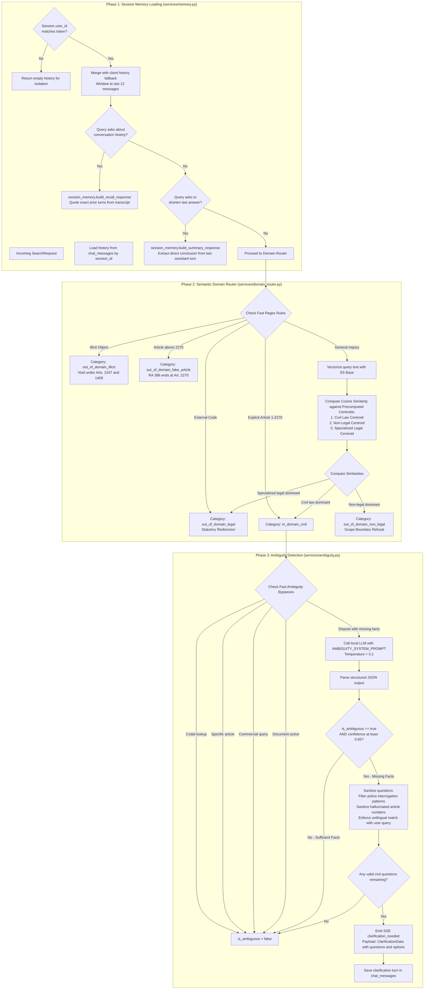
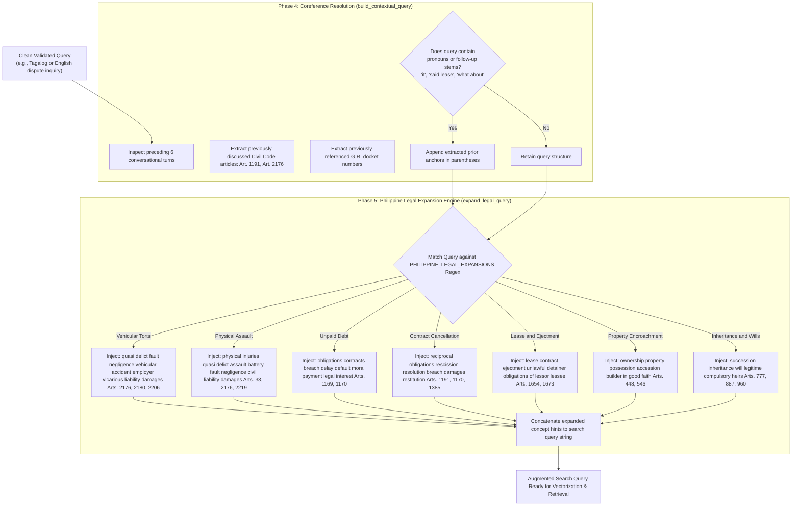
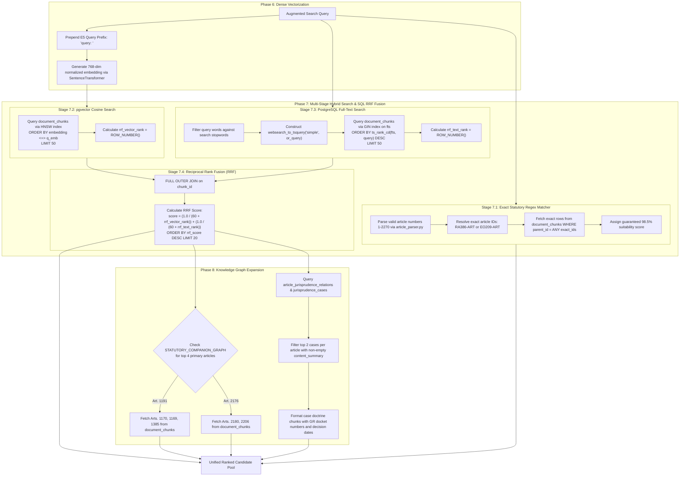
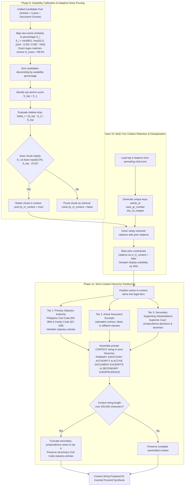
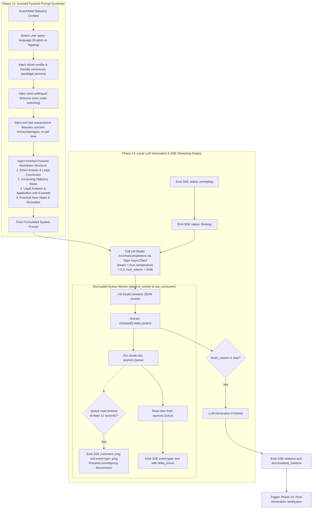
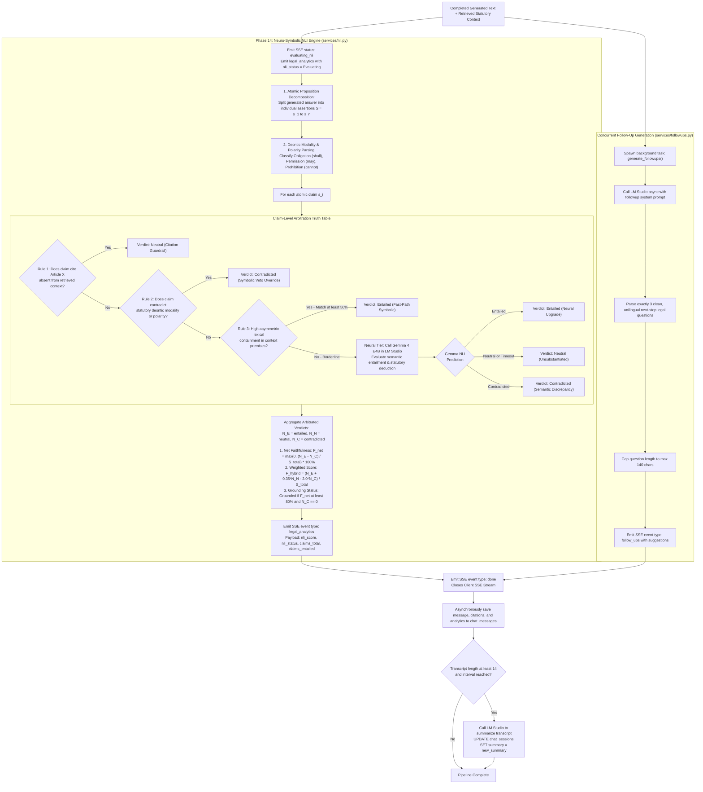

# CIVIL-LEX: Dedicated RAG Pipeline Flowcharts & Execution Logic

This document provides exhaustive, granular flowcharts detailing every phase of the CIVIL-LEX bilingual Retrieval-Augmented Generation (RAG) pipeline for Philippine Civil Law.

---

## 1. Complete RAG Pipeline Master Flowchart (14 Distinct Phases)

```mermaid
flowchart TD
    Start(["User Submits Prompt via Web UI"]) --> QueueGate{"Resource Queue<br/>QueryQueueManager<br/>Active is 0?"}
    
    QueueGate -->|"No - Slot Busy"| Enqueue["Wait in FIFO Queue<br/>Emit SSE status: queued<br/>Display Position in UI"]
    Enqueue --> AwaitSlot["Await Concurrency Slot Event"]
    AwaitSlot --> AcquireSlot["Acquire Slot<br/>Emit SSE status: embedding"]
    QueueGate -->|"Yes - Slot Free"| AcquireSlot
    
    AcquireSlot --> P1["Phase 1: History Windowing & Session Memory<br/>Load canonical turns from chat_messages by session_id"]
    
    P1 --> CheckMetaQueries{"Meta-Query Check"}
    CheckMetaQueries -->|"History Recall Query"| HistoryRecall["Extract prior queries from transcript<br/>Emit deterministic recall response<br/>Emit SSE done"]
    CheckMetaQueries -->|"Summary Request Query"| SummaryRecall["Extract direct conclusion from last assistant turn<br/>Emit deterministic summary response<br/>Emit SSE done"]
    CheckMetaQueries -->|"Standard Legal Inquiry"| P2["Phase 2: Intent Classification & Semantic Domain Router<br/>services/domain_router.py"]
    
    P2 --> DomainCheck{"Evaluate Query Category"}
    DomainCheck -->|"Out of Domain - Non-Legal"| RefuseNonLegal["Synthesize Civil Code Scope Refusal<br/>List supported civil topics<br/>Emit SSE done"]
    DomainCheck -->|"Out of Domain - Other Legal"| RedirectLegal["Synthesize Statutory Redirection<br/>Identify competent agency: BIR, DOLE, PNP<br/>Emit SSE done"]
    DomainCheck -->|"Out of Domain - Fake Article"| RefuseFakeArticle["Inform user Civil Code concludes at Art. 2270<br/>Emit SSE done"]
    DomainCheck -->|"Out of Domain - Illicit Object"| RefuseIllicit["Refuse illegal object under Arts. 1347 and 1409<br/>Emit SSE done"]
    
    DomainCheck -->|"In-Domain Civil Law"| P3["Phase 3: Pre-Retrieval Ambiguity Detection<br/>services/ambiguity.py"]
    
    P3 --> AmbiguityCheck{"Critical Legal<br/>Facts Missing?"}
    AmbiguityCheck -->|"Yes - Ambiguous Dispute"| EmitClarification["Emit SSE clarification_needed<br/>Send interactive questions & options<br/>Save state and Emit SSE done"]
    AmbiguityCheck -->|"No - Sufficient Facts"| P4["Phase 4: Conversational Coreference & Context Augmentation<br/>Resolve pronouns using preceding 6 turns"]
    
    P4 --> P5["Phase 5: Philippine Legal Expansion Engine<br/>Map Tagalog/Taglish expressions to statutory concepts"]
    P5 --> P6["Phase 6: Dense Query Vectorization<br/>Prepend 'query: ' prefix to intfloat/multilingual-e5-base"]
    P6 --> P7["Phase 7: Multi-Stage Hybrid Retrieval<br/>Exact Match + HNSW Cosine + PostgreSQL GIN FTS + RRF k=60"]
    P7 --> P8["Phase 8: Knowledge Graph Expansion<br/>Statutory Companion Graph + Linked Supreme Court Cases"]
    P8 --> P9["Phase 9: Suitability Scoring & Adaptive Noise Pruning<br/>Drop delta over 22% from top anchor; absolute floor = 62.0%"]
    P9 --> P10["Phase 10: Multi-Turn Citation Retention & Deduplication<br/>Union with top 6 prior citations, dampening non-context items"]
    P10 --> P11["Phase 11: Strict Context Hierarchy Partitioning<br/>Statutory Primacy over Document Excerpts over Jurisprudence"]
    P11 --> P12["Phase 12: Inverted Pyramid Prompt Synthesis<br/>Direct Answer to Statutory Basis to Analysis to Next Steps"]
    P12 --> P13["Phase 13: Local LLM Generation & Server-Sent Events Streaming<br/>Stream delta tokens via LM Studio Gemma 4; keepalive pings"]
    P13 --> P14["Phase 14: Post-Generation Neuro-Symbolic NLI Verification & Follow-Ups<br/>Symbolic veto + Gemma arbitration; generate 3 unilingual follow-ups"]
    
    P14 --> PersistDB["Save assistant message, citations & analytics to chat_messages"]
    PersistDB --> ReleaseSlot["Release QueryQueueManager Slot<br/>Wake next FIFO waiter in line"]
    ReleaseSlot --> End(["Complete"])
```

---

## 2. Pre-Retrieval Gating Flowchart (Phases 1 to 3)

This flowchart details session memory loading, domain classification, and interactive ambiguity resolution:

---

## 3. Query Augmentation & Legal Expansion Flowchart (Phases 4 and 5)

---

## 4. Multi-Stage Hybrid Retrieval & Graph Expansion Flowchart (Phases 6 to 8)

---

## 5. Scoring, Stratification & Context Partitioning Flowchart (Phases 9 to 11)

---

## 6. Prompt Assembly & Server-Sent Events Streaming Flowchart (Phases 12 and 13)

---

## 7. Post-Generation Verification & Follow-Up Engine Flowchart (Phase 14)

