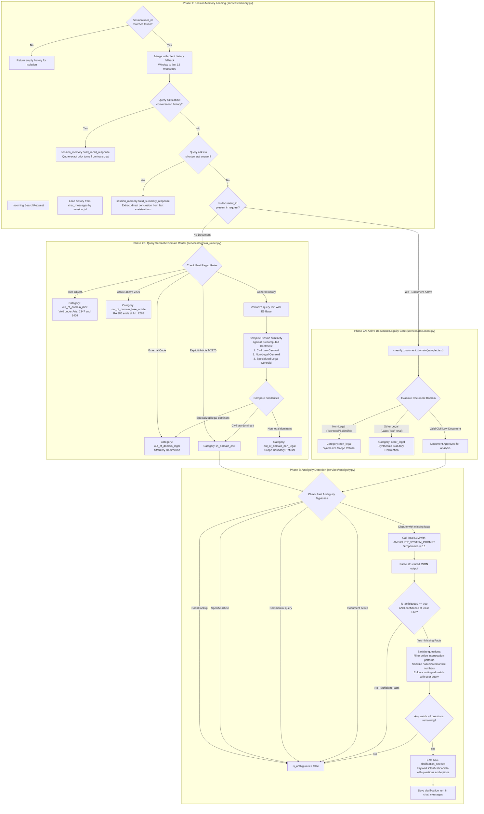
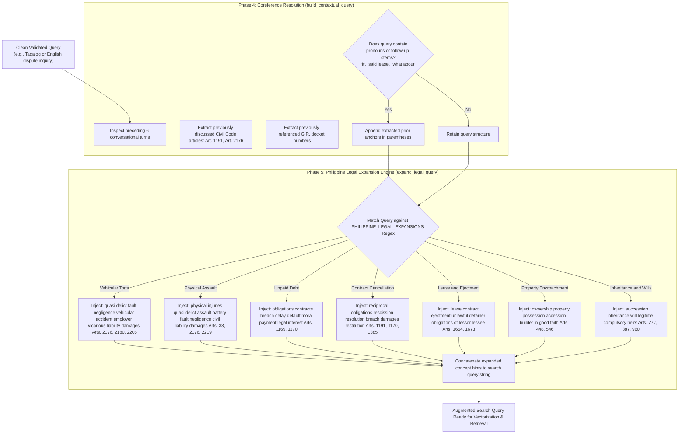
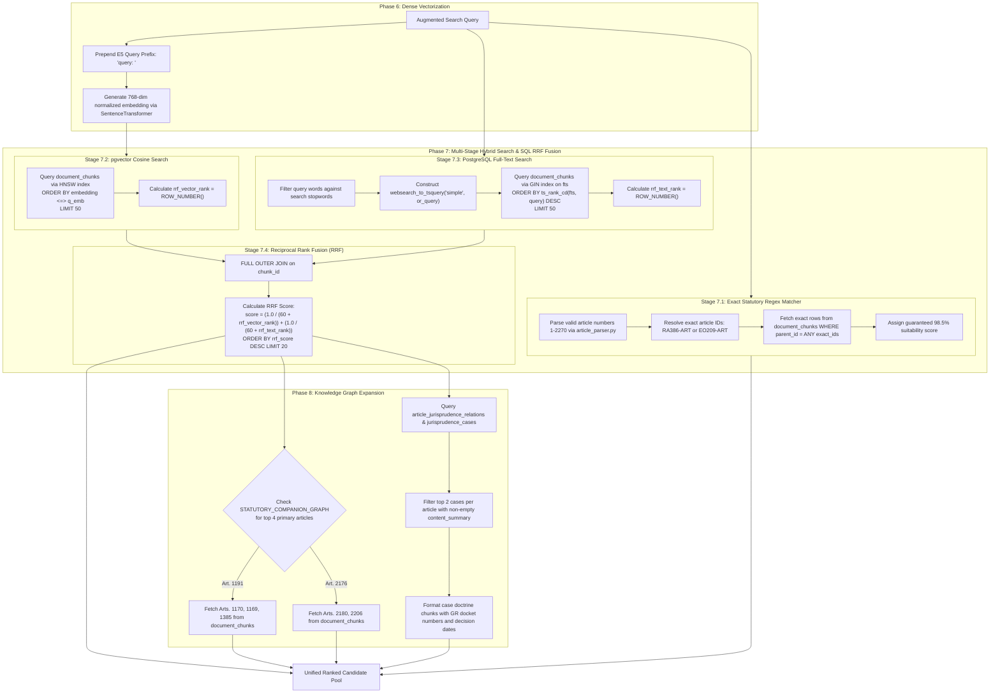
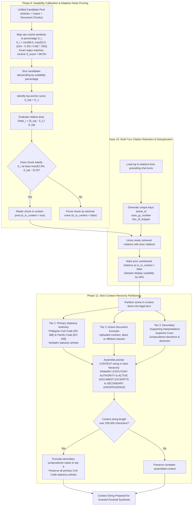
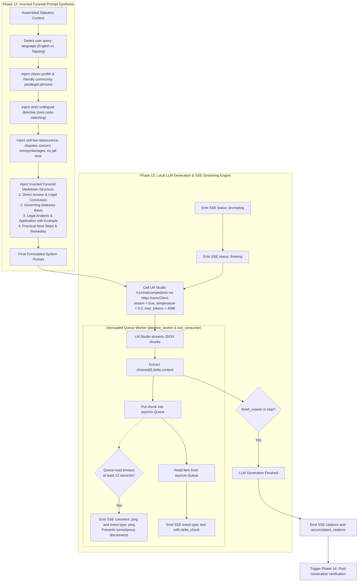
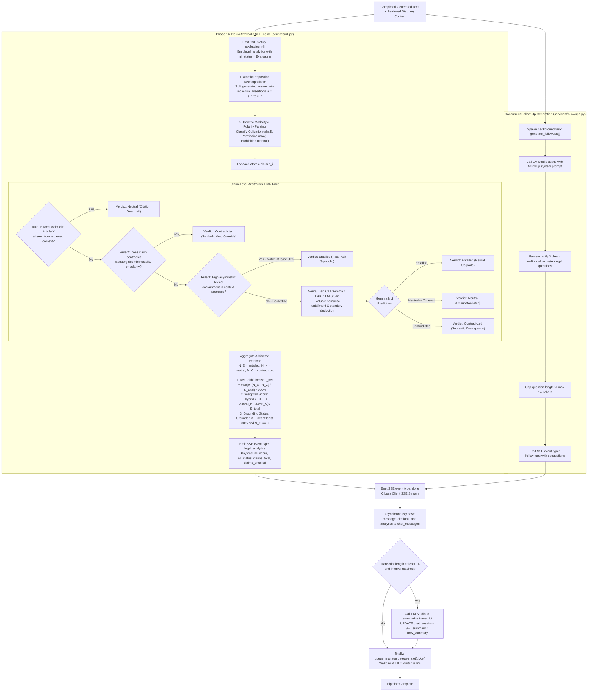

# CIVIL-LEX: Dedicated RAG Pipeline Flowcharts & Execution Logic

This document provides exhaustive, granular flowcharts detailing every phase of the CIVIL-LEX bilingual Retrieval-Augmented Generation (RAG) pipeline for Philippine Civil Law.

---

## 1. Complete RAG Pipeline Master Flowchart (14 Distinct Phases)

The master pipeline is architected around a strict **Separation of Concerns (SoC)** model across 10 decoupled layers. Each layer maintains its own boundary, input/output contract, and fault isolation barrier:

```mermaid
flowchart TD
    subgraph Layer1 ["1. Presentation & Transport Gateway (Edge / Proxy)"]
        direction TB
        ClientReq(["Client Submits Prompt via Web UI"]) --> ExpressGateway["Node.js Express 5 API Gateway<br/>Validate Auth, Headers & Session Tokens"]
        ExpressGateway --> StreamJobInit["Stream Job Registration<br/>stream_jobs.create() -> Emit SSE: job (job_id)"]
    end

    subgraph Layer2 ["2. Session State & Fast-Path Memory (Phase 1)"]
        direction TB
        StreamJobInit --> LoadMemory["Load Canonical History<br/>services/memory.py: chat_messages"]
        LoadMemory --> CheckMetaQuery{"Meta-Query Check<br/>is_history_recall or<br/>is_summary_request?"}
        CheckMetaQuery -->|"History Recall"| FastRecall["session_memory.build_recall_response<br/>Deterministic recall from transcript"]
        CheckMetaQuery -->|"Summary Request"| FastSummary["session_memory.build_summary_response<br/>Extract direct answer from prior turn"]
        FastRecall --> FastSSE["Emit SSE: status, text, done<br/>(Bypasses GPU Queue completely)"]
        FastSummary --> FastSSE
        FastSSE --> FastPersist["Save turn to chat_messages"]
        FastPersist --> FastComplete(["Fast-Path Turn Complete"])
    end

    subgraph Layer3 ["3. Hardware Resource & Concurrency Governor"]
        direction TB
        CheckMetaQuery -->|"Standard Legal Inquiry"| CheckReadiness{"Model Readiness Probe<br/>check_model_readiness()"}
        CheckReadiness -->|"LM Studio Offline"| HaltOffline["Emit SSE error: Model not ready<br/>Halt pipeline before queue"]
        CheckReadiness -->|"Model Online"| EnterQueue["queue_manager.enter_queue()<br/>Register ticket for 6GB VRAM slot"]
        EnterQueue --> ConcurrencyGate{"Active Slots < 1?<br/>(Strict VRAM Guard)"}
        ConcurrencyGate -->|"No - Slot Busy"| EnqueueWait["FIFO Waiters Queue<br/>Emit SSE status: queued (#k)<br/>Periodic keepalive status updates"]
        EnqueueWait --> AwaitEvent["Await Concurrency Slot Event"]
        AwaitEvent --> GrantSlot["Grant VRAM Slot<br/>Emit SSE status: embedding"]
        ConcurrencyGate -->|"Yes - Slot Free"| GrantSlot
    end

    subgraph Layer4 ["4. Cognitive Scope & Ambiguity Guardrails (Phases 2 & 3)"]
        direction TB
        GrantSlot --> DocGate{"Document Uploaded<br/>(document_id present)?"}
        DocGate -->|"Yes"| EvalDocLegality{"classify_document_domain()<br/>Is document valid civil law?"}
        EvalDocLegality -->|"Non-Legal Document"| RefuseDocNonLegal["Synthesize Scope Refusal<br/>List supported civil contracts<br/>Emit SSE citations, text, done"]
        EvalDocLegality -->|"Other Legal Document"| RedirectDocLegal["Synthesize Statutory Redirection<br/>Identify competent agency: DOLE/BIR/PNP<br/>Emit SSE citations, text, done"]
        EvalDocLegality -->|"Valid Civil Document"| AmbiguityDetector

        DocGate -->|"No Document"| SemanticRouter["Phase 2: Semantic Domain Router<br/>services/domain_router.py"]
        SemanticRouter --> DomainClassify{"Evaluate Query Domain<br/>Fast Regex + E5 Centroids"}
        DomainClassify -->|"Non-Legal Inquiry"| RefuseNonLegal["Synthesize Scope Boundary Refusal<br/>List supported civil law topics<br/>Emit SSE citations, text, done"]
        DomainClassify -->|"Specialized Legal Inquiry"| RedirectLegal["Synthesize Statutory Redirection<br/>Map to Labor/Tax/Penal statute & agency<br/>Sanitize hallucinated external statutes<br/>Emit SSE citations, text, done"]
        DomainClassify -->|"Out-of-Bounds Article"| RefuseFakeArticle["Boundary Notice: RA 386 ends at Art. 2270<br/>Clarify penal/theft under RPC<br/>Emit SSE citations, text, done"]
        DomainClassify -->|"Illicit Contract Object"| RefuseIllicit["Refuse illegal object under Arts. 1347 & 1409<br/>Emit SSE citations, text, done"]
        DomainClassify -->|"In-Domain Civil Law"| AmbiguityDetector["Phase 3: Pre-Retrieval Ambiguity Detection<br/>services/ambiguity.py"]

        AmbiguityDetector --> AmbiguityGate{"Ambiguity Gating<br/>is_ambiguous AND<br/>confidence >= 0.65?"}
        AmbiguityGate -->|"Yes - Missing Facts"| EmitClarification["Emit SSE clarification_needed<br/>Send interactive multi-choice options<br/>Save turn state & Emit SSE done"]
        AmbiguityGate -->|"No - Sufficient Facts"| ProceedToAugmentation["Proceed to Query Formulation"]
    end

    subgraph Layer5 ["5. Query Engineering & Legal Expansion (Phases 4 & 5)"]
        direction TB
        ProceedToAugmentation --> P4Coreference["Phase 4: Conversational Coreference<br/>build_contextual_query(): Resolve pronouns from prior 6 turns"]
        P4Coreference --> P5Expansion["Phase 5: Philippine Legal Expansion Engine<br/>expand_legal_query(): Map Tagalog/Taglish to statutory anchors"]
    end

    subgraph Layer6 ["6. Hybrid Knowledge Retrieval & Graph Expansion (Phases 6, 7 & 8)"]
        direction TB
        P5Expansion --> P6Vectorize["Phase 6: Dense Vectorization<br/>SentenceTransformer: multilingual-e5-base ('query: ' prefix)"]
        P6Vectorize --> P7Hybrid["Phase 7: Tri-Search Hybrid Retrieval (search_with_embedding)<br/>1. Exact Match (Arts 1-2270, G.R. Nos.)<br/>2. pgvector HNSW Cosine Search<br/>3. PostgreSQL GIN Full-Text Search (ts_rank_cd)<br/>4. SQL Reciprocal Rank Fusion (RRF k=60)"]
        P7Hybrid --> P8Graph["Phase 8: Knowledge Graph Expansion<br/>STATUTORY_COMPANION_GRAPH + Linked Landmark Supreme Court Cases"]
    end

    subgraph Layer7 ["7. Evidence Calibration & Context Stratification (Phases 9, 10 & 11)"]
        direction TB
        P8Graph --> P9Calibration["Phase 9: Suitability Calibration & Adaptive Pruning<br/>Cosine to % calibration; prune delta > 22% from anchor; floor = 62.0%"]
        P9Calibration --> P10Deduplication["Phase 10: Multi-Turn Citation Retention & Deduplication<br/>Union top 6 prior citations; dampen unretrieved items by 30%"]
        P10Deduplication --> P11Hierarchy["Phase 11: Strict Context Hierarchy Partitioning<br/>Tier 1: Verbatim Articles -> Tier 2: Doc Excerpts -> Tier 3: Jurisprudence"]
    end

    subgraph Layer8 ["8. Inverted Pyramid Synthesis & Decoupled Streaming (Phases 12 & 13)"]
        direction TB
        P11Hierarchy --> P12Prompt["Phase 12: Inverted Pyramid Prompt Synthesis<br/>Citizen persona + unilingual directive + 4-tier markdown structure"]
        P12Prompt --> P13StreamWorker["Phase 13: Local LLM Generation & Decoupled Streaming<br/>Call LM Studio Gemma 4; decouple via asyncio.Queue & 12s heartbeat pings"]
        P13StreamWorker --> StreamTokens["Stream delta tokens via SSE event: text"]
        StreamTokens --> ReconcileCitations["Reconcile citations against generated text<br/>Emit SSE citations and accumulated_citations"]
    end

    subgraph Layer9 ["9. Neuro-Symbolic Verification & Faithfulness Audit (Phase 14)"]
        direction TB
        ReconcileCitations --> P14NLI["Phase 14: Neuro-Symbolic NLI Engine (services/nli.py)"]
        ReconcileCitations -.->|"Concurrent Async Task"| GenFollowups["Concurrent Follow-Up Generation<br/>services/followups.py: 3 unilingual questions"]
        P14NLI --> ClaimDecomposition["Atomic Claim Decomposition & Deontic Modality Parsing (shall, may, cannot)"]
        ClaimDecomposition --> ArbitrationTruthTable["4-Tier Arbitration Truth Table:<br/>1. Citation Guardrail (Article in context?)<br/>2. Deontic Symbolic Veto (Modality match?)<br/>3. Horn Clause Fast-Path (Containment >= 50%)<br/>4. Neural Tier (Gemma 4 NLI entailment check)"]
        ArbitrationTruthTable --> EmitAnalytics["Emit SSE event: legal_analytics (nli_score, nli_status)"]
        GenFollowups --> EmitFollowups["Emit SSE event: follow_ups"]
        EmitAnalytics --> EmitStreamDone["Emit SSE event: done<br/>(Closes Client SSE Stream)"]
        EmitFollowups --> EmitStreamDone
    end

    subgraph Layer10 ["10. Persistence, Analytics & Hardware Lifecycle"]
        direction TB
        RefuseDocNonLegal --> EarlyExitDone["Emit SSE done"]
        RedirectDocLegal --> EarlyExitDone
        RefuseNonLegal --> EarlyExitDone
        RedirectLegal --> EarlyExitDone
        RefuseFakeArticle --> EarlyExitDone
        RefuseIllicit --> EarlyExitDone
        EmitClarification --> EarlyExitDone

        EmitStreamDone --> PostStreamBridge["Post-Stream Execution Hand-off"]
        EarlyExitDone --> PostStreamBridge
        PostStreamBridge --> PersistDB["Save assistant message, citations & analytics to chat_messages"]
        PersistDB --> CheckSummaryRefresh{"Transcript length >= 14<br/>and interval reached?"}
        CheckSummaryRefresh -->|"Yes"| RefreshSummary["Call LM Studio to summarize transcript<br/>UPDATE chat_sessions SET summary"]
        CheckSummaryRefresh -->|"No"| ReleaseVRAMSlot["finally: queue_manager.release_slot(ticket)<br/>Wake next FIFO waiter in line"]
        RefreshSummary --> ReleaseVRAMSlot
        ReleaseVRAMSlot --> PipelineComplete(["Pipeline Complete"])
    end
```

---

## 2. Pre-Retrieval Gating Flowchart (Phases 1 to 3)

This flowchart details session memory loading, dual-track domain classification (document vs query), and interactive ambiguity resolution:

---

## 3. Query Augmentation & Legal Expansion Flowchart (Phases 4 and 5)

---

## 4. Multi-Stage Hybrid Retrieval & Graph Expansion Flowchart (Phases 6 to 8)

---

## 5. Scoring, Stratification & Context Partitioning Flowchart (Phases 9 to 11)

---

## 6. Prompt Assembly & Server-Sent Events Streaming Flowchart (Phases 12 and 13)

---

## 7. Post-Generation Verification & Follow-Up Engine Flowchart (Phase 14)

---

## 8. Separation of Concerns Architecture Matrix

| Architectural Layer / Concern | Responsible Code Module(s) | Primary Invariant / Single Responsibility | Key Inputs | Clean Outputs / Interfaces |
| :--- | :--- | :--- | :--- | :--- |
| **1. Presentation & Transport Gateway** | `backend-node/src/routes/chat.js` `stream_jobs.py` | HTTP/SSE transport negotiation, client token validation, reconnectable job ticket creation. | Raw HTTP Request, Auth Headers | `job_id`, SSE stream handle, keepalive pings |
| **2. Session State & Fast-Path Memory** | `services/memory.py` | Transcript windowing (last 12 turns), user-level data isolation, and instant deterministic meta-query resolution. | `session_id`, `user_id`, query string | Canonical history, deterministic recall/summary (zero GPU cost) |
| **3. Hardware Resource & Concurrency Governor** | `core/queue_manager.py` `services/llm_client.py` | Strict 6GB VRAM hardware safety (`max_concurrent = 1`), model health validation, and FIFO request scheduling. | Ingress ticket request | Execution slot acquisition, queue position `#k` SSE events |
| **4. Cognitive Scope & Ambiguity Guardrails** | `services/document.py` `services/domain_router.py` `services/ambiguity.py` | Gating inputs to Philippine Civil Law (RA 386 / EO 209), sanitizing external statute hallucinations, and clarifying under-specified disputes. | Query text, document chunks, session history | Validated civil intent OR graceful scope refusal / statutory redirection / interactive clarification |
| **5. Query Engineering & Legal Expansion** | `main.py` (`build_contextual_query`, `expand_legal_query`) | Resolving conversational pronouns and augmenting colloquial Tagalog/Taglish disputes with statutory legal anchors. | Raw query, prior 6 turns, document name | Contextualized augmented search query |
| **6. Hybrid Knowledge Retrieval & Graph Expansion** | `main.py` (`search_with_embedding`) | High-recall hybrid information retrieval combining dense semantic vectors, sparse full-text search, exact statutory regex, and graph traversal. | Augmented query string, 768-dim E5 vector | Merged candidate pool (statutes, contracts, Supreme Court cases) |
| **7. Evidence Calibration & Context Stratification** | `main.py` (`rank_and_stratify_citations`) | Calibrating suitability scores to human-interpretable percentages, pruning semantic noise, and partitioning active context into 3 strict legal tiers. | Candidate citations, multi-turn prior citations | Calibrated citations, partitioned context string (Tier 1 > Tier 2 > Tier 3) |
| **8. Inverted Pyramid Synthesis & Decoupled Streaming** | `services/llm_client.py` `main.py` (`pipeline_worker`) | Assembling citizen-tailored inverted pyramid prompts and decoupling GPU token generation from client network latency via async buffers. | System prompt, user query, partitioned context | Delta character tokens (`text`), reconciled citations |
| **9. Neuro-Symbolic Verification & Faithfulness Audit** | `services/nli.py` `services/followups.py` | Decomposing claims, enforcing statutory modality guardrails, running neural entailment checks, and generating unilingual follow-up questions. | Generated answer text, retrieved context, user language | Faithfulness analytics (`nli_score`, `nli_status`), 3 follow-up suggestions |
| **10. Persistence, Analytics & Hardware Lifecycle** | `main.py` (`finally:` block) PostgreSQL / Supabase | Asynchronous conversation persistence, background session summary updates, and guaranteed hardware VRAM slot release. | Final answer, citations, NLI payload, queue ticket | Persisted database records, released VRAM slot waking next FIFO waiter |

