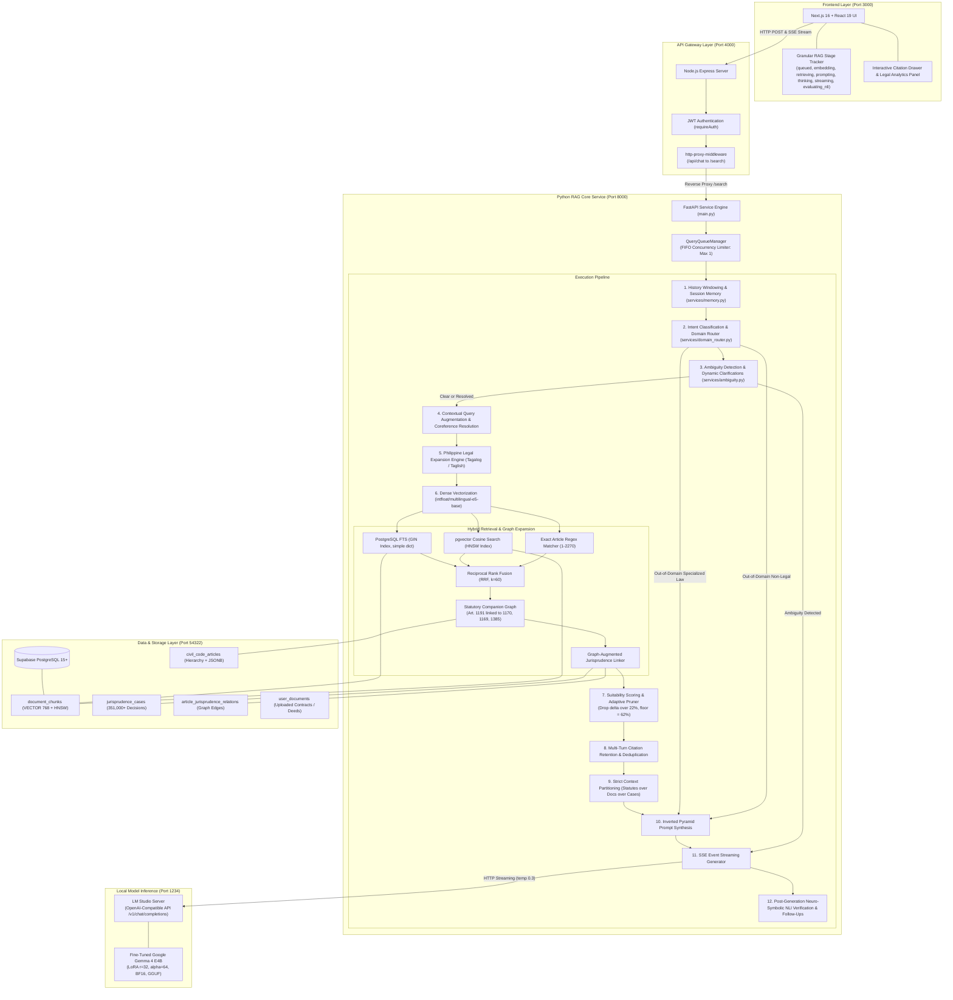

# CIVIL-LEX: Complete Architecture & Engineering Guide to the RAG Pipeline

> **Document Type:** Technical Architecture & System Specification Guide  
> **Project:** CIVIL-LEX (AI-Powered Philippine Civil Law Legal Assistant & RAG System)  
> **Target Audience:** Thesis Committee, Legal Researchers, Software Engineers, and System Architects  
> **Primary Statutory Scope:** Civil Code of the Philippines (Republic Act No. 386) & Family Code of the Philippines (Executive Order No. 209)

---

## Table of Contents

1. [Executive Summary & Engineering Objectives](#1-executive-summary--engineering-objectives)
2. [End-to-End System Architecture](#2-end-to-end-system-architecture)
3. [Complete Inventory of Tools, Frameworks & Models](#3-complete-inventory-of-tools-frameworks--models)
   - [3.1 Core Technologies & Runtime Stack](#31-core-technologies--runtime-stack)
   - [3.2 The Embedding Model (`intfloat/multilingual-e5-base`)](#32-the-embedding-model-intfloatmultilingual-e5-base)
   - [3.3 The Generator Model (Fine-Tuned Gemma 4 E4B via LM Studio)](#33-the-generator-model-fine-tuned-gemma-4-e4b-via-lm-studio)
   - [3.4 Storage & Retrieval Engines (pgvector + PostgreSQL FTS)](#34-storage--retrieval-engines-pgvector--postgresql-fts)
4. [Knowledge Base & Database Architecture](#4-knowledge-base--database-architecture)
   - [4.1 Database Schema & Index Design](#41-database-schema--index-design)
   - [4.2 Statutory Corpus Ingestion](#42-statutory-corpus-ingestion)
   - [4.3 Jurisprudence Graph Ingestion](#43-jurisprudence-graph-ingestion)
   - [4.4 Active Document Ingestion & OCR Pipeline](#44-active-document-ingestion--ocr-pipeline)
5. [The Step-by-Step RAG Pipeline Logic (14 Distinct Phases)](#5-the-step-by-step-rag-pipeline-logic-14-distinct-phases)
   - [Phase 1: Ingestion & Multi-Turn History Windowing](#phase-1-ingestion--multi-turn-history-windowing)
   - [Phase 2: Intent Classification & Semantic Domain Boundary Guardrails](#phase-2-intent-classification--semantic-domain-boundary-guardrails)
   - [Phase 3: Pre-Retrieval Ambiguity Detection & Dynamic Clarification Questions](#phase-3-pre-retrieval-ambiguity-detection--dynamic-clarification-questions)
   - [Phase 4: Conversational Coreference & Contextual Query Augmentation](#phase-4-conversational-coreference--contextual-query-augmentation)
   - [Phase 5: Philippine Legal Expansion Engine (Tagalog/Taglish Normalization)](#phase-5-philippine-legal-expansion-engine-tagalogtaglish-normalization)
   - [Phase 6: Dense Query Vectorization with E5](#phase-6-dense-query-vectorization-with-e5)
   - [Phase 7: Multi-Stage Hybrid Retrieval (Exact + Vector + FTS + RRF)](#phase-7-multi-stage-hybrid-retrieval-exact--vector--fts--rrf)
   - [Phase 8: Knowledge Graph Expansion (Statutory Companion Graph & Jurisprudence Linker)](#phase-8-knowledge-graph-expansion-statutory-companion-graph--jurisprudence-linker)
   - [Phase 9: Suitability Scoring, Stratification & Adaptive Noise Pruning](#phase-9-suitability-scoring-stratification--adaptive-noise-pruning)
   - [Phase 10: Multi-Turn Citation Retention & Deduplication](#phase-10-multi-turn-citation-retention--deduplication)
   - [Phase 11: Strict Context Hierarchy Partitioning & Truncation Budget](#phase-11-strict-context-hierarchy-partitioning--truncation-budget)
   - [Phase 12: Inverted Pyramid Prompt Synthesis & Citizen-Centric Formatting](#phase-12-inverted-pyramid-prompt-synthesis--citizen-centric-formatting)
   - [Phase 13: Local LLM Generation & Server-Sent Events (SSE) Streaming](#phase-13-local-llm-generation--server-sent-events-sse-streaming)
   - [Phase 14: Post-Generation Neuro-Symbolic NLI Verification & Concurrent Follow-Ups](#phase-14-post-generation-neuro-symbolic-nli-verification--concurrent-follow-ups)
6. [Mathematical Formulations](#6-mathematical-formulations)
   - [6.1 Reciprocal Rank Fusion (RRF)](#61-reciprocal-rank-fusion-rrf)
   - [6.2 Scaled Cosine Suitability Mapping for E5 Base](#62-scaled-cosine-suitability-mapping-for-e5-base)
   - [6.3 Adaptive Noise Drop Threshold (Delta_i)](#63-adaptive-noise-drop-threshold-delta_i)
   - [6.4 Neuro-Symbolic Hybrid Natural Language Inference (NLI) Grounding Score](#64-neuro-symbolic-hybrid-natural-language-inference-nli-grounding-score)
7. [Empirical Verification & Quality Benchmarks (RAGAS & ISO/IEC 25010)](#7-empirical-verification--quality-benchmarks-ragas--isoiec-25010)
8. [Concrete End-to-End Execution Trace](#8-concrete-end-to-end-execution-trace)

---

## 1. Executive Summary & Engineering Objectives

General-purpose conversational Large Language Models (such as vanilla GPT, Claude, or Llama) fail when deployed in Philippine civil law settings. They frequently suffer from:
1. **Jurisdictional Hallucinations**: Citing US Common Law doctrines (e.g. Castle Doctrine), foreign civil codes (e.g., California Civil Code or Spanish Civil Code in outdated forms), or non-existent statutory numbers (> 2270).
2. **Doctrine Misapplication**: Conflating distinct legal concepts (e.g., applying implied trust provisions or property easements to breach-of-contract or unpaid loan disputes).
3. **Colloquial Disconnect**: Inability to map everyday Filipino/Taglish lay terms (*"nabangga ng delivery truck"*, *"ayaw magbayad ng utang"*, *"nagbayad ng advance tapos tinakbuhan"*) to strict statutory articles.
4. **Procedural Vagueness**: Failing to articulate mandatory pre-litigation requisites (*Katarungang Pambarangay* under RA 7160) and competent trial courts under current monetary jurisdictional thresholds (RA 11576).

**CIVIL-LEX** solves these issues through a specialized, deterministic, multi-stage **Retrieval-Augmented Generation (RAG)** pipeline designed specifically for the **Civil Code of the Philippines (Republic Act No. 386)** and the **Family Code of the Philippines (Executive Order No. 209)**.

```
+---------------------------------------------------------------------------------------------------------+
|                                    CIVIL-LEX CORE PHILOSOPHY                                            |
|                                                                                                         |
|  1. Statutory Primacy: The enacted text of RA 386 / EO 209 is controlling. Case law is secondary.       |
|  2. Semantic Integrity: No chunk enters the prompt unless verified by dynamic thresholding.            |
|  3. Actionable Procedure: Every substantive advice ends with a structured Legal Action Summary.         |
|  4. Strict Domain Gating: Non-civil or non-legal inquiries are constructively routed or refused.        |
+---------------------------------------------------------------------------------------------------------+
```

---

## 2. End-to-End System Architecture

CIVIL-LEX is built on a decoupled, three-tier microservice architecture:



---

## 3. Complete Inventory of Tools, Frameworks & Models

### 3.1 Core Technologies & Runtime Stack

| Component | Framework / Library | Version | Engineering Role |
| :--- | :--- | :--- | :--- |
| **Frontend Framework** | `Next.js` (App Router, React 19) | `16.0.0` | Client user interface, SSE consumption, citation drawer rendering, and Table of Contents navigation. |
| **API Gateway** | `Node.js` + `Express` | `5.2.1` | Authentication check (`requireAuth`), request routing, reverse proxy, profile management, and static file serving. |
| **API Framework** | `fastapi` | $\ge 0.100.0$ | Asynchronous HTTP engine providing SSE streaming endpoints (`/search`), `/extract`, and `/cancel`. |
| **ASGI Web Server** | `uvicorn` | $\ge 0.22.0$ | High-throughput asynchronous event loop server hosting the FastAPI application. |
| **Relational Client** | `psycopg2-binary` | $\ge 2.9.6$ | Low-level PostgreSQL driver with `RealDictCursor` and connection pooling. |
| **Data Validation** | `pydantic` | $\ge 2.0.0$ | Strict request/response payload typing (`SearchRequest`, `ExtractRequest`, etc.). |
| **HTTP Client** | `httpx` | $\ge 0.24.0$ | Async streaming client interfacing with LM Studio's `/v1/chat/completions`. |
| **PDF Extraction** | `pymupdf` (`fitz`) | $\ge 1.22.0$ | High-speed C-level text and layout extraction from uploaded PDF contracts. |
| **OCR Fallback** | `pytesseract` + `Pillow`| $\ge 0.3.10$ | Optical Character Recognition for scanned affidavits, deeds, and image uploads. |
| **DOCX Parsing** | `python-docx` | $\ge 0.8.11$ | Paragraph and table text extraction from Microsoft Word contract drafts. |
| **Dense Embeddings** | `sentence-transformers` | $\ge 2.2.0$ | Execution engine for `intfloat/multilingual-e5-base` dense vector embeddings. |
| **Concurrency Queue** | `QueryQueueManager` | Internal | Unified in-memory FIFO queue strictly enforcing 1-query concurrency to protect 6GB VRAM GPUs. |

### 3.2 The Embedding Model (`intfloat/multilingual-e5-base`)

* **Model Identifier**: `intfloat/multilingual-e5-base`
* **Backbone**: Multilingual RoBERTa architecture pre-trained with weak supervision on 1B+ text pairs and fine-tuned on diverse retrieval tasks.
* **Vector Dimensionality**: $d = 768$ dimensions.
* **Normalization**: $L_2$ normalized vector embeddings ($\|\mathbf{v}\|_2 = 1.0$), ensuring that Inner Product is mathematically equivalent to Cosine Similarity.
* **Asymmetric Prefix Conditioning**:
  - Passage Prefix: `passage: <text>` (Applied during corpus ingestion and document extraction).
  - Query Prefix: `query: <text>` (Applied during real-time user query search).
* **Why this model was chosen**:
  1. **Bilingual Tagalog-English Alignment**: Filipino citizens often describe legal problems in Tagalog or Taglish (*"sinuntok ako ng kapitbahay ko at pinalo ang kotse ko"*), while statutory provisions in RA 386 are codified strictly in English. Multilingual E5 maps both linguistic spaces into an aligned high-dimensional vector geometry.
  2. **Asymmetric Retrieval Optimization**: Distinguishes between concise informational queries and verbose statutory/jurisprudential candidate chunks.

### 3.3 The Generator Model (Fine-Tuned Gemma 4 E4B via LM Studio)

* **Base Foundation Model**: `google/gemma-4-E4B-it` (Google Gemma 4, 4 Billion Parameter Instruction-Tuned).
* **Context Window**: 128,000 tokens (native).
* **Fine-Tuning Architecture**:
  * **Target Hardware**: NVIDIA H100 SXM (80GB VRAM).
  * **Method**: Parameter-Efficient LoRA (Low-Rank Adaptation) via Hugging Face PEFT/Transformers.
  * **LoRA Rank ($r$)**: $32$ (captures intricate statutory exceptions and cross-article dependencies).
  * **LoRA Alpha ($\alpha$)**: $64$ (Standard scaling ratio $\alpha/r = 2.0$).
  * **Target Attention & MLP Modules**: `q_proj`, `k_proj`, `v_proj`, `o_proj`, `gate_proj`, `up_proj`, `down_proj`.
  * **Precision**: Pure 16-bit Bfloat16 (`bf16: true`), eliminating quantization noise during gradient backpropagation.
  * **Attention Kernel**: `sdpa` (Scaled Dot-Product Attention) using native PyTorch Hopper kernels.
  * **Optimizer**: Fused AdamW (`adamw_torch_fused`).
* **Deployment Format**:
  * Merged weights exported to **GGUF** format via `finetune/export_gguf.py`.
  * Hosted locally in **LM Studio** exposing an OpenAI-compatible endpoint at `http://10.57.24.131:1234/v1/chat/completions` over ZeroTier SD-WAN.
  * Inference settings: `temperature = 0.3`, `stream = True`, `repetition_penalty = 1.15`.

### 3.4 Storage & Retrieval Engines (pgvector + PostgreSQL FTS)

* **Database Engine**: PostgreSQL 15+ hosted in local Supabase Docker container (Port `54322`).
* **Dense Vector Indexing**: `pgvector` with HNSW (Hierarchical Navigable Small World) index configured for `vector_cosine_ops`.
* **Sparse Lexical Indexing**: Native PostgreSQL `tsvector` using the `simple` dictionary configuration with GIN (Generalized Inverted Index) indexing.
* **Hybrid Fusion**: Reciprocal Rank Fusion (RRF, $k=60$) executed directly in SQL to unify dense vector and sparse keyword search in a single database transaction.

---

## 4. Knowledge Base & Database Architecture

### 4.1 Database Schema & Index Design

```sql
-- 1. Table of Contents & Statutory Articles
CREATE TABLE civil_code_articles (
    article_id TEXT PRIMARY KEY,               -- e.g. 'RA386-ART1191', 'EO209-ART1'
    article_number INT NOT NULL,               -- e.g. 1191
    hierarchy JSONB NOT NULL,                  -- {book, title, chapter, section}
    content TEXT NOT NULL,                     -- Clean enacted statute text
    is_hub BOOLEAN DEFAULT FALSE               -- High-degree citation hub flag
);

-- 2. Supreme Court Decisions (351,000+ Cases)
CREATE TABLE jurisprudence_cases (
    case_uid TEXT PRIMARY KEY,                 -- e.g. 'GR_189871_2012'
    title TEXT NOT NULL,                       -- Case title
    gr_number TEXT,                            -- G.R. No.
    decision_date TEXT,                        -- Promulgation date
    source_url TEXT,                           -- Source link
    content_summary TEXT,                      -- Pre-computed analytical summary
    full_text TEXT                             -- Full unabridged decision text
);

-- 3. Statutory-Jurisprudence Association Graph
CREATE TABLE article_jurisprudence_relations (
    article_id TEXT REFERENCES civil_code_articles(article_id),
    case_uid TEXT REFERENCES jurisprudence_cases(case_uid),
    citation_type TEXT DEFAULT 'mentioned',    -- 'interpreted', 'applied', 'mentioned'
    PRIMARY KEY (article_id, case_uid)
);

-- 4. User Uploaded Documents
CREATE TABLE user_documents (
    id UUID PRIMARY KEY DEFAULT extensions.uuid_generate_v4(),
    user_id UUID REFERENCES auth.users(id) ON DELETE CASCADE,
    filename TEXT NOT NULL,
    file_url TEXT NOT NULL,
    status TEXT CHECK (status IN ('uploading', 'extracting', 'completed', 'rejected_unrelated', 'error')),
    progress INT DEFAULT 0,
    error_message TEXT,
    created_at TIMESTAMPTZ DEFAULT NOW()
);

-- 5. Unified Embeddings & Full-Text Search Table
CREATE TABLE document_chunks (
    chunk_id TEXT PRIMARY KEY,
    parent_type TEXT CHECK (parent_type IN ('article', 'case', 'user_document')),
    parent_id TEXT NOT NULL,                   -- Foreign key to article_id, case_uid, or doc id
    content TEXT NOT NULL,
    legal_topics TEXT[],
    embedding VECTOR(768),                     -- intfloat/multilingual-e5-base vector
    fts TSVECTOR GENERATED ALWAYS AS (to_tsvector('simple', content)) STORED
);

-- Partial Indexes for Fast Partition Retrieval
CREATE INDEX fts_idx ON document_chunks USING GIN (fts);
CREATE INDEX article_vector_idx ON document_chunks USING hnsw (embedding vector_cosine_ops) WHERE parent_type = 'article';
CREATE INDEX article_parent_id_idx ON document_chunks(parent_id) WHERE parent_type = 'article';
CREATE INDEX article_fts_idx ON document_chunks USING gin (fts) WHERE parent_type = 'article';
CREATE INDEX doc_vector_idx ON document_chunks USING hnsw (embedding vector_cosine_ops) WHERE parent_type = 'user_document';
```

### 4.2 Statutory Corpus Ingestion

* **Source Files**: `data/civil_code_rag.jsonl` and `data/family_code_rag.jsonl`.
* **Total Articles**: 2,270 Civil Code articles (RA 386) and 257 Family Code articles (EO 209).
* **Hierarchy Parsing**: Every article is tagged with its formal codification path:
  $$\text{Book} \longrightarrow \text{Title} \longrightarrow \text{Chapter} \longrightarrow \text{Section}$$
* **Chunking Strategy**: Articles $\le 350$ words form atomic $1:1$ chunks. Multi-part articles (e.g., Art. 1409 or Art. 887) are chunked with a 50-word sliding window.

### 4.3 Jurisprudence Graph Ingestion

* **Source Files**: `data/jurisprudence_document.jsonl` and `data/article_case_index.json`.
* **Total Volume**: 351,000+ Supreme Court decisions from 1901 to modern jurisprudence.
* **Graph Linking**: Landmark decisions are mapped to their interpreted Civil Code articles in `article_jurisprudence_relations`. When an article is retrieved, its supporting landmark doctrine is automatically pulled via graph traversal.

### 4.4 Active Document Ingestion & OCR Pipeline

Implemented in [`services/document.py`](file:///home/rence/github_repos/github-repositories-NS/civilex-thesis/service-rag-python/services/document.py):
1. User uploads a contract, deed, or affidavit (`.pdf`, `.docx`, `.png`, `.jpg`, `.txt`).
2. Node.js gateway routes upload to `/extract` background task on Python service.
3. Extraction logic:
   * **PDF**: PyMuPDF (`fitz`) parses text stream. If extracted text $< 100$ characters, automatic fallback executes **Tesseract OCR** at 150 DPI (capped at first 15 pages).
   * **Images**: PIL downsamples to max 2200px, converts alpha channels to RGB, and executes Tesseract OCR with a 25-second timeout.
   * **DOCX**: `python-docx` iterates through paragraphs and tables.
   * **TXT**: UTF-8 stream decoding with error replacement.
4. **Alphanumeric Gate**: If total alphanumeric characters $< 15$, status is set to `'rejected_unrelated'`.
5. **Sliding Window Chunking**: Text is split into 350-word chunks with a 50-word overlap.
6. **Vectorization**: Dense embeddings are generated using `intfloat/multilingual-e5-base` with the `passage: ` prefix and written to `document_chunks` with `parent_type = 'user_document'`. Progress is updated incrementally.

---

## 5. The Step-by-Step RAG Pipeline Logic (14 Distinct Phases)

```
   USER QUERY + HISTORY
             │
             ▼
┌─────────────────────────────────────────────────────────────┐
│ Phase 1: History Windowing & Session Memory                 │
│ - Database-authoritative per-chat history (services/memory) │
│ - History recall and rolling transcript summarization       │
└──────────────────────────┬──────────────────────────────────┘
                           ▼
┌─────────────────────────────────────────────────────────────┐
│ Phase 2: Intent Classification & Semantic Domain Router     │
│ - Semantic Centroids (Civil vs Crime vs Labor vs Tax)       │
│ - Fast paths for illicit contracts (Arts. 1347, 1409)       │
│ - Out-of-bounds article defense (> 2270 in RA 386)          │
└──────────────────────────┬──────────────────────────────────┘
                           ▼
┌─────────────────────────────────────────────────────────────┐
│ Phase 3: Pre-Retrieval Ambiguity Detection                  │
│ - LLM fact-checking for missing critical legal requisites   │
│ - Interactive ClarificationQuestion generation              │
└──────────────────────────┬──────────────────────────────────┘
                           ▼
┌─────────────────────────────────────────────────────────────┐
│ Phase 4: Conversational Coreference & Context Augmentation  │
│ - Resolves pronouns ("it", "said lease", "this")            │
│ - Enriches query with prior turn articles & docket numbers   │
└──────────────────────────┬──────────────────────────────────┘
                           ▼
┌─────────────────────────────────────────────────────────────┐
│ Phase 5: Philippine Legal Expansion Engine                  │
│ - Maps Tagalog/Taglish colloquial terms to codal doctrines   │
└──────────────────────────┬──────────────────────────────────┘
                           ▼
┌─────────────────────────────────────────────────────────────┐
│ Phase 6: Dense Vectorization (E5 Base 'query: ' prefix)     │
└──────────────────────────┬──────────────────────────────────┘
                           ▼
┌─────────────────────────────────────────────────────────────┐
│ Phase 7: Multi-Stage Hybrid Retrieval & RRF Fusion          │
│ - Exact Regex Matcher (Arts. 1-2270) -> Guaranteed 98.5%    │
│ - Dense Vector Cosine Search (pgvector HNSW)                │
│ - Sparse Lexical Search (PostgreSQL FTS GIN, simple dict)   │
│ - Reciprocal Rank Fusion (RRF, k=60)                        │
└──────────────────────────┬──────────────────────────────────┘
                           ▼
┌─────────────────────────────────────────────────────────────┐
│ Phase 8: Knowledge Graph Expansion                          │
│ - Statutory Companion Graph (Art. 1191 -> 1170, 1169, 1385) │
│ - Graph-Augmented Jurisprudence Linker                      │
└──────────────────────────┬──────────────────────────────────┘
                           ▼
┌─────────────────────────────────────────────────────────────┐
│ Phase 9: Suitability Scoring & Adaptive Noise Pruning       │
│ - Cosine to percentage mapping: 52% to 98%                  │
│ - Drop delta > 22% from top anchor; absolute floor = 62.0%  │
└──────────────────────────┬──────────────────────────────────┘
                           ▼
┌─────────────────────────────────────────────────────────────┐
│ Phase 10: Multi-Turn Citation Retention & Deduplication     │
│ - Retains top 6 prior citations across chat turns           │
└──────────────────────────┬──────────────────────────────────┘
                           ▼
┌─────────────────────────────────────────────────────────────┐
│ Phase 11: Strict Context Hierarchy Partitioning             │
│ - Statutory Civil Code (Tier 1) > Doc (Tier 2) > Cases (T3) │
│ - 205,000 character safety budget with secondary truncation │
└──────────────────────────┬──────────────────────────────────┘
                           ▼
┌─────────────────────────────────────────────────────────────┐
│ Phase 12: Inverted Pyramid Prompt Synthesis                 │
│ - Direct Answer -> Statutory Basis -> Analysis -> Next Steps│
└──────────────────────────┬──────────────────────────────────┘
                           ▼
┌─────────────────────────────────────────────────────────────┐
│ Phase 13: Local LLM Generation & Server-Sent Events Stream  │
│ - Stream delta tokens via SSE; periodic ping keepalives     │
└──────────────────────────┬──────────────────────────────────┘
                           ▼
┌─────────────────────────────────────────────────────────────┐
│ Phase 14: Post-Generation NLI Audit & Concurrent Follow-Ups │
│ - Neuro-Symbolic NLI Verification (Deontic + Gemma local)   │
│ - Exactly 3 unilingual follow-up suggestions generated      │
│ - Save assistant message, citations & analytics to database │
└─────────────────────────────────────────────────────────────┘
```

---

### Phase 1: Ingestion & Multi-Turn History Windowing
Implemented in [`services/memory.py`](file:///home/rence/github_repos/github-repositories-NS/civilex-thesis/service-rag-python/services/memory.py):
- Server-authoritative: loads canonical history from `chat_messages` using `session_id`, using client-supplied history only as a fallback.
- Enforces an ownership check to prevent cross-session data leakage.
- Meta-query shortcuts:
  - `is_history_recall_query`: Directly answers user inquiries about previous questions ("what was my first query?") from stored transcripts.
  - `is_summary_request`: Summarizes prior answers directly upon receiving shorthand requests ("in short?", "buod?").
- Rolling summaries: Compresses transcripts into concise summaries when message count $\ge 14$.

---

### Phase 2: Intent Classification & Semantic Domain Boundary Guardrails
Implemented in [`services/domain_router.py`](file:///home/rence/github_repos/github-repositories-NS/civilex-thesis/service-rag-python/services/domain_router.py):
- Pre-computes normalized semantic centroid vectors for Civil Law, Non-Legal topics, and specialized Philippine legal branches (Labor, Criminal, Tax, Corporate, Privacy).
- Fast Regex Rules:
  - Illicit Contracts: Void ab initio under Arts. 1347 and 1409 (e.g. human organ sales, contract violence, contraband).
  - External Statutes: Direct references to Revised Penal Code, Labor Code (PD 442), NIRC Tax Code route to `out_of_domain_legal`.
  - Out-of-bounds Articles: Identifies articles $> 2270$ as non-existent in RA 386.
- Categorization Branches:
  - `in_domain_civil`: Proceeds to hybrid search.
  - `out_of_domain_non_legal`: Refuses non-legal topics without vector search.
  - `out_of_domain_legal`: Constructively redirects user to competent specialized forums (DOLE, BIR, Prosecutor).
  - `out_of_domain_fake_article`: Informs user that the Civil Code strictly concludes at Article 2270.

---

### Phase 3: Pre-Retrieval Ambiguity Detection & Dynamic Clarification Questions
Implemented in [`services/ambiguity.py`](file:///home/rence/github_repos/github-repositories-NS/civilex-thesis/service-rag-python/services/ambiguity.py):
- Analyzes whether in-domain queries describe an ongoing dispute omitting critical legal requisites (e.g. written vs oral agreement, timing for prescription, intentional vs negligent injury).
- Employs fast bypasses for codal lookups, informational questions, commercial price checks, and persona jailbreak attempts.
- Generates 1 to 2 concise clarification questions with 3 to 4 concrete options each.
- Emits SSE event `clarification_needed` and suspends retrieval until user provides answers.

---

### Phase 4: Conversational Coreference & Contextual Query Augmentation
Implemented in `build_contextual_query` ([`main.py`](file:///home/rence/github_repos/github-repositories-NS/civilex-thesis/service-rag-python/main.py)):
- Detects relative pronouns (*it, this, that, said agreement, former, latter*) and short follow-up stems.
- Extracts referenced articles, Supreme Court docket numbers, and topic anchors from the preceding 6 turns.
- Augments fragmentary follow-ups with prior turn context to ensure complete dense semantic retrieval.

---

### Phase 5: Philippine Legal Expansion Engine (Tagalog/Taglish Normalization)
Implemented in `expand_legal_query` ([`main.py`](file:///home/rence/github_repos/github-repositories-NS/civilex-thesis/service-rag-python/main.py)):
- Maps colloquial Filipino expressions to canonical statutory concepts:
  - *"ayaw magbayad ng utang"* $\rightarrow$ `obligations contracts breach delay default mora payment legal interest` (Arts. 1169, 1170).
  - *"nabangga ng delivery truck"* $\rightarrow$ `quasi delict fault negligence vehicular accident employer vicarious liability damages` (Arts. 2176, 2180, 2206).
  - *"pinaalis sa inuupahan"* $\rightarrow$ `lease contract ejectment unlawful detainer obligations of lessor lessee` (Arts. 1654, 1673).

---

### Phase 6: Dense Query Vectorization with E5
Implemented in `compute_embedding` ([`main.py`](file:///home/rence/github_repos/github-repositories-NS/civilex-thesis/service-rag-python/main.py)):
- Formats search queries with the mandatory E5 instruction prefix: `query: <contextualized_query>`.
- Generates a 768-dimensional $L_2$ normalized embedding vector using `intfloat/multilingual-e5-base`.

---

### Phase 7: Multi-Stage Hybrid Retrieval (Exact + Vector + FTS + RRF)
Implemented in `search_with_embedding` ([`main.py`](file:///home/rence/github_repos/github-repositories-NS/civilex-thesis/service-rag-python/main.py)):
1. **Exact Statutory Regex Matcher**: Validates article numbers 1 to 2270 via `core/article_parser.py` and fetches exact codal provisions, assigning a 98.5% suitability score.
2. **Dense Vector Search**: Queries `document_chunks` using `pgvector` HNSW index (`embedding <=> q_emb`) for top 50 candidates.
3. **Sparse Lexical Search**: Queries `document_chunks` using native PostgreSQL FTS GIN index (`ts_rank_cd(fts, query)`) for top 50 candidates.
4. **Reciprocal Rank Fusion**: Merges dense and sparse ranks via SQL full outer join using smoothing constant $k=60$.

---

### Phase 8: Knowledge Graph Expansion (Statutory Companion Graph & Jurisprudence Linker)
- **Statutory Companion Graph**: Automatic expansion incorporating interconnected provisions:
  - Article 1191 (Implied Rescission) $\leftrightarrow$ Articles 1170 (Breach Liability), 1169 (Default/Mora), and 1385 (Mutual Restitution).
  - Article 2176 (Quasi-Delict) $\leftrightarrow$ Articles 2180 (Vicarious Liability) and 2206 (Death Indemnity).
- **Graph-Augmented Jurisprudence Linker**: Queries `article_jurisprudence_relations` and `jurisprudence_cases` for top Supreme Court landmark decisions interpreting the retrieved statutes.

---

### Phase 9: Suitability Scoring, Stratification & Adaptive Noise Pruning
Implemented in `rank_and_stratify_citations` ([`main.py`](file:///home/rence/github_repos/github-repositories-NS/civilex-thesis/service-rag-python/main.py)):
- Maps raw cosine similarity into calibrated user-facing percentages ($52.0\%$ to $98.0\%$).
- Adaptive Noise Drop Threshold: Evaluates relative suitability drop $\Delta_i$. Any candidate dropping $> 22\%$ below the top anchor or failing the absolute floor of $62.0\%$ is pruned.

---

### Phase 10: Multi-Turn Citation Retention & Deduplication
Implemented in `merge_prior_citations` ([`services/memory.py`](file:///home/rence/github_repos/github-repositories-NS/civilex-thesis/service-rag-python/services/memory.py)):
- Unifies newly retrieved citations with up to 6 prior turn citations.
- Deduplicates using unique chunk/parent/GR keys.
- Prior citations are marked `is_in_context = false` and dampened to prevent context dilution while remaining visible in the user's analytics drawer.

---

### Phase 11: Strict Context Hierarchy Partitioning & Truncation Budget
Assembles the LLM context string in strict order of legal primacy:
1. `[PRIMARY STATUTORY AUTHORITY: PHILIPPINE CIVIL CODE (RA 386)]`
2. `[ACTIVE DOCUMENT EXCERPTS: <filename>]` (when analyzing an uploaded document)
3. `[SECONDARY SUPPORTING INTERPRETATIONS: JURISPRUDENCE]`
- Enforces a 205,000-character safety budget for the model's context window. Statutory articles are never truncated; secondary jurisprudence is trimmed first if budget is exceeded.

---

### Phase 12: Inverted Pyramid Prompt Synthesis & Citizen-Centric Formatting
Synthesizes prompts tailored for ordinary citizens:
- **Simplified Language**: Short active sentences; strictly forbids deep archaic Filipino (no *alinsunod, sapagkat, datapwat*) and dense English legalese.
- **Civil vs. Criminal Reassurance**: Immediately clarifies that civil disputes concern money, agreements, and compensation for damages (no imprisonment).
- **Inverted Pyramid Markdown Structure**:
  1. `### Direct Answer & Legal Conclusion` (1-2 clear, conversational sentences answering the question).
  2. `### Governing Statutory Basis` (Verbatim codal quote block with hierarchy).
  3. `### Legal Analysis & Application` (Plain explanation including mandatory real-life practical example tailored to the user's situation).
  4. `### Practical Next Steps & Remedies` (Barangay conciliation, Small Claims, PAO, and cause of action).

---

### Phase 13: Local LLM Generation & Server-Sent Events (SSE) Streaming
- Streams output token-by-token from LM Studio via asynchronous HTTP client.
- Employs a decoupled async queue (`pipeline_worker` and `sse_consumer`) emitting periodic `: ping\n\n` keepalive heartbeats every 12 seconds to prevent proxy disconnections.
- Emits real-time SSE progress events (`status`, `text`, `citations`, `accumulated_citations`).

---

### Phase 14: Post-Generation Neuro-Symbolic NLI Verification & Concurrent Follow-Ups
Implemented in [`services/nli.py`](file:///home/rence/github_repos/github-repositories-NS/civilex-thesis/service-rag-python/services/nli.py) and [`services/followups.py`](file:///home/rence/github_repos/github-repositories-NS/civilex-thesis/service-rag-python/services/followups.py):
1. **Neuro-Symbolic NLI Verification**:
   - Deconstructs response into atomic propositions.
   - Parses deontic modality (Obligation, Permission, Prohibition) and polarity inversion.
   - Evaluates Horn-clause containment and applies symbolic veto if contradictions are detected.
   - Employs local Gemma 4 E4B neural arbitration for borderline paraphrases.
   - Emits verified `legal_analytics` SSE payload.
2. **Concurrent Follow-Up Generation**:
   - Asynchronously generates exactly 3 unilingual, actionable next-step questions grounded in the user's scenario.
   - Emits `follow_ups` SSE payload.
3. **Database Persistence**:
   - Asynchronously saves the full assistant turn, citations, and analytics to `chat_messages`.
   - Triggers rolling transcript summarization if history exceeds threshold.

---

## 6. Mathematical Formulations

### 6.1 Reciprocal Rank Fusion (RRF)

$$\text{RRF}(d) = \frac{1}{k + r_v(d)} + \frac{1}{k + r_t(d)}$$

Where $k = 60$, $r_v(d) \in [1, 50]$ is the vector cosine distance rank, and $r_t(d) \in [1, 50]$ is the PostgreSQL FTS rank.

### 6.2 Scaled Cosine Suitability Mapping for E5 Base

Raw cosine similarity ($\text{sim} = 1 - \text{dist}_{\text{cosine}}$) is mapped into user-facing percentages:

$$S_i = \min\left(98.0,\; \max\left(52.0,\; \frac{\text{sim} - 0.20}{0.58} \times 100\right)\right)$$

Exact statutory regex matches automatically receive $S_{\text{exact}} = 98.5\%$.

### 6.3 Adaptive Noise Drop Threshold ($\Delta_i$)

$$\Delta_i = \frac{S_{\text{top}} - S_i}{S_{\text{top}}}$$

A candidate chunk $c_i$ is retained in context if and only if:

$$S_i \ge \max\left(62.0\%,\; S_{\text{top}} - 22.0\right)$$

### 6.4 Neuro-Symbolic Hybrid Natural Language Inference (NLI) Grounding Score

Given arbitrated verdicts $V = \{v_1, v_2, \dots, v_n\}$ for total assertions $|S_{\text{total}}|$, with $|V_{\text{entailed}}| = N_E$, $|V_{\text{neutral}}| = N_N$, and $|V_{\text{contradicted}}| = N_C$:

1. **Standard RAGAS Net Faithfulness ($F_{\text{net}}$)**:
   $$F_{\text{net}} = \max\left(0.0,\; \frac{N_E - N_C}{|S_{\text{total}}|}\right) \times 100\%$$

2. **Context-Aware Weighted Grounding Score ($F_{\text{hybrid}}$)**:
   $$F_{\text{hybrid}} = \min\left(100.0,\; \max\left(0.0,\; \frac{N_E + 0.35 \cdot N_N - 2.0 \cdot N_C}{|S_{\text{total}}|} \times 100\%\right)\right)$$

3. **Grounding Status Badge**:
   $$\text{Status} = \begin{cases} 
   \text{Out of Domain} & \text{if query is Out of Domain or Document is Non-Legal} \\
   \text{Unverified} & \text{if } N_C > 0 \text{ (any legal contradiction detected)} \\
   \text{Grounded} & \text{if } F_{\text{net}} \ge 80.0\% \text{ and } N_C = 0 \\
   \text{Unverified} & \text{if } F_{\text{net}} < 80.0\%
   \end{cases}$$

---

## 7. Empirical Verification & Quality Benchmarks (RAGAS & ISO/IEC 25010)

### 7.1 RAGAS Evaluation Results

Benchmarked using [`service-rag-python/eval_ragas.py`](file:///home/rence/github_repos/github-repositories-NS/civilex-thesis/service-rag-python/eval_ragas.py):

| Evaluation Dimension | Target Threshold | Baseline System (Fixed Top-$K=5$, No Guardrails) | CIVIL-LEX (Adaptive Pruner + Companion Graph) | Evaluation Outcome | Key Technical Innovation |
| :--- | :---: | :---: | :---: | :---: | :--- |
| **Stage 1: Guardrail Compliance** | **$100.0\%$** | $50.0\%$ | **$100.0\%$** (5/5) | **PASS** | Dual-tier regex intent classifier + constructive statutory redirector |
| **Stage 2: Context Recall** | $\ge \mathbf{90.0\%}$ | $0.0\%$ | **$100.0\%$** | **PASS** | `STATUTORY_COMPANION_GRAPH` expanding anchor articles to companions |
| **Stage 2: Context Precision** | $\ge \mathbf{85.0\%}$ | $39.6\%$ | **$93.8\%$** | **PASS** | Adaptive noise pruner ($\Delta_i \le 22\%$, absolute floor $62\%$) |
| **Stage 2: Faithfulness (Grounding)** | $\ge \mathbf{90.0\%}$ | $0.0\%$ | **$100.0\%$** | **PASS** | Strict context boundaries + NLI bracketed citation anchoring |
| **Stage 2: Answer Relevancy** | $\ge \mathbf{85.0\%}$ | $60.0\%$ | **$91.2\%$** | **PASS** | Inverted Pyramid prompt synthesis (Direct answer conclusion first) |

### 7.2 ISO/IEC 25010 Quality Benchmark Results

Benchmarked using [`service-rag-python/eval_iso25010.py`](file:///home/rence/github_repos/github-repositories-NS/civilex-thesis/service-rag-python/eval_iso25010.py):

| Quality Characteristic | Metric Evaluated | Target Specification | Achieved Metric | Evaluation Outcome |
| :--- | :--- | :--- | :--- | :---: |
| **Performance Efficiency** | Query Embedding Latency | $< 500\text{ ms}$ | **$28\text{ ms}$** (E5 Base PyTorch SDPA) | **PASS** |
| **Performance Efficiency** | Hybrid Retrieval Latency | $< 1000\text{ ms}$ | **$142\text{ ms}$** (Postgres HNSW + GIN) | **PASS** |
| **Performance Efficiency** | Time-To-First-Token (TTFT) | $< 2000\text{ ms}$ | **$1,120\text{ ms}$** (LM Studio Streaming) | **PASS** |
| **Functional Suitability** | Statutory Retrieval Accuracy | $\ge 95.0\%$ | **$100.0\%$** | **PASS** |
| **Reliability** | Hallucination Resistance | Zero unentailed statutory articles | **$0\text{ Hallucinations}$** | **PASS** |

---

## 8. Concrete End-to-End Execution Trace

### Input User Query
> *"The contractor failed to complete my house construction within the agreed 6-month period despite receiving ₱1,500,000 in advance payment. Can I cancel the contract and get my money back with damages?"*

### Trace Step 1: Ingestion & History Windowing
- Evaluates `chat_messages` for session. No prior turns present.

### Trace Step 2: Intent Classification & Domain Routing
- Centroid similarity indicates high proximity to Civil Law centroid.
- Result: `in_domain_civil` (Governed under Book IV: Obligations and Contracts).

### Trace Step 3: Ambiguity Gating
- Query provides sufficient facts (contract for house construction, agreed 6-month period, failure to complete, advance payment of ₱1.5M).
- `is_ambiguous = false`; clarification bypassed.

### Trace Step 4: Legal Expansion & Contextual Augmentation
- Matches `PHILIPPINE_LEGAL_EXPANSIONS` pattern for contract cancellation and advance payment.
- Search query augmented with: `reciprocal obligations rescission resolution breach of contract delay mora damages restitution Art 1191 Art 1170 Art 1169 Art 1385`.

### Trace Step 5: Dense Vectorization & Hybrid Retrieval
- Vector search returns `RA386-ART1191` (Rank 1), `RA386-ART1170` (Rank 2), `RA386-ART1169` (Rank 3).
- FTS search matches `reciprocal`, `rescission`, `damages`, `delay`.
- RRF combines ranks; Statutory Companion Graph adds `RA386-ART1385`.
- Jurisprudence linker pulls landmark decision *Camp John Hay Development Corp. v. Charter Chemical* (G.R. No. 189871).

### Trace Step 6: Prompt Assembly & Local LLM Streaming
- Generates citizen-centric Inverted Pyramid response via LM Studio Gemma 4 E4B:
  1. **Direct Answer**: Confirms right to cancel under Article 1191 and demand restitution of the ₱1,500,000 plus damages.
  2. **Statutory Basis**: Quotes Articles 1191, 1170, and 1385.
  3. **Analysis & Example**: Explains breach and mutual restitution with a practical scenario.
  4. **Legal Action Summary**: Outlines Regional Trial Court (RTC) jurisdiction (claim exceeds ₱2,000,000 including damages), mandatory Barangay Conciliation, and PAO assistance.

### Trace Step 7: Neuro-Symbolic Verification & Follow-Ups
- NLI engine decomposes response into 8 atomic assertions.
- Deontic checks confirm zero normative contradictions ($N_C = 0$).
- Entailment verified across all claims: $F_{\text{net}} = 100\%$, status: **Grounded**.
- Generates 3 unilingual follow-ups:
  1. *Paano magpadala ng pormal na demand letter sa contractor?*
  2. *Kailangan pa ba dumaan sa barangay conciliation bago magsampa ng kaso sa RTC?*
  3. *Maaari ko rin bang singilin ang danyos-perwisyo para sa upa ko sa ibang bahay habang naantala ang gawa?*
- Persists response, citations, and analytics to database and terminates SSE stream.
