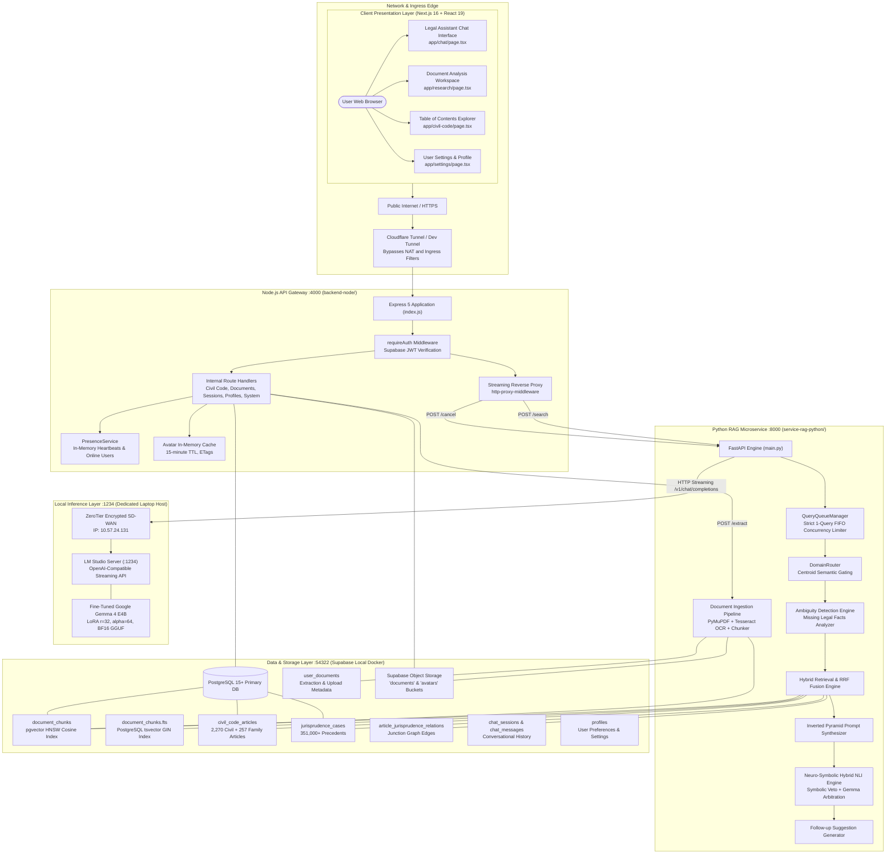
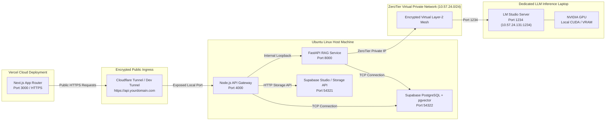
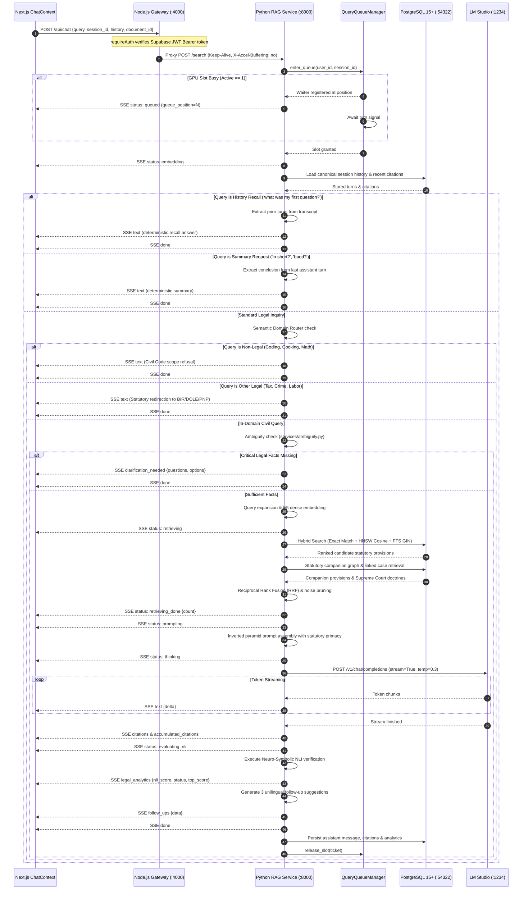
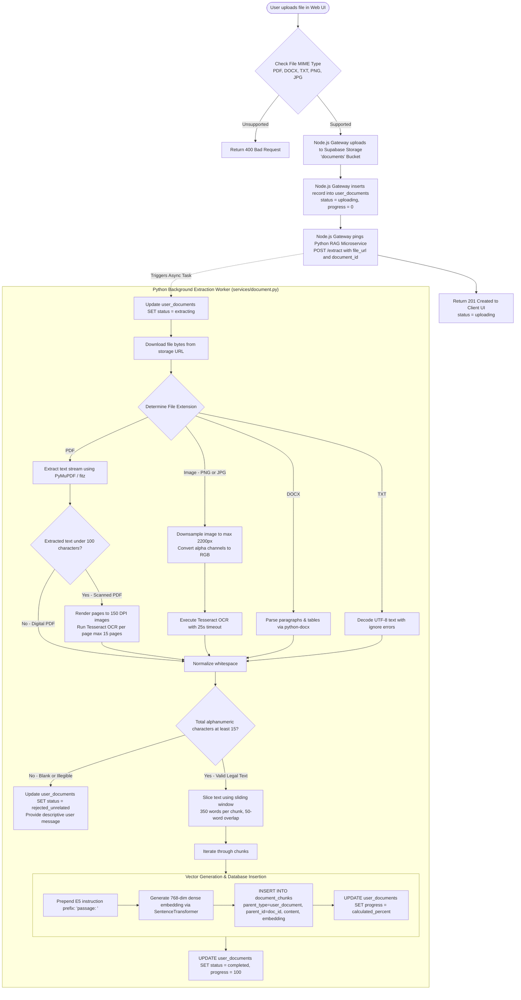
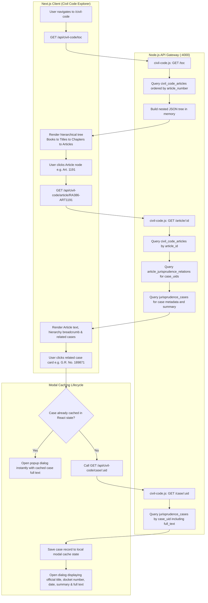
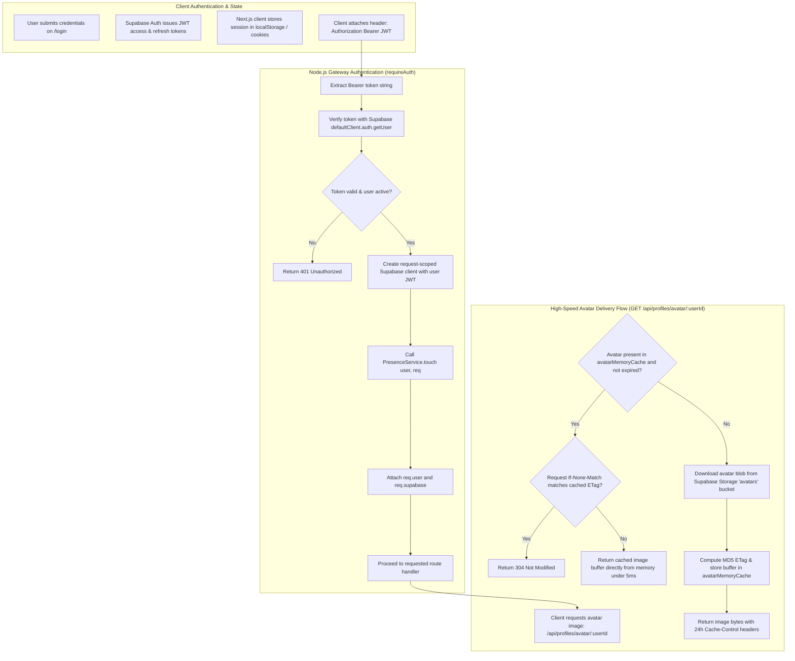
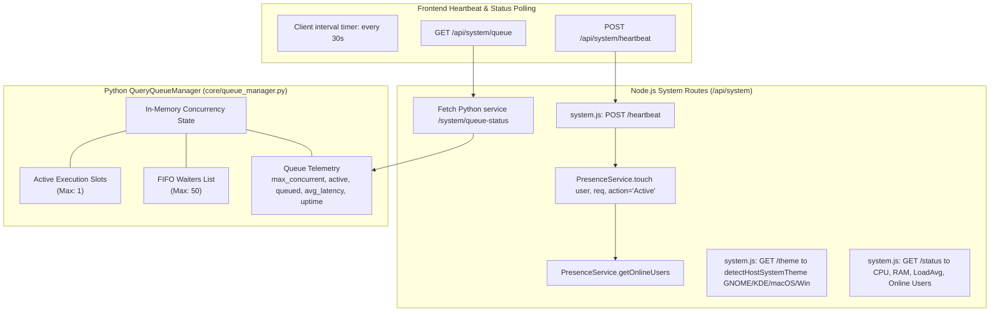

# CIVIL-LEX: Complete System Flowcharts & Architecture Maps

This document provides architectural flowcharts and sequence diagrams mapping the end-to-end operations of the CIVIL-LEX platform across the Next.js frontend, Node.js API Gateway, Python RAG Microservice, Supabase PostgreSQL with `pgvector`, and the local LM Studio LLM inference host.

---

## 1. End-to-End System Architecture Topology

The overall system architecture spans client interfaces, gateway security, analytical microservices, storage layers, and hardware-accelerated local inference:

---

## 2. Physical Network Deployment & Port Mapping Flowchart

---

## 3. End-to-End Chat Query & SSE Streaming Sequence Flowchart

---

## 4. Document Ingestion, OCR & Vectorization Flowchart

This flowchart details how contracts, deeds, and scanned documents are ingested, OCR'd, and embedded:

---

## 5. Table of Contents & Jurisprudence Modal Flowchart

This flowchart illustrates Table of Contents navigation and the two-tier caching mechanism for Supreme Court jurisprudence case popups:

---

## 6. Authentication, Profile & Avatar In-Memory Cache Flowchart

This flowchart outlines Bearer authentication, user metadata synchronization, and high-speed in-memory avatar delivery:

---

## 7. Real-Time Telemetry & Concurrency Queue Flowchart

This diagram maps how the `QueryQueueManager` and `PresenceService` coordinate to protect resources and report live metrics:

